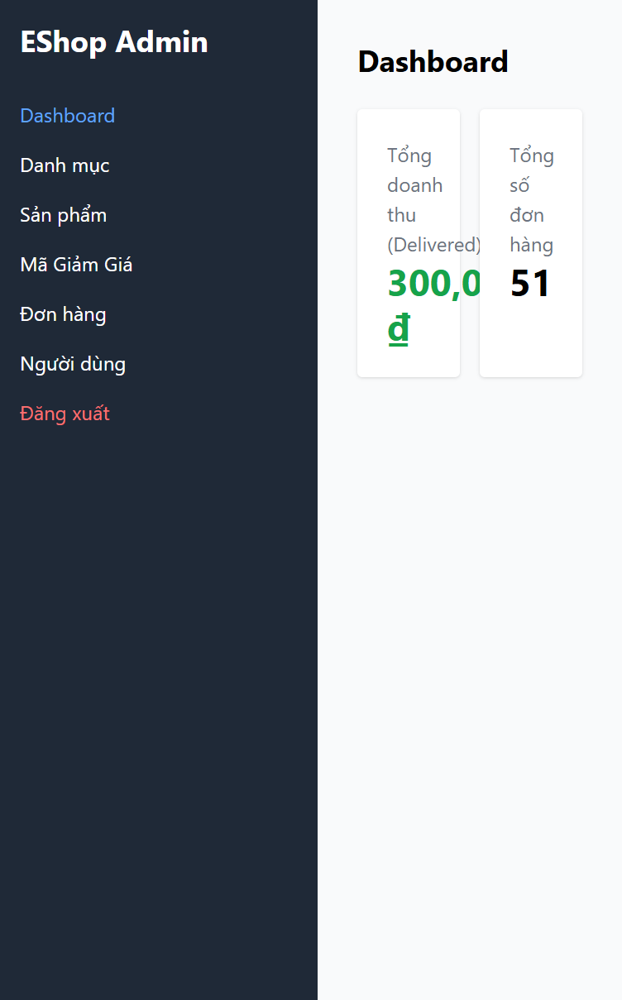
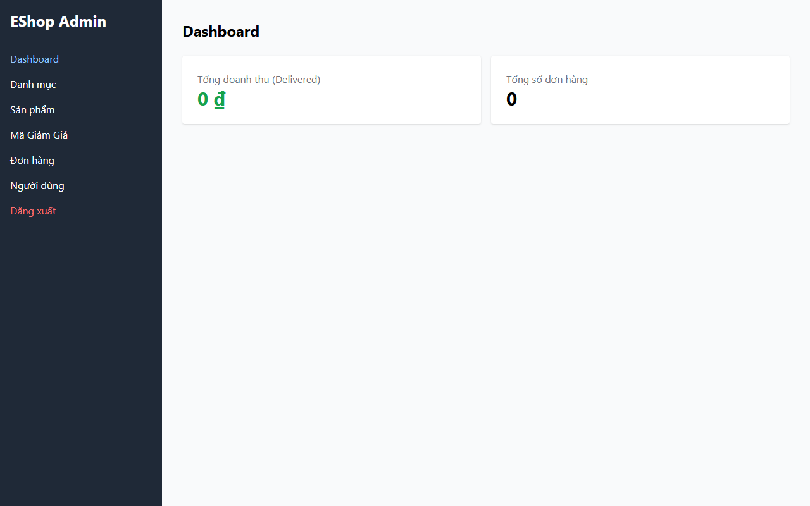
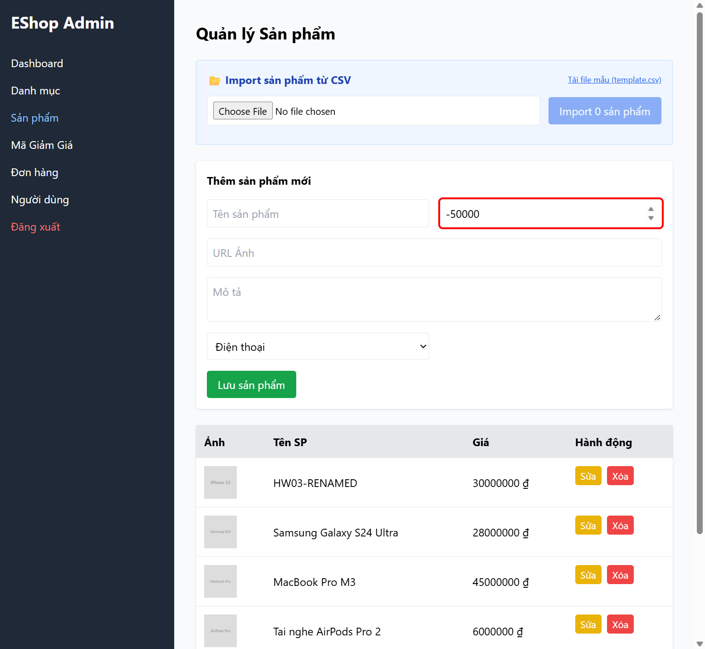
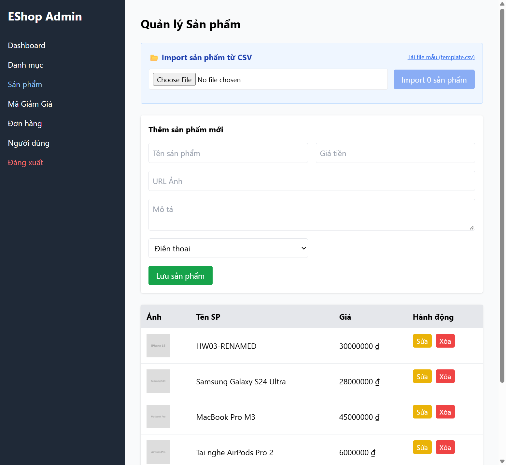

# BỘ 26 GITHUB ISSUES SẴN SÀNG ĐĂNG TẢI (ĐÃ NHÚNG SẴN ẢNH TỪ REPO)

> **Hướng dẫn đăng nhanh lên GitHub Issues (`https://github.com/Hidebray/Homework-week03-SoftwareTesting/issues/new`):**
> 1. Copy dòng **Title** dán vào ô tiêu đề Issue.
> 2. Copy khối **Body** dán vào nội dung Issue — **ảnh bằng chứng đã được nhúng sẵn bằng đường dẫn `raw.githubusercontent.com`**, tự động hiển thị ngay khi tạo Issue mà không cần upload thủ công!
> 3. Sau khi tạo xong, chụp ảnh màn hình trang danh sách GitHub Issues lưu vào `proof-image/github_issues_list.png`.

---

## 1. [BUG_ADMIN_01] [MAJOR] [Dashboard - IA-01] Visual consistency of primary Call-to-Action (CTA) button colors across screens (Login: Blue, Products: Green, Coupons: Orange).

**Title:** `[BUG_ADMIN_01] [MAJOR] [Dashboard - IA-01] Visual consistency of primary Call-to-Action (CTA) button colors across screens (Login: Blue, Products: Green, Coupons: Orange).`

```markdown
### 1. Thông tin chung (Defect Metadata)
- **Bug ID:** `BUG_ADMIN_01` (Checklist Item: `CHK-03`)
- **Phân hệ / Màn hình:** EShop Web Admin (`frontend-admin`) — Tab **Dashboard**
- **Khía cạnh giao diện (Interface Aspect):** `IA-01`
- **Mức độ nghiêm trọng (Severity):** **MAJOR**
- **Vị trí mã nguồn (Source Location):** `eshop-sut/frontend-admin/src/frontend-admin/src/App.jsx`

### 2. Các bước tái hiện (Steps to Reproduce)
1. Khởi chạy Backend (`http://localhost:3000`) và Frontend Admin (`http://localhost:5174`).
2. Đăng nhập tài khoản Admin (`admin@eshop.com` / `Admin123!`).
3. Điều hướng tới tab **Dashboard** và kiểm tra tiêu chí `CHK-03`: *Visual consistency of primary Call-to-Action (CTA) button colors across screens (Login: Blue, Products: Green, Coupons: Orange).*

### 3. Kết quả thực tế (Actual Result)
- Visual consistency of primary Call-to-Action (CTA) button colors across screens (Login: Blue, Products: Green, Coupons: Orange).
- **Kết quả đo tự động (Playwright Assertion):** `CTA colours {"login":"rgb(37, 99, 235)","products":"rgb(22, 163, 74)","coupons":"rgb(249, 115, 22)"}`

### 4. Kết quả kỳ vọng (Expected Result)
- Application adheres to a unified brand primary CTA color across all views rather than arbitrary per-screen color shifts.

### 5. Ảnh chụp màn hình bằng chứng (Screenshot Evidence)

```

---

## 2. [BUG_ADMIN_02] [MAJOR] [Dashboard - IA-01] Responsive behavior and card stacking when viewport is resized to tablet/mobile resolution (width < 768px).

**Title:** `[BUG_ADMIN_02] [MAJOR] [Dashboard - IA-01] Responsive behavior and card stacking when viewport is resized to tablet/mobile resolution (width < 768px).`

```markdown
### 1. Thông tin chung (Defect Metadata)
- **Bug ID:** `BUG_ADMIN_02` (Checklist Item: `CHK-04`)
- **Phân hệ / Màn hình:** EShop Web Admin (`frontend-admin`) — Tab **Dashboard**
- **Khía cạnh giao diện (Interface Aspect):** `IA-01`
- **Mức độ nghiêm trọng (Severity):** **MAJOR**
- **Vị trí mã nguồn (Source Location):** `eshop-sut/frontend-admin/src/frontend-admin/src/App.jsx`

### 2. Các bước tái hiện (Steps to Reproduce)
1. Khởi chạy Backend (`http://localhost:3000`) và Frontend Admin (`http://localhost:5174`).
2. Đăng nhập tài khoản Admin (`admin@eshop.com` / `Admin123!`).
3. Điều hướng tới tab **Dashboard** và kiểm tra tiêu chí `CHK-04`: *Responsive behavior and card stacking when viewport is resized to tablet/mobile resolution (width < 768px).*

### 3. Kết quả thực tế (Actual Result)
- Responsive behavior and card stacking when viewport is resized to tablet/mobile resolution (width < 768px).
- **Kết quả đo tự động (Playwright Assertion):** `window innerWidth=501px: KPI grid columns=2, sidebar width=256px`

### 4. Kết quả kỳ vọng (Expected Result)
- KPI grid collapses smoothly to single-column stacking without clipping card borders or overflowing viewport.

### 5. Ảnh chụp màn hình bằng chứng (Screenshot Evidence)

```

---

## 3. [BUG_ADMIN_03] [MAJOR] [Dashboard - IA-02] Date range filter controls or temporal scoping inputs for revenue aggregation.

**Title:** `[BUG_ADMIN_03] [MAJOR] [Dashboard - IA-02] Date range filter controls or temporal scoping inputs for revenue aggregation.`

```markdown
### 1. Thông tin chung (Defect Metadata)
- **Bug ID:** `BUG_ADMIN_03` (Checklist Item: `CHK-05`)
- **Phân hệ / Màn hình:** EShop Web Admin (`frontend-admin`) — Tab **Dashboard**
- **Khía cạnh giao diện (Interface Aspect):** `IA-02`
- **Mức độ nghiêm trọng (Severity):** **MAJOR**
- **Vị trí mã nguồn (Source Location):** `eshop-sut/frontend-admin/src/frontend-admin/src/App.jsx`

### 2. Các bước tái hiện (Steps to Reproduce)
1. Khởi chạy Backend (`http://localhost:3000`) và Frontend Admin (`http://localhost:5174`).
2. Đăng nhập tài khoản Admin (`admin@eshop.com` / `Admin123!`).
3. Điều hướng tới tab **Dashboard** và kiểm tra tiêu chí `CHK-05`: *Date range filter controls or temporal scoping inputs for revenue aggregation.*

### 3. Kết quả thực tế (Actual Result)
- Date range filter controls or temporal scoping inputs for revenue aggregation.
- **Kết quả đo tự động (Playwright Assertion):** `date/select/search controls on dashboard: 0`

### 4. Kết quả kỳ vọng (Expected Result)
- Interactive date pickers or dropdowns exist to allow filtering revenue and order count by custom date intervals (e.g., Today, This Month).

### 5. Ảnh chụp màn hình bằng chứng (Screenshot Evidence)

```

---

## 4. [BUG_ADMIN_04] [MAJOR] [Dashboard - IA-03] Keyboard accessibility and `Tab` key traversal on Sidebar navigation menu items (`<li>`).

**Title:** `[BUG_ADMIN_04] [MAJOR] [Dashboard - IA-03] Keyboard accessibility and `Tab` key traversal on Sidebar navigation menu items (`<li>`).`

```markdown
### 1. Thông tin chung (Defect Metadata)
- **Bug ID:** `BUG_ADMIN_04` (Checklist Item: `CHK-06`)
- **Phân hệ / Màn hình:** EShop Web Admin (`frontend-admin`) — Tab **Dashboard**
- **Khía cạnh giao diện (Interface Aspect):** `IA-03`
- **Mức độ nghiêm trọng (Severity):** **MAJOR**
- **Vị trí mã nguồn (Source Location):** `eshop-sut/frontend-admin/src/frontend-admin/src/App.jsx`

### 2. Các bước tái hiện (Steps to Reproduce)
1. Khởi chạy Backend (`http://localhost:3000`) và Frontend Admin (`http://localhost:5174`).
2. Đăng nhập tài khoản Admin (`admin@eshop.com` / `Admin123!`).
3. Điều hướng tới tab **Dashboard** và kiểm tra tiêu chí `CHK-06`: *Keyboard accessibility and `Tab` key traversal on Sidebar navigation menu items (`<li>`).*

### 3. Kết quả thực tế (Actual Result)
- Keyboard accessibility and `Tab` key traversal on Sidebar navigation menu items (`<li>`).
- **Kết quả đo tự động (Playwright Assertion):** `sidebar li tabIndex=[-1,-1,-1,-1,-1,-1,-1], focus after 2xTab=BODY`

### 4. Kết quả kỳ vọng (Expected Result)
- Menu items are focusable via keyboard (`tabIndex={0}`, `<button>` or `<a>`) with a visible focus ring for keyboard-only users.

### 5. Ảnh chụp màn hình bằng chứng (Screenshot Evidence)

```

---

## 5. [BUG_ADMIN_05] [MAJOR] [Dashboard - IA-03] Quick shortcut navigation links or clickable drill-downs from KPI cards to detailed listing views.

**Title:** `[BUG_ADMIN_05] [MAJOR] [Dashboard - IA-03] Quick shortcut navigation links or clickable drill-downs from KPI cards to detailed listing views.`

```markdown
### 1. Thông tin chung (Defect Metadata)
- **Bug ID:** `BUG_ADMIN_05` (Checklist Item: `CHK-08`)
- **Phân hệ / Màn hình:** EShop Web Admin (`frontend-admin`) — Tab **Dashboard**
- **Khía cạnh giao diện (Interface Aspect):** `IA-03`
- **Mức độ nghiêm trọng (Severity):** **MAJOR**
- **Vị trí mã nguồn (Source Location):** `eshop-sut/frontend-admin/src/frontend-admin/src/App.jsx`

### 2. Các bước tái hiện (Steps to Reproduce)
1. Khởi chạy Backend (`http://localhost:3000`) và Frontend Admin (`http://localhost:5174`).
2. Đăng nhập tài khoản Admin (`admin@eshop.com` / `Admin123!`).
3. Điều hướng tới tab **Dashboard** và kiểm tra tiêu chí `CHK-08`: *Quick shortcut navigation links or clickable drill-downs from KPI cards to detailed listing views.*

### 3. Kết quả thực tế (Actual Result)
- Quick shortcut navigation links or clickable drill-downs from KPI cards to detailed listing views.
- **Kết quả đo tự động (Playwright Assertion):** `clicking KPI card keeps the Dashboard view`

### 4. Kết quả kỳ vọng (Expected Result)
- Clicking the "Tổng số đơn hàng" card redirects or switches active tab to the Orders view (`activeTab = "orders"`).

### 5. Ảnh chụp màn hình bằng chứng (Screenshot Evidence)

```

---

## 6. [BUG_ADMIN_06] [MAJOR] [Dashboard - IA-04] Revenue calculation accuracy and synchronization with actual delivered orders in database.

**Title:** `[BUG_ADMIN_06] [MAJOR] [Dashboard - IA-04] Revenue calculation accuracy and synchronization with actual delivered orders in database.`

```markdown
### 1. Thông tin chung (Defect Metadata)
- **Bug ID:** `BUG_ADMIN_06` (Checklist Item: `CHK-09`)
- **Phân hệ / Màn hình:** EShop Web Admin (`frontend-admin`) — Tab **Dashboard**
- **Khía cạnh giao diện (Interface Aspect):** `IA-04`
- **Mức độ nghiêm trọng (Severity):** **MAJOR**
- **Vị trí mã nguồn (Source Location):** `eshop-sut/frontend-admin/src/frontend-admin/src/App.jsx`

### 2. Các bước tái hiện (Steps to Reproduce)
1. Khởi chạy Backend (`http://localhost:3000`) và Frontend Admin (`http://localhost:5174`).
2. Đăng nhập tài khoản Admin (`admin@eshop.com` / `Admin123!`).
3. Điều hướng tới tab **Dashboard** và kiểm tra tiêu chí `CHK-09`: *Revenue calculation accuracy and synchronization with actual delivered orders in database.*

### 3. Kết quả thực tế (Actual Result)
- Revenue calculation accuracy and synchronization with actual delivered orders in database.
- **Kết quả đo tự động (Playwright Assertion):** `API delivered sum=150000, UI shows=300000`

### 4. Kết quả kỳ vọng (Expected Result)
- Revenue displays exact sum of `total_amount` for all orders with status `delivered` (`sum + o.total_amount`).

### 5. Ảnh chụp màn hình bằng chứng (Screenshot Evidence)

```

---

## 7. [BUG_ADMIN_07] [MAJOR] [Dashboard - IA-04] Cross-screen currency formatting consistency between Dashboard (`toLocaleString() ₫`), Products (raw unformatted), and Coupons (US comma).

**Title:** `[BUG_ADMIN_07] [MAJOR] [Dashboard - IA-04] Cross-screen currency formatting consistency between Dashboard (`toLocaleString() ₫`), Products (raw unformatted), and Coupons (US comma).`

```markdown
### 1. Thông tin chung (Defect Metadata)
- **Bug ID:** `BUG_ADMIN_07` (Checklist Item: `CHK-10`)
- **Phân hệ / Màn hình:** EShop Web Admin (`frontend-admin`) — Tab **Dashboard**
- **Khía cạnh giao diện (Interface Aspect):** `IA-04`
- **Mức độ nghiêm trọng (Severity):** **MAJOR**
- **Vị trí mã nguồn (Source Location):** `eshop-sut/frontend-admin/src/frontend-admin/src/App.jsx`

### 2. Các bước tái hiện (Steps to Reproduce)
1. Khởi chạy Backend (`http://localhost:3000`) và Frontend Admin (`http://localhost:5174`).
2. Đăng nhập tài khoản Admin (`admin@eshop.com` / `Admin123!`).
3. Điều hướng tới tab **Dashboard** và kiểm tra tiêu chí `CHK-10`: *Cross-screen currency formatting consistency between Dashboard (`toLocaleString() ₫`), Products (raw unformatted), and Coupons (US comma).*

### 3. Kết quả thực tế (Actual Result)
- Cross-screen currency formatting consistency between Dashboard (`toLocaleString() ₫`), Products (raw unformatted), and Coupons (US comma).
- **Kết quả đo tự động (Playwright Assertion):** `[Manual] BUG_ADMIN_07: Fragmented currency formats across tabs (Dashboard uses `0 ₫`, Products shows raw unseparated `30000000 ₫`, Coupons uses US comma `300,000 ₫`). ([Ảnh](../proof-image/checklist/BUG_ADMIN_07_currency_format_disparity.png))`

### 4. Kết quả kỳ vọng (Expected Result)
- Currency follows a uniform locale format (e.g., Vietnamese thousands dots `150.000 ₫`) consistently across all 4 tabs.

### 5. Ảnh chụp màn hình bằng chứng (Screenshot Evidence)

```

---

## 8. [BUG_ADMIN_08] [MAJOR] [Dashboard - IA-04] Loading feedback and skeleton display during initial asynchronous API fetch of orders.

**Title:** `[BUG_ADMIN_08] [MAJOR] [Dashboard - IA-04] Loading feedback and skeleton display during initial asynchronous API fetch of orders.`

```markdown
### 1. Thông tin chung (Defect Metadata)
- **Bug ID:** `BUG_ADMIN_08` (Checklist Item: `CHK-11`)
- **Phân hệ / Màn hình:** EShop Web Admin (`frontend-admin`) — Tab **Dashboard**
- **Khía cạnh giao diện (Interface Aspect):** `IA-04`
- **Mức độ nghiêm trọng (Severity):** **MAJOR**
- **Vị trí mã nguồn (Source Location):** `eshop-sut/frontend-admin/src/frontend-admin/src/App.jsx`

### 2. Các bước tái hiện (Steps to Reproduce)
1. Khởi chạy Backend (`http://localhost:3000`) và Frontend Admin (`http://localhost:5174`).
2. Đăng nhập tài khoản Admin (`admin@eshop.com` / `Admin123!`).
3. Điều hướng tới tab **Dashboard** và kiểm tra tiêu chí `CHK-11`: *Loading feedback and skeleton display during initial asynchronous API fetch of orders.*

### 3. Kết quả thực tế (Actual Result)
- Loading feedback and skeleton display during initial asynchronous API fetch of orders.
- **Kết quả đo tự động (Playwright Assertion):** `Orders API delayed 2.5s: dashboard shows 0 ₫ / 0 with no loader/skeleton`

### 4. Kết quả kỳ vọng (Expected Result)
- Displays an animated loading spinner or skeleton card placeholders while `fetchData()` resolves orders payload.

### 5. Ảnh chụp màn hình bằng chứng (Screenshot Evidence)

```

---

## 9. [BUG_ADMIN_09] [MAJOR] [Sản phẩm & CSV - IA-01] Formatted price display in product catalog table with localized thousand separators.

**Title:** `[BUG_ADMIN_09] [MAJOR] [Sản phẩm & CSV - IA-01] Formatted price display in product catalog table with localized thousand separators.`

```markdown
### 1. Thông tin chung (Defect Metadata)
- **Bug ID:** `BUG_ADMIN_09` (Checklist Item: `CHK-15`)
- **Phân hệ / Màn hình:** EShop Web Admin (`frontend-admin`) — Tab **Sản phẩm & CSV**
- **Khía cạnh giao diện (Interface Aspect):** `IA-01`
- **Mức độ nghiêm trọng (Severity):** **MAJOR**
- **Vị trí mã nguồn (Source Location):** `eshop-sut/frontend-admin/src/frontend-admin/src/App.jsx`

### 2. Các bước tái hiện (Steps to Reproduce)
1. Khởi chạy Backend (`http://localhost:3000`) và Frontend Admin (`http://localhost:5174`).
2. Đăng nhập tài khoản Admin (`admin@eshop.com` / `Admin123!`).
3. Điều hướng tới tab **Sản phẩm & CSV** và kiểm tra tiêu chí `CHK-15`: *Formatted price display in product catalog table with localized thousand separators.*

### 3. Kết quả thực tế (Actual Result)
- Formatted price display in product catalog table with localized thousand separators.
- **Kết quả đo tự động (Playwright Assertion):** `unformatted prices: 30000000 ₫ | 28000000 ₫ | 45000000 ₫`

### 4. Kết quả kỳ vọng (Expected Result)
- Product prices display localized thousand separators (e.g., `30.000.000 ₫`) rather than raw unformatted numbers.

### 5. Ảnh chụp màn hình bằng chứng (Screenshot Evidence)

```

---

## 10. [BUG_ADMIN_10] [MAJOR] [Sản phẩm & CSV - IA-02] Boundary constraint validation on product price field (`price >= 0`).

**Title:** `[BUG_ADMIN_10] [MAJOR] [Sản phẩm & CSV - IA-02] Boundary constraint validation on product price field (`price >= 0`).`

```markdown
### 1. Thông tin chung (Defect Metadata)
- **Bug ID:** `BUG_ADMIN_10` (Checklist Item: `CHK-17`)
- **Phân hệ / Màn hình:** EShop Web Admin (`frontend-admin`) — Tab **Sản phẩm & CSV**
- **Khía cạnh giao diện (Interface Aspect):** `IA-02`
- **Mức độ nghiêm trọng (Severity):** **MAJOR**
- **Vị trí mã nguồn (Source Location):** `eshop-sut/frontend-admin/src/frontend-admin/src/App.jsx`

### 2. Các bước tái hiện (Steps to Reproduce)
1. Khởi chạy Backend (`http://localhost:3000`) và Frontend Admin (`http://localhost:5174`).
2. Đăng nhập tài khoản Admin (`admin@eshop.com` / `Admin123!`).
3. Điều hướng tới tab **Sản phẩm & CSV** và kiểm tra tiêu chí `CHK-17`: *Boundary constraint validation on product price field (`price >= 0`).*

### 3. Kết quả thực tế (Actual Result)
- Boundary constraint validation on product price field (`price >= 0`).
- **Kết quả đo tự động (Playwright Assertion):** `price input min attr=null; value -50000 accepted by field`

### 4. Kết quả kỳ vọng (Expected Result)
- Input restricts negative price values via `min="0"` constraint and prevents alphanumeric invalid characters.

### 5. Ảnh chụp màn hình bằng chứng (Screenshot Evidence)

```

---

## 11. [BUG_ADMIN_11] [MAJOR] [Sản phẩm & CSV - IA-02] File upload MIME type and file extension restriction on CSV input control.

**Title:** `[BUG_ADMIN_11] [MAJOR] [Sản phẩm & CSV - IA-02] File upload MIME type and file extension restriction on CSV input control.`

```markdown
### 1. Thông tin chung (Defect Metadata)
- **Bug ID:** `BUG_ADMIN_11` (Checklist Item: `CHK-18`)
- **Phân hệ / Màn hình:** EShop Web Admin (`frontend-admin`) — Tab **Sản phẩm & CSV**
- **Khía cạnh giao diện (Interface Aspect):** `IA-02`
- **Mức độ nghiêm trọng (Severity):** **MAJOR**
- **Vị trí mã nguồn (Source Location):** `eshop-sut/frontend-admin/src/frontend-admin/src/App.jsx`

### 2. Các bước tái hiện (Steps to Reproduce)
1. Khởi chạy Backend (`http://localhost:3000`) và Frontend Admin (`http://localhost:5174`).
2. Đăng nhập tài khoản Admin (`admin@eshop.com` / `Admin123!`).
3. Điều hướng tới tab **Sản phẩm & CSV** và kiểm tra tiêu chí `CHK-18`: *File upload MIME type and file extension restriction on CSV input control.*

### 3. Kết quả thực tế (Actual Result)
- File upload MIME type and file extension restriction on CSV input control.
- **Kết quả đo tự động (Playwright Assertion):** `file input accept attr=null`

### 4. Kết quả kỳ vọng (Expected Result)
- File selector restricts file dialog to `.csv` files using `accept=".csv"` attribute, rejecting `.exe` or `.png`.

### 5. Ảnh chụp màn hình bằng chứng (Screenshot Evidence)

```

---

## 12. [BUG_ADMIN_12] [MAJOR] [Sản phẩm & CSV - IA-02] CSV parser handling of embedded commas within quoted string fields (e.g., `"Shirt, Cotton, Blue"`).

**Title:** `[BUG_ADMIN_12] [MAJOR] [Sản phẩm & CSV - IA-02] CSV parser handling of embedded commas within quoted string fields (e.g., `"Shirt, Cotton, Blue"`).`

```markdown
### 1. Thông tin chung (Defect Metadata)
- **Bug ID:** `BUG_ADMIN_12` (Checklist Item: `CHK-19`)
- **Phân hệ / Màn hình:** EShop Web Admin (`frontend-admin`) — Tab **Sản phẩm & CSV**
- **Khía cạnh giao diện (Interface Aspect):** `IA-02`
- **Mức độ nghiêm trọng (Severity):** **MAJOR**
- **Vị trí mã nguồn (Source Location):** `eshop-sut/frontend-admin/src/frontend-admin/src/App.jsx`

### 2. Các bước tái hiện (Steps to Reproduce)
1. Khởi chạy Backend (`http://localhost:3000`) và Frontend Admin (`http://localhost:5174`).
2. Đăng nhập tài khoản Admin (`admin@eshop.com` / `Admin123!`).
3. Điều hướng tới tab **Sản phẩm & CSV** và kiểm tra tiêu chí `CHK-19`: *CSV parser handling of embedded commas within quoted string fields (e.g., `"Shirt, Cotton, Blue"`).*

### 3. Kết quả thực tế (Actual Result)
- CSV parser handling of embedded commas within quoted string fields (e.g., `"Shirt, Cotton, Blue"`).
- **Kết quả đo tự động (Playwright Assertion):** `quoted field "Áo thun, cotton" kept as one cell: false; preview cells sample: "Áo thun | cotton"`

### 4. Kết quả kỳ vọng (Expected Result)
- Parser properly parses quoted fields without misaligning column values into subsequent header keys.

### 5. Ảnh chụp màn hình bằng chứng (Screenshot Evidence)

```

---

## 13. [BUG_ADMIN_13] [MAJOR] [Sản phẩm & CSV - IA-03] Physical separation and safe spacing between "Sửa" (Edit) and "Xóa" (Delete) action buttons in table rows.

**Title:** `[BUG_ADMIN_13] [MAJOR] [Sản phẩm & CSV - IA-03] Physical separation and safe spacing between "Sửa" (Edit) and "Xóa" (Delete) action buttons in table rows.`

```markdown
### 1. Thông tin chung (Defect Metadata)
- **Bug ID:** `BUG_ADMIN_13` (Checklist Item: `CHK-22`)
- **Phân hệ / Màn hình:** EShop Web Admin (`frontend-admin`) — Tab **Sản phẩm & CSV**
- **Khía cạnh giao diện (Interface Aspect):** `IA-03`
- **Mức độ nghiêm trọng (Severity):** **MAJOR**
- **Vị trí mã nguồn (Source Location):** `eshop-sut/frontend-admin/src/frontend-admin/src/App.jsx`

### 2. Các bước tái hiện (Steps to Reproduce)
1. Khởi chạy Backend (`http://localhost:3000`) và Frontend Admin (`http://localhost:5174`).
2. Đăng nhập tài khoản Admin (`admin@eshop.com` / `Admin123!`).
3. Điều hướng tới tab **Sản phẩm & CSV** và kiểm tra tiêu chí `CHK-22`: *Physical separation and safe spacing between "Sửa" (Edit) and "Xóa" (Delete) action buttons in table rows.*

### 3. Kết quả thực tế (Actual Result)
- Physical separation and safe spacing between "Sửa" (Edit) and "Xóa" (Delete) action buttons in table rows.
- **Kết quả đo tự động (Playwright Assertion):** `gap between Sửa and Xóa = 8.0px`

### 4. Kết quả kỳ vọng (Expected Result)
- Edit and Delete buttons provide adequate spacing or distinct visual weighting to prevent accidental destructive clicks.

### 5. Ảnh chụp màn hình bằng chứng (Screenshot Evidence)

```

---

## 14. [BUG_ADMIN_14] [MAJOR] [Sản phẩm & CSV - IA-04] Destructive action confirmation modal dialog prior to product catalog deletion (`deleteProduct`).

**Title:** `[BUG_ADMIN_14] [MAJOR] [Sản phẩm & CSV - IA-04] Destructive action confirmation modal dialog prior to product catalog deletion (`deleteProduct`).`

```markdown
### 1. Thông tin chung (Defect Metadata)
- **Bug ID:** `BUG_ADMIN_14` (Checklist Item: `CHK-23`)
- **Phân hệ / Màn hình:** EShop Web Admin (`frontend-admin`) — Tab **Sản phẩm & CSV**
- **Khía cạnh giao diện (Interface Aspect):** `IA-04`
- **Mức độ nghiêm trọng (Severity):** **MAJOR**
- **Vị trí mã nguồn (Source Location):** `eshop-sut/frontend-admin/src/frontend-admin/src/App.jsx`

### 2. Các bước tái hiện (Steps to Reproduce)
1. Khởi chạy Backend (`http://localhost:3000`) và Frontend Admin (`http://localhost:5174`).
2. Đăng nhập tài khoản Admin (`admin@eshop.com` / `Admin123!`).
3. Điều hướng tới tab **Sản phẩm & CSV** và kiểm tra tiêu chí `CHK-23`: *Destructive action confirmation modal dialog prior to product catalog deletion (`deleteProduct`).*

### 3. Kết quả thực tế (Actual Result)
- Destructive action confirmation modal dialog prior to product catalog deletion (`deleteProduct`).
- **Kết quả đo tự động (Playwright Assertion):** `confirm dialog shown=false; product deleted from DB=true`

### 4. Kết quả kỳ vọng (Expected Result)
- Clicking Delete triggers a modal confirmation dialog (`"Are you sure?"`) before executing irrevocable backend deletion.

### 5. Ảnh chụp màn hình bằng chứng (Screenshot Evidence)

```

---

## 15. [BUG_ADMIN_15] [MAJOR] [Sản phẩm & CSV - IA-04] Single product update UI state integrity across catalog table records (`setProducts`).

**Title:** `[BUG_ADMIN_15] [MAJOR] [Sản phẩm & CSV - IA-04] Single product update UI state integrity across catalog table records (`setProducts`).`

```markdown
### 1. Thông tin chung (Defect Metadata)
- **Bug ID:** `BUG_ADMIN_15` (Checklist Item: `CHK-24`)
- **Phân hệ / Màn hình:** EShop Web Admin (`frontend-admin`) — Tab **Sản phẩm & CSV**
- **Khía cạnh giao diện (Interface Aspect):** `IA-04`
- **Mức độ nghiêm trọng (Severity):** **MAJOR**
- **Vị trí mã nguồn (Source Location):** `eshop-sut/frontend-admin/src/frontend-admin/src/App.jsx`

### 2. Các bước tái hiện (Steps to Reproduce)
1. Khởi chạy Backend (`http://localhost:3000`) và Frontend Admin (`http://localhost:5174`).
2. Đăng nhập tài khoản Admin (`admin@eshop.com` / `Admin123!`).
3. Điều hướng tới tab **Sản phẩm & CSV** và kiểm tra tiêu chí `CHK-24`: *Single product update UI state integrity across catalog table records (`setProducts`).*

### 3. Kết quả thực tế (Actual Result)
- Single product update UI state integrity across catalog table records (`setProducts`).
- **Kết quả đo tự động (Playwright Assertion):** `edited 1 product, 6 rows now named HW03-RENAMED (of 7)`

### 4. Kết quả kỳ vọng (Expected Result)
- Updating an individual product updates only the targeted product row without mutating sibling product titles in UI state.

### 5. Ảnh chụp màn hình bằng chứng (Screenshot Evidence)

```

---

## 16. [BUG_ADMIN_16] [MAJOR] [Mã Giảm Giá - IA-02] Persistent field labels visibility and differentiation when inputs have initial default numeric values.

**Title:** `[BUG_ADMIN_16] [MAJOR] [Mã Giảm Giá - IA-02] Persistent field labels visibility and differentiation when inputs have initial default numeric values.`

```markdown
### 1. Thông tin chung (Defect Metadata)
- **Bug ID:** `BUG_ADMIN_16` (Checklist Item: `CHK-27`)
- **Phân hệ / Màn hình:** EShop Web Admin (`frontend-admin`) — Tab **Mã Giảm Giá**
- **Khía cạnh giao diện (Interface Aspect):** `IA-02`
- **Mức độ nghiêm trọng (Severity):** **MAJOR**
- **Vị trí mã nguồn (Source Location):** `eshop-sut/frontend-admin/src/frontend-admin/src/App.jsx`

### 2. Các bước tái hiện (Steps to Reproduce)
1. Khởi chạy Backend (`http://localhost:3000`) và Frontend Admin (`http://localhost:5174`).
2. Đăng nhập tài khoản Admin (`admin@eshop.com` / `Admin123!`).
3. Điều hướng tới tab **Mã Giảm Giá** và kiểm tra tiêu chí `CHK-27`: *Persistent field labels visibility and differentiation when inputs have initial default numeric values.*

### 3. Kết quả thực tế (Actual Result)
- Persistent field labels visibility and differentiation when inputs have initial default numeric values.
- **Kết quả đo tự động (Playwright Assertion):** `<label> count=0; numeric defaults=["","0","1"] hide placeholders`

### 4. Kết quả kỳ vọng (Expected Result)
- Form inputs have visible `<label>` elements so that default values (e.g., `0` for min order, `1` for max uses) do not obliterate field purpose.

### 5. Ảnh chụp màn hình bằng chứng (Screenshot Evidence)

```

---

## 17. [BUG_ADMIN_18] [MAJOR] [Mã Giảm Giá - IA-02] Temporal validity constraint on coupon expiration date picker (`min = today`).

**Title:** `[BUG_ADMIN_18] [MAJOR] [Mã Giảm Giá - IA-02] Temporal validity constraint on coupon expiration date picker (`min = today`).`

```markdown
### 1. Thông tin chung (Defect Metadata)
- **Bug ID:** `BUG_ADMIN_18` (Checklist Item: `CHK-29`)
- **Phân hệ / Màn hình:** EShop Web Admin (`frontend-admin`) — Tab **Mã Giảm Giá**
- **Khía cạnh giao diện (Interface Aspect):** `IA-02`
- **Mức độ nghiêm trọng (Severity):** **MAJOR**
- **Vị trí mã nguồn (Source Location):** `eshop-sut/frontend-admin/src/frontend-admin/src/App.jsx`

### 2. Các bước tái hiện (Steps to Reproduce)
1. Khởi chạy Backend (`http://localhost:3000`) và Frontend Admin (`http://localhost:5174`).
2. Đăng nhập tài khoản Admin (`admin@eshop.com` / `Admin123!`).
3. Điều hướng tới tab **Mã Giảm Giá** và kiểm tra tiêu chí `CHK-29`: *Temporal validity constraint on coupon expiration date picker (`min = today`).*

### 3. Kết quả thực tế (Actual Result)
- Temporal validity constraint on coupon expiration date picker (`min = today`).
- **Kết quả đo tự động (Playwright Assertion):** `date min attr=null; coupon with expiry 2020-01-01 created=true`

### 4. Kết quả kỳ vọng (Expected Result)
- Date picker prevents selecting past dates by enforcing `min` attribute set to current calendar date.

### 5. Ảnh chụp màn hình bằng chứng (Screenshot Evidence)

```

---

## 18. [BUG_ADMIN_19] [MAJOR] [Mã Giảm Giá - IA-02] Upper boundary constraint enforcement for percentage discount value (`1 <= value <= 100`).

**Title:** `[BUG_ADMIN_19] [MAJOR] [Mã Giảm Giá - IA-02] Upper boundary constraint enforcement for percentage discount value (`1 <= value <= 100`).`

```markdown
### 1. Thông tin chung (Defect Metadata)
- **Bug ID:** `BUG_ADMIN_19` (Checklist Item: `CHK-30`)
- **Phân hệ / Màn hình:** EShop Web Admin (`frontend-admin`) — Tab **Mã Giảm Giá**
- **Khía cạnh giao diện (Interface Aspect):** `IA-02`
- **Mức độ nghiêm trọng (Severity):** **MAJOR**
- **Vị trí mã nguồn (Source Location):** `eshop-sut/frontend-admin/src/frontend-admin/src/App.jsx`

### 2. Các bước tái hiện (Steps to Reproduce)
1. Khởi chạy Backend (`http://localhost:3000`) và Frontend Admin (`http://localhost:5174`).
2. Đăng nhập tài khoản Admin (`admin@eshop.com` / `Admin123!`).
3. Điều hướng tới tab **Mã Giảm Giá** và kiểm tra tiêu chí `CHK-30`: *Upper boundary constraint enforcement for percentage discount value (`1 <= value <= 100`).*

### 3. Kết quả thực tế (Actual Result)
- Upper boundary constraint enforcement for percentage discount value (`1 <= value <= 100`).
- **Kết quả đo tự động (Playwright Assertion):** `max attr=null; percent coupon saved with value=500`

### 4. Kết quả kỳ vọng (Expected Result)
- When discount type is "Phần trăm", input restricts maximum value to `100` via HTML5 `max="100"` validation.

### 5. Ảnh chụp màn hình bằng chứng (Screenshot Evidence)

```

---

## 19. [BUG_ADMIN_21] [MAJOR] [Mã Giảm Giá - IA-04] Destructive action confirmation modal dialog prior to coupon deletion.

**Title:** `[BUG_ADMIN_21] [MAJOR] [Mã Giảm Giá - IA-04] Destructive action confirmation modal dialog prior to coupon deletion.`

```markdown
### 1. Thông tin chung (Defect Metadata)
- **Bug ID:** `BUG_ADMIN_21` (Checklist Item: `CHK-35`)
- **Phân hệ / Màn hình:** EShop Web Admin (`frontend-admin`) — Tab **Mã Giảm Giá**
- **Khía cạnh giao diện (Interface Aspect):** `IA-04`
- **Mức độ nghiêm trọng (Severity):** **MAJOR**
- **Vị trí mã nguồn (Source Location):** `eshop-sut/frontend-admin/src/frontend-admin/src/App.jsx`

### 2. Các bước tái hiện (Steps to Reproduce)
1. Khởi chạy Backend (`http://localhost:3000`) và Frontend Admin (`http://localhost:5174`).
2. Đăng nhập tài khoản Admin (`admin@eshop.com` / `Admin123!`).
3. Điều hướng tới tab **Mã Giảm Giá** và kiểm tra tiêu chí `CHK-35`: *Destructive action confirmation modal dialog prior to coupon deletion.*

### 3. Kết quả thực tế (Actual Result)
- Destructive action confirmation modal dialog prior to coupon deletion.
- **Kết quả đo tự động (Playwright Assertion):** `confirm shown=false; coupon deleted=true`

### 4. Kết quả kỳ vọng (Expected Result)
- Clicking Delete triggers a confirmation dialog (`window.confirm` or modal) requiring explicit confirmation before calling API.

### 5. Ảnh chụp màn hình bằng chứng (Screenshot Evidence)

```

---

## 20. [BUG_ADMIN_22] [MAJOR] [Đơn Hàng - IA-02] Search or filter input controls for locating specific orders by customer name or order ID.

**Title:** `[BUG_ADMIN_22] [MAJOR] [Đơn Hàng - IA-02] Search or filter input controls for locating specific orders by customer name or order ID.`

```markdown
### 1. Thông tin chung (Defect Metadata)
- **Bug ID:** `BUG_ADMIN_22` (Checklist Item: `CHK-40`)
- **Phân hệ / Màn hình:** EShop Web Admin (`frontend-admin`) — Tab **Đơn Hàng**
- **Khía cạnh giao diện (Interface Aspect):** `IA-02`
- **Mức độ nghiêm trọng (Severity):** **MAJOR**
- **Vị trí mã nguồn (Source Location):** `eshop-sut/frontend-admin/src/frontend-admin/src/App.jsx`

### 2. Các bước tái hiện (Steps to Reproduce)
1. Khởi chạy Backend (`http://localhost:3000`) và Frontend Admin (`http://localhost:5174`).
2. Đăng nhập tài khoản Admin (`admin@eshop.com` / `Admin123!`).
3. Điều hướng tới tab **Đơn Hàng** và kiểm tra tiêu chí `CHK-40`: *Search or filter input controls for locating specific orders by customer name or order ID.*

### 3. Kết quả thực tế (Actual Result)
- Search or filter input controls for locating specific orders by customer name or order ID.
- **Kết quả đo tự động (Playwright Assertion):** `search/filter controls on Orders tab=0`

### 4. Kết quả kỳ vọng (Expected Result)
- Provides search bar or filter dropdown to quickly filter orders by ID, customer email, or status.

### 5. Ảnh chụp màn hình bằng chứng (Screenshot Evidence)

```

---

## 21. [BUG_ADMIN_23] [MAJOR] [Đơn Hàng - IA-02] Pagination or virtualized scrolling controls for handling large order volumes (>50 orders).

**Title:** `[BUG_ADMIN_23] [MAJOR] [Đơn Hàng - IA-02] Pagination or virtualized scrolling controls for handling large order volumes (>50 orders).`

```markdown
### 1. Thông tin chung (Defect Metadata)
- **Bug ID:** `BUG_ADMIN_23` (Checklist Item: `CHK-41`)
- **Phân hệ / Màn hình:** EShop Web Admin (`frontend-admin`) — Tab **Đơn Hàng**
- **Khía cạnh giao diện (Interface Aspect):** `IA-02`
- **Mức độ nghiêm trọng (Severity):** **MAJOR**
- **Vị trí mã nguồn (Source Location):** `eshop-sut/frontend-admin/src/frontend-admin/src/App.jsx`

### 2. Các bước tái hiện (Steps to Reproduce)
1. Khởi chạy Backend (`http://localhost:3000`) và Frontend Admin (`http://localhost:5174`).
2. Đăng nhập tài khoản Admin (`admin@eshop.com` / `Admin123!`).
3. Điều hướng tới tab **Đơn Hàng** và kiểm tra tiêu chí `CHK-41`: *Pagination or virtualized scrolling controls for handling large order volumes (>50 orders).*

### 3. Kết quả thực tế (Actual Result)
- Pagination or virtualized scrolling controls for handling large order volumes (>50 orders).
- **Kết quả đo tự động (Playwright Assertion):** `orders in DB=51; rows rendered on one page=51; pager controls=0`

### 4. Kết quả kỳ vọng (Expected Result)
- Table provides pagination controls (Next/Prev, page numbers) or virtual scrolling to prevent unbounded DOM bloat.

### 5. Ảnh chụp màn hình bằng chứng (Screenshot Evidence)

```

---

## 22. [BUG_ADMIN_24] [MAJOR] [Đơn Hàng - IA-03] Action button sizing, touch target dimensions, and ergonomic spacing (Fitts's Law).

**Title:** `[BUG_ADMIN_24] [MAJOR] [Đơn Hàng - IA-03] Action button sizing, touch target dimensions, and ergonomic spacing (Fitts's Law).`

```markdown
### 1. Thông tin chung (Defect Metadata)
- **Bug ID:** `BUG_ADMIN_24` (Checklist Item: `CHK-42`)
- **Phân hệ / Màn hình:** EShop Web Admin (`frontend-admin`) — Tab **Đơn Hàng**
- **Khía cạnh giao diện (Interface Aspect):** `IA-03`
- **Mức độ nghiêm trọng (Severity):** **MAJOR**
- **Vị trí mã nguồn (Source Location):** `eshop-sut/frontend-admin/src/frontend-admin/src/App.jsx`

### 2. Các bước tái hiện (Steps to Reproduce)
1. Khởi chạy Backend (`http://localhost:3000`) và Frontend Admin (`http://localhost:5174`).
2. Đăng nhập tài khoản Admin (`admin@eshop.com` / `Admin123!`).
3. Điều hướng tới tab **Đơn Hàng** và kiểm tra tiêu chí `CHK-42`: *Action button sizing, touch target dimensions, and ergonomic spacing (Fitts's Law).*

### 3. Kết quả thực tế (Actual Result)
- Action button sizing, touch target dimensions, and ergonomic spacing (Fitts's Law).
- **Kết quả đo tự động (Playwright Assertion):** `Xác nhận button height=24.0px (min 36)`

### 4. Kết quả kỳ vọng (Expected Result)
- Action buttons provide adequate touch targets (minimum 36px height) with comfortable spacing between adjacent controls.

### 5. Ảnh chụp màn hình bằng chứng (Screenshot Evidence)

```

---

## 23. [BUG_ADMIN_25] [MAJOR] [Đơn Hàng - IA-03] Physical buffer separation between positive progression action ("Xác nhận") and destructive action ("Hủy").

**Title:** `[BUG_ADMIN_25] [MAJOR] [Đơn Hàng - IA-03] Physical buffer separation between positive progression action ("Xác nhận") and destructive action ("Hủy").`

```markdown
### 1. Thông tin chung (Defect Metadata)
- **Bug ID:** `BUG_ADMIN_25` (Checklist Item: `CHK-43`)
- **Phân hệ / Màn hình:** EShop Web Admin (`frontend-admin`) — Tab **Đơn Hàng**
- **Khía cạnh giao diện (Interface Aspect):** `IA-03`
- **Mức độ nghiêm trọng (Severity):** **MAJOR**
- **Vị trí mã nguồn (Source Location):** `eshop-sut/frontend-admin/src/frontend-admin/src/App.jsx`

### 2. Các bước tái hiện (Steps to Reproduce)
1. Khởi chạy Backend (`http://localhost:3000`) và Frontend Admin (`http://localhost:5174`).
2. Đăng nhập tài khoản Admin (`admin@eshop.com` / `Admin123!`).
3. Điều hướng tới tab **Đơn Hàng** và kiểm tra tiêu chí `CHK-43`: *Physical buffer separation between positive progression action ("Xác nhận") and destructive action ("Hủy").*

### 3. Kết quả thực tế (Actual Result)
- Physical buffer separation between positive progression action ("Xác nhận") and destructive action ("Hủy").
- **Kết quả đo tự động (Playwright Assertion):** `gap Xác nhận↔Hủy=4.0px (stacked vertically, flex-col gap-1)`

### 4. Kết quả kỳ vọng (Expected Result)
- Progression button and cancel button are visually distinguished and separated to prevent accidental order cancellation.

### 5. Ảnh chụp màn hình bằng chứng (Screenshot Evidence)

```

---

## 24. [BUG_ADMIN_26] [MAJOR] [Đơn Hàng - IA-04] Empty state visual representation and explanatory messaging when no orders exist in the database (`orders = []`).

**Title:** `[BUG_ADMIN_26] [MAJOR] [Đơn Hàng - IA-04] Empty state visual representation and explanatory messaging when no orders exist in the database (`orders = []`).`

```markdown
### 1. Thông tin chung (Defect Metadata)
- **Bug ID:** `BUG_ADMIN_26` (Checklist Item: `CHK-45`)
- **Phân hệ / Màn hình:** EShop Web Admin (`frontend-admin`) — Tab **Đơn Hàng**
- **Khía cạnh giao diện (Interface Aspect):** `IA-04`
- **Mức độ nghiêm trọng (Severity):** **MAJOR**
- **Vị trí mã nguồn (Source Location):** `eshop-sut/frontend-admin/src/frontend-admin/src/App.jsx`

### 2. Các bước tái hiện (Steps to Reproduce)
1. Khởi chạy Backend (`http://localhost:3000`) và Frontend Admin (`http://localhost:5174`).
2. Đăng nhập tài khoản Admin (`admin@eshop.com` / `Admin123!`).
3. Điều hướng tới tab **Đơn Hàng** và kiểm tra tiêu chí `CHK-45`: *Empty state visual representation and explanatory messaging when no orders exist in the database (`orders = []`).*

### 3. Kết quả thực tế (Actual Result)
- Empty state visual representation and explanatory messaging when no orders exist in the database (`orders = []`).
- **Kết quả đo tự động (Playwright Assertion):** `orders=0, tbody rows=0, empty-state message=false`

### 4. Kết quả kỳ vọng (Expected Result)
- Displays a clear, centered empty state notification (e.g., "Chưa có đơn hàng nào") across the table body when orders array is empty.

### 5. Ảnh chụp màn hình bằng chứng (Screenshot Evidence)

```

---

## 25. [BUG_ADMIN_27] [MAJOR] [Đơn Hàng - IA-04] State machine terminal state integrity enforcement for `canceled` orders (disallowing reactivation).

**Title:** `[BUG_ADMIN_27] [MAJOR] [Đơn Hàng - IA-04] State machine terminal state integrity enforcement for `canceled` orders (disallowing reactivation).`

```markdown
### 1. Thông tin chung (Defect Metadata)
- **Bug ID:** `BUG_ADMIN_27` (Checklist Item: `CHK-47`)
- **Phân hệ / Màn hình:** EShop Web Admin (`frontend-admin`) — Tab **Đơn Hàng**
- **Khía cạnh giao diện (Interface Aspect):** `IA-04`
- **Mức độ nghiêm trọng (Severity):** **MAJOR**
- **Vị trí mã nguồn (Source Location):** `eshop-sut/frontend-admin/src/frontend-admin/src/App.jsx`

### 2. Các bước tái hiện (Steps to Reproduce)
1. Khởi chạy Backend (`http://localhost:3000`) và Frontend Admin (`http://localhost:5174`).
2. Đăng nhập tài khoản Admin (`admin@eshop.com` / `Admin123!`).
3. Điều hướng tới tab **Đơn Hàng** và kiểm tra tiêu chí `CHK-47`: *State machine terminal state integrity enforcement for `canceled` orders (disallowing reactivation).*

### 3. Kết quả thực tế (Actual Result)
- State machine terminal state integrity enforcement for `canceled` orders (disallowing reactivation).
- **Kết quả đo tự động (Playwright Assertion):** `canceled order row has "Đánh dấu Đã giao" button=true`

### 4. Kết quả kỳ vọng (Expected Result)
- Canceled orders are terminal; UI must not provide any action button transitioning a canceled order to delivered.

### 5. Ảnh chụp màn hình bằng chứng (Screenshot Evidence)

```

---

## 26. [BUG_ADMIN_28] [MAJOR] [Đơn Hàng - IA-04] Security sanitization and XSS protection on rendered customer shipping address (`shipping_address`).

**Title:** `[BUG_ADMIN_28] [MAJOR] [Đơn Hàng - IA-04] Security sanitization and XSS protection on rendered customer shipping address (`shipping_address`).`

```markdown
### 1. Thông tin chung (Defect Metadata)
- **Bug ID:** `BUG_ADMIN_28` (Checklist Item: `CHK-48`)
- **Phân hệ / Màn hình:** EShop Web Admin (`frontend-admin`) — Tab **Đơn Hàng**
- **Khía cạnh giao diện (Interface Aspect):** `IA-04`
- **Mức độ nghiêm trọng (Severity):** **MAJOR**
- **Vị trí mã nguồn (Source Location):** `eshop-sut/frontend-admin/src/frontend-admin/src/App.jsx`

### 2. Các bước tái hiện (Steps to Reproduce)
1. Khởi chạy Backend (`http://localhost:3000`) và Frontend Admin (`http://localhost:5174`).
2. Đăng nhập tài khoản Admin (`admin@eshop.com` / `Admin123!`).
3. Điều hướng tới tab **Đơn Hàng** và kiểm tra tiêu chí `CHK-48`: *Security sanitization and XSS protection on rendered customer shipping address (`shipping_address`).*

### 3. Kết quả thực tế (Actual Result)
- Security sanitization and XSS protection on rendered customer shipping address (`shipping_address`).
- **Kết quả đo tự động (Playwright Assertion):** `injected  executed: document.title="XSS-HW03"; injected red HTML rendered`

### 4. Kết quả kỳ vọng (Expected Result)
- Shipping address is safely escaped as plain text or sanitized against script/HTML injection attacks.

### 5. Ảnh chụp màn hình bằng chứng (Screenshot Evidence)

```

---
