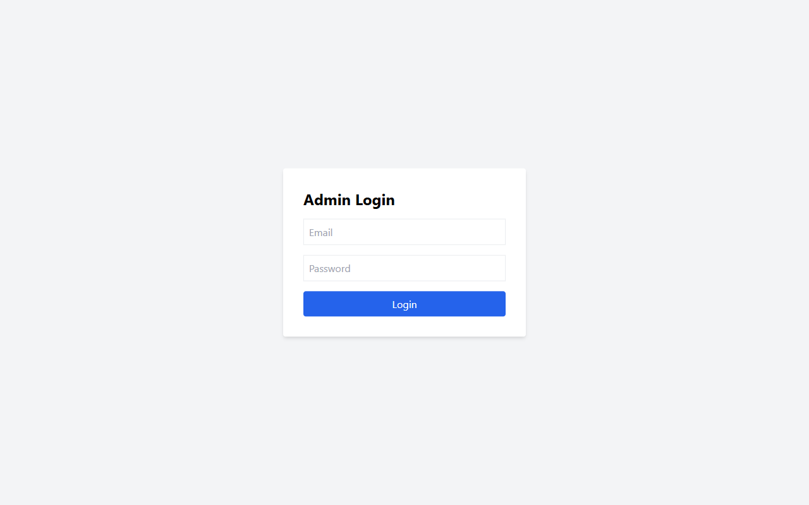
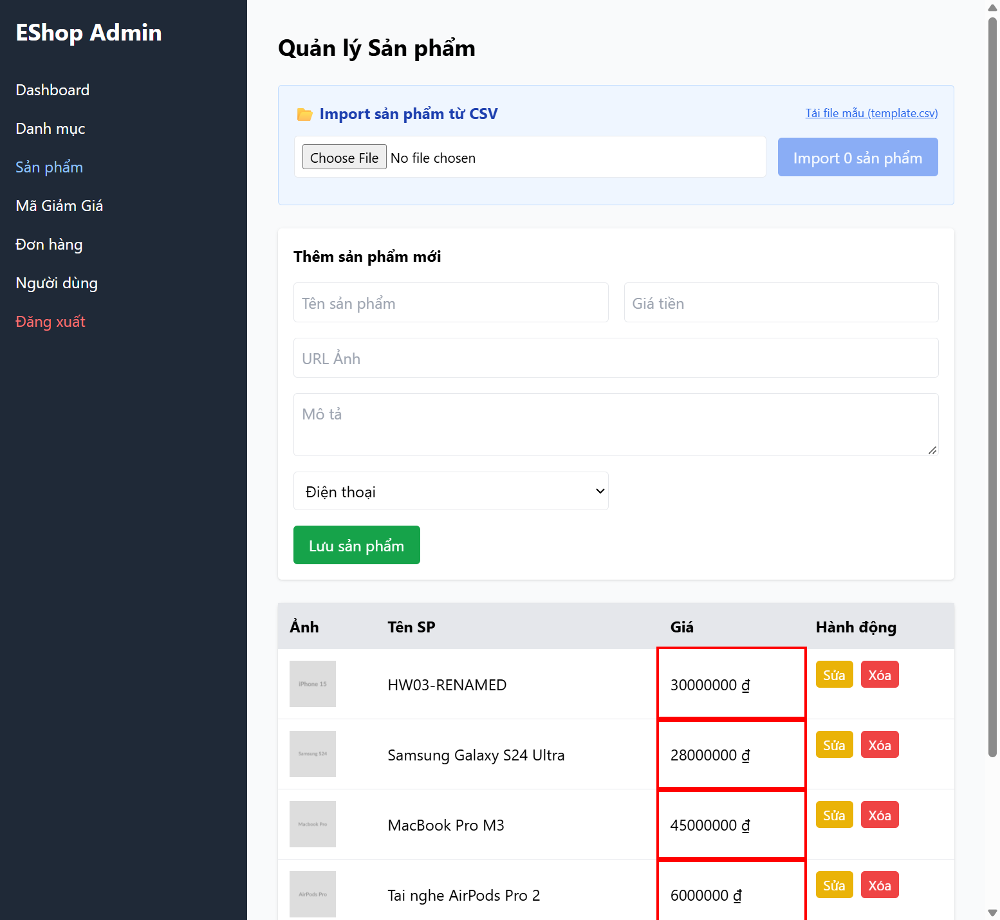
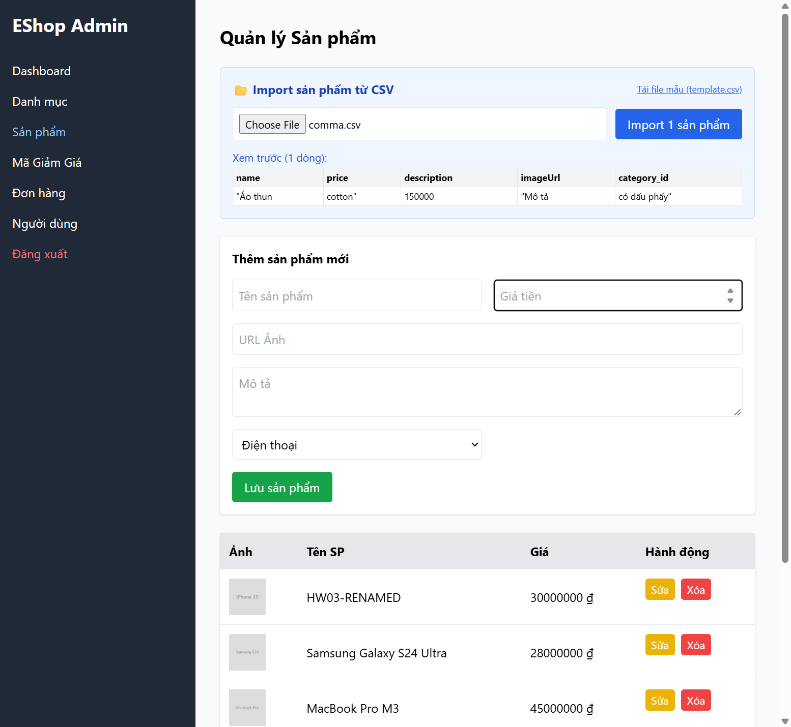
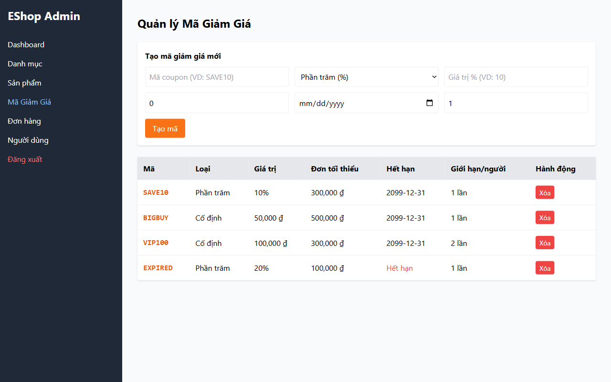
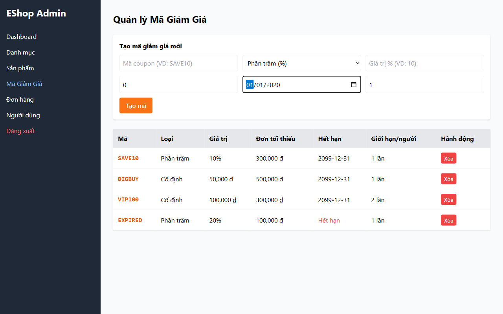
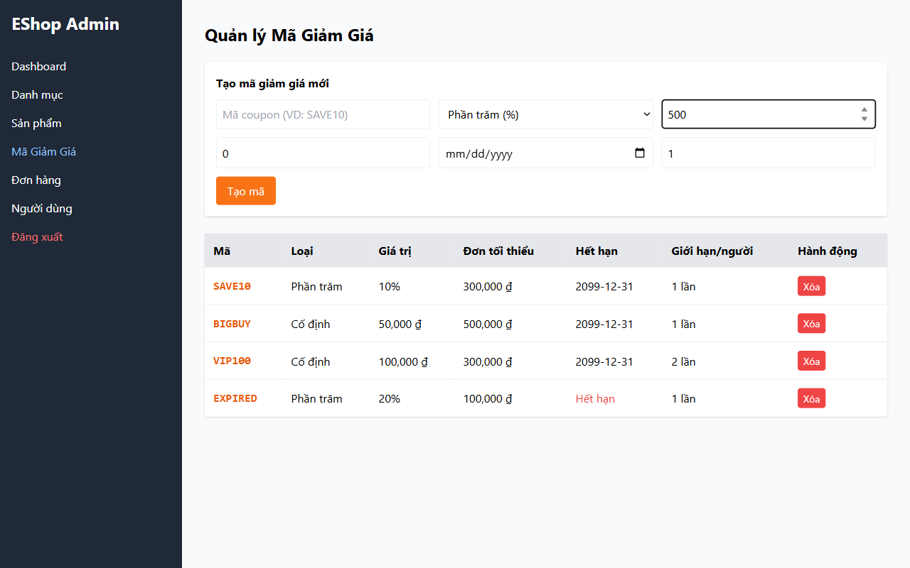
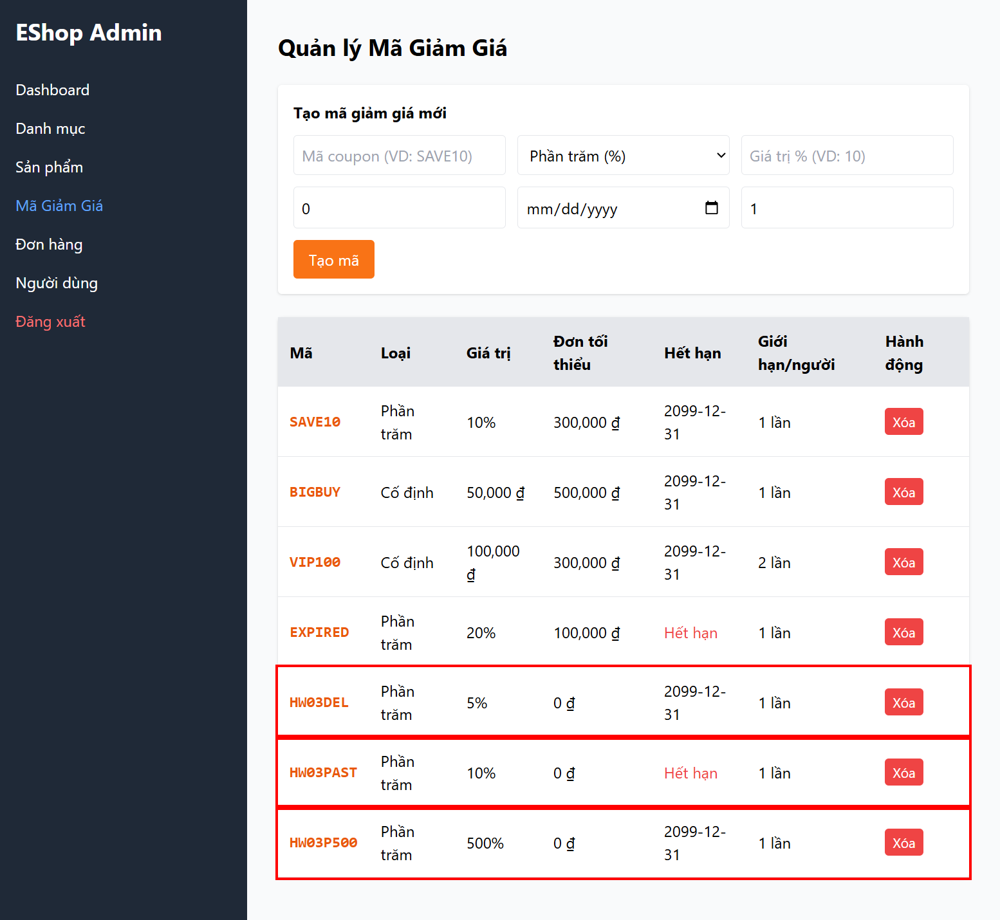
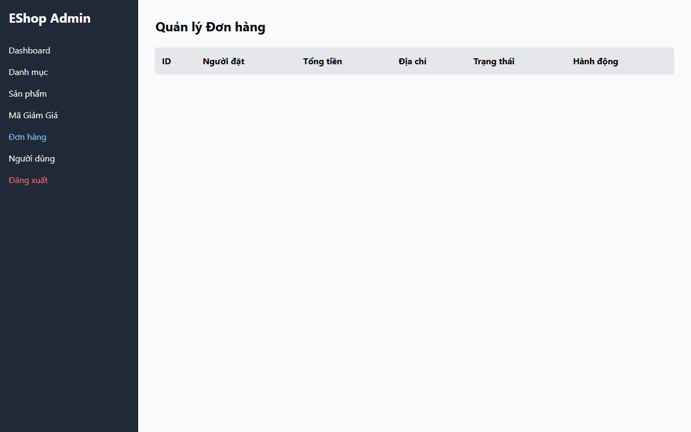

# BỘ 26 GITHUB ISSUES ĐÃ ĐỒNG BỘ CHính XÁC TRÊN REPO

> Đường dẫn trang Issues: [https://github.com/Hidebray/Homework-week03-SoftwareTesting/issues](https://github.com/Hidebray/Homework-week03-SoftwareTesting/issues)

---

## 1. [#4](https://github.com/Hidebray/Homework-week03-SoftwareTesting/issues/4) — [BUG_ADMIN_01] [MINOR] [Dashboard - IA-01] Phân mảnh màu sắc nút bấm chính (CTA): Login Xanh dương, Lưu SP Xanh lá, Tạo Coupon Cam

```markdown
### 1. Thông tin chung (Defect Metadata)
- **Mã lỗi (Bug ID):** `BUG_ADMIN_01` (Hạng mục Checklist: `CHK-03`)
- **Phân hệ / Màn hình:** EShop Web Admin (`frontend-admin`) — Tab **Dashboard**
- **Khía cạnh giao diện (Interface Aspect):** `IA-01`
- **Mức độ nghiêm trọng (Severity):** **MINOR**
- **Vị trí mã nguồn (Source Location):** `eshop-sut/frontend-admin/src/App.jsx:209, 545, 712`

### 2. Các bước tái hiện (Steps to Reproduce)
1. Khởi chạy Backend (`http://localhost:3000`) và Frontend Admin (`http://localhost:5174`).
2. Đăng nhập tài khoản Admin (`admin@eshop.com` / `Admin123!`).
3. Mở tab **Dashboard** và kiểm tra tiêu chí `CHK-03`: *Visual consistency of primary Call-to-Action (CTA) button colors across screens (Login: Blue, Products: Green, Coupons: Orange).*

### 3. Kết quả thực tế (Actual Result)
- **Hiện tượng lỗi:** Phân mảnh màu sắc nút bấm chính (CTA): Login Xanh dương, Lưu SP Xanh lá, Tạo Coupon Cam.
- **Kết quả kiểm chứng tự động (Playwright Assertion):** `CTA colours {"login":"rgb(37, 99, 235)","products":"rgb(22, 163, 74)","coupons":"rgb(249, 115, 22)"}`

### 4. Kết quả kỳ vọng (Expected Result)
- Application adheres to a unified brand primary CTA color across all views rather than arbitrary per-screen color shifts.

### 5. Ảnh chụp màn hình bằng chứng (Screenshot Evidence)

```

---

## 2. [#5](https://github.com/Hidebray/Homework-week03-SoftwareTesting/issues/5) — [BUG_ADMIN_02] [MINOR] [Dashboard - IA-01] Lưới thẻ KPI hardcode `grid-cols-2`, không co giãn thành 1 cột trên mobile làm tràn chữ

```markdown
### 1. Thông tin chung (Defect Metadata)
- **Mã lỗi (Bug ID):** `BUG_ADMIN_02` (Hạng mục Checklist: `CHK-04`)
- **Phân hệ / Màn hình:** EShop Web Admin (`frontend-admin`) — Tab **Dashboard**
- **Khía cạnh giao diện (Interface Aspect):** `IA-01`
- **Mức độ nghiêm trọng (Severity):** **MINOR**
- **Vị trí mã nguồn (Source Location):** `eshop-sut/frontend-admin/src/App.jsx:279`

### 2. Các bước tái hiện (Steps to Reproduce)
1. Khởi chạy Backend (`http://localhost:3000`) và Frontend Admin (`http://localhost:5174`).
2. Đăng nhập tài khoản Admin (`admin@eshop.com` / `Admin123!`).
3. Mở tab **Dashboard** và kiểm tra tiêu chí `CHK-04`: *Responsive behavior and card stacking when viewport is resized to tablet/mobile resolution (width < 768px).*

### 3. Kết quả thực tế (Actual Result)
- **Hiện tượng lỗi:** Lưới thẻ KPI hardcode `grid-cols-2`, không co giãn thành 1 cột trên mobile làm tràn chữ.
- **Kết quả kiểm chứng tự động (Playwright Assertion):** `window innerWidth=501px: KPI grid columns=2, sidebar width=256px`

### 4. Kết quả kỳ vọng (Expected Result)
- KPI grid collapses smoothly to single-column stacking without clipping card borders or overflowing viewport.

### 5. Ảnh chụp màn hình bằng chứng (Screenshot Evidence)

```

---

## 3. [#3](https://github.com/Hidebray/Homework-week03-SoftwareTesting/issues/3) — [BUG_ADMIN_03] [MINOR] [Dashboard - IA-02] Thiếu hoàn toàn bộ lọc thời gian (Date filter) để thống kê doanh thu

```markdown
### 1. Thông tin chung (Defect Metadata)
- **Mã lỗi (Bug ID):** `BUG_ADMIN_03` (Hạng mục Checklist: `CHK-05`)
- **Phân hệ / Màn hình:** EShop Web Admin (`frontend-admin`) — Tab **Dashboard**
- **Khía cạnh giao diện (Interface Aspect):** `IA-02`
- **Mức độ nghiêm trọng (Severity):** **MINOR**
- **Vị trí mã nguồn (Source Location):** `eshop-sut/frontend-admin/src/App.jsx:276-291`

### 2. Các bước tái hiện (Steps to Reproduce)
1. Khởi chạy Backend (`http://localhost:3000`) và Frontend Admin (`http://localhost:5174`).
2. Đăng nhập tài khoản Admin (`admin@eshop.com` / `Admin123!`).
3. Mở tab **Dashboard** và kiểm tra tiêu chí `CHK-05`: *Date range filter controls or temporal scoping inputs for revenue aggregation.*

### 3. Kết quả thực tế (Actual Result)
- **Hiện tượng lỗi:** Thiếu hoàn toàn bộ lọc thời gian (Date filter) để thống kê doanh thu.
- **Kết quả kiểm chứng tự động (Playwright Assertion):** `date/select/search controls on dashboard: 0`

### 4. Kết quả kỳ vọng (Expected Result)
- Interactive date pickers or dropdowns exist to allow filtering revenue and order count by custom date intervals (e.g., Today, This Month).

### 5. Ảnh chụp màn hình bằng chứng (Screenshot Evidence)

```

---

## 4. [#6](https://github.com/Hidebray/Homework-week03-SoftwareTesting/issues/6) — [BUG_ADMIN_04] [MAJOR] [Dashboard - IA-03] Menu Sidebar dùng thẻ `<li>` không có `tabIndex`, liệt hoàn toàn điều hướng bằng phím Tab

```markdown
### 1. Thông tin chung (Defect Metadata)
- **Mã lỗi (Bug ID):** `BUG_ADMIN_04` (Hạng mục Checklist: `CHK-06`)
- **Phân hệ / Màn hình:** EShop Web Admin (`frontend-admin`) — Tab **Dashboard**
- **Khía cạnh giao diện (Interface Aspect):** `IA-03`
- **Mức độ nghiêm trọng (Severity):** **MAJOR**
- **Vị trí mã nguồn (Source Location):** `eshop-sut/frontend-admin/src/App.jsx:227-272`

### 2. Các bước tái hiện (Steps to Reproduce)
1. Khởi chạy Backend (`http://localhost:3000`) và Frontend Admin (`http://localhost:5174`).
2. Đăng nhập tài khoản Admin (`admin@eshop.com` / `Admin123!`).
3. Mở tab **Dashboard** và kiểm tra tiêu chí `CHK-06`: *Keyboard accessibility and `Tab` key traversal on Sidebar navigation menu items (`<li>`).*

### 3. Kết quả thực tế (Actual Result)
- **Hiện tượng lỗi:** Menu Sidebar dùng thẻ `<li>` không có `tabIndex`, liệt hoàn toàn điều hướng bằng phím Tab.
- **Kết quả kiểm chứng tự động (Playwright Assertion):** `sidebar li tabIndex=[-1,-1,-1,-1,-1,-1,-1], focus after 2xTab=BODY`

### 4. Kết quả kỳ vọng (Expected Result)
- Menu items are focusable via keyboard (`tabIndex={0}`, `<button>` or `<a>`) with a visible focus ring for keyboard-only users.

### 5. Ảnh chụp màn hình bằng chứng (Screenshot Evidence)

```

---

## 5. [#7](https://github.com/Hidebray/Homework-week03-SoftwareTesting/issues/7) — [BUG_ADMIN_05] [MINOR] [Dashboard - IA-03] Thẻ KPI tổng số đơn hàng là div tĩnh, không thể nhấp để chuyển sang trang Quản lý đơn

```markdown
### 1. Thông tin chung (Defect Metadata)
- **Mã lỗi (Bug ID):** `BUG_ADMIN_05` (Hạng mục Checklist: `CHK-08`)
- **Phân hệ / Màn hình:** EShop Web Admin (`frontend-admin`) — Tab **Dashboard**
- **Khía cạnh giao diện (Interface Aspect):** `IA-03`
- **Mức độ nghiêm trọng (Severity):** **MINOR**
- **Vị trí mã nguồn (Source Location):** `eshop-sut/frontend-admin/src/App.jsx:286-289`

### 2. Các bước tái hiện (Steps to Reproduce)
1. Khởi chạy Backend (`http://localhost:3000`) và Frontend Admin (`http://localhost:5174`).
2. Đăng nhập tài khoản Admin (`admin@eshop.com` / `Admin123!`).
3. Mở tab **Dashboard** và kiểm tra tiêu chí `CHK-08`: *Quick shortcut navigation links or clickable drill-downs from KPI cards to detailed listing views.*

### 3. Kết quả thực tế (Actual Result)
- **Hiện tượng lỗi:** Thẻ KPI tổng số đơn hàng là div tĩnh, không thể nhấp để chuyển sang trang Quản lý đơn.
- **Kết quả kiểm chứng tự động (Playwright Assertion):** `clicking KPI card keeps the Dashboard view`

### 4. Kết quả kỳ vọng (Expected Result)
- Clicking the "Tổng số đơn hàng" card redirects or switches active tab to the Orders view (`activeTab = "orders"`).

### 5. Ảnh chụp màn hình bằng chứng (Screenshot Evidence)

```

---

## 6. [#8](https://github.com/Hidebray/Homework-week03-SoftwareTesting/issues/8) — [BUG_ADMIN_06] [CRITICAL] [Dashboard - IA-04] Phép tính doanh thu bị nhân đôi (`* 2`), đánh lừa số liệu tài chính quản trị viên

```markdown
### 1. Thông tin chung (Defect Metadata)
- **Mã lỗi (Bug ID):** `BUG_ADMIN_06` (Hạng mục Checklist: `CHK-09`)
- **Phân hệ / Màn hình:** EShop Web Admin (`frontend-admin`) — Tab **Dashboard**
- **Khía cạnh giao diện (Interface Aspect):** `IA-04`
- **Mức độ nghiêm trọng (Severity):** **CRITICAL**
- **Vị trí mã nguồn (Source Location):** `eshop-sut/frontend-admin/src/App.jsx:218`

### 2. Các bước tái hiện (Steps to Reproduce)
1. Khởi chạy Backend (`http://localhost:3000`) và Frontend Admin (`http://localhost:5174`).
2. Đăng nhập tài khoản Admin (`admin@eshop.com` / `Admin123!`).
3. Mở tab **Dashboard** và kiểm tra tiêu chí `CHK-09`: *Revenue calculation accuracy and synchronization with actual delivered orders in database.*

### 3. Kết quả thực tế (Actual Result)
- **Hiện tượng lỗi:** Phép tính doanh thu bị nhân đôi (`* 2`), đánh lừa số liệu tài chính quản trị viên.
- **Kết quả kiểm chứng tự động (Playwright Assertion):** `API delivered sum=150000, UI shows=300000`

### 4. Kết quả kỳ vọng (Expected Result)
- Revenue displays exact sum of `total_amount` for all orders with status `delivered` (`sum + o.total_amount`).

### 5. Ảnh chụp màn hình bằng chứng (Screenshot Evidence)

```

---

## 7. [#9](https://github.com/Hidebray/Homework-week03-SoftwareTesting/issues/9) — [BUG_ADMIN_07] [MINOR] [Dashboard - IA-04] Loạn định dạng tiền tệ giữa các tab (`0 ₫` vs `30000000 ₫` vs `300,000 ₫`)

```markdown
### 1. Thông tin chung (Defect Metadata)
- **Mã lỗi (Bug ID):** `BUG_ADMIN_07` (Hạng mục Checklist: `CHK-10`)
- **Phân hệ / Màn hình:** EShop Web Admin (`frontend-admin`) — Tab **Dashboard**
- **Khía cạnh giao diện (Interface Aspect):** `IA-04`
- **Mức độ nghiêm trọng (Severity):** **MINOR**
- **Vị trí mã nguồn (Source Location):** `eshop-sut/frontend-admin/src/App.jsx (Toàn ứng dụng)`

### 2. Các bước tái hiện (Steps to Reproduce)
1. Khởi chạy Backend (`http://localhost:3000`) và Frontend Admin (`http://localhost:5174`).
2. Đăng nhập tài khoản Admin (`admin@eshop.com` / `Admin123!`).
3. Mở tab **Dashboard** và kiểm tra tiêu chí `CHK-10`: *Cross-screen currency formatting consistency between Dashboard (`toLocaleString() ₫`), Products (raw unformatted), and Coupons (US comma).*

### 3. Kết quả thực tế (Actual Result)
- **Hiện tượng lỗi:** Loạn định dạng tiền tệ giữa các tab (`0 ₫` vs `30000000 ₫` vs `300,000 ₫`).
- **Kết quả kiểm chứng tự động (Playwright Assertion):** `[Manual] BUG_ADMIN_07: Fragmented currency formats across tabs (Dashboard uses `0 ₫`, Products shows raw unseparated `30000000 ₫`, Coupons uses US comma `300,000 ₫`). ([Ảnh](../proof-image/checklist/BUG_ADMIN_07_currency_format_disparity.png))`

### 4. Kết quả kỳ vọng (Expected Result)
- Currency follows a uniform locale format (e.g., Vietnamese thousands dots `150.000 ₫`) consistently across all 4 tabs.

### 5. Ảnh chụp màn hình bằng chứng (Screenshot Evidence)

```

---

## 8. [#10](https://github.com/Hidebray/Homework-week03-SoftwareTesting/issues/10) — [BUG_ADMIN_08] [MINOR] [Dashboard - IA-04] Thiếu Skeleton loader hoặc loading spinner khi API đang nạp danh sách đơn hàng

```markdown
### 1. Thông tin chung (Defect Metadata)
- **Mã lỗi (Bug ID):** `BUG_ADMIN_08` (Hạng mục Checklist: `CHK-11`)
- **Phân hệ / Màn hình:** EShop Web Admin (`frontend-admin`) — Tab **Dashboard**
- **Khía cạnh giao diện (Interface Aspect):** `IA-04`
- **Mức độ nghiêm trọng (Severity):** **MINOR**
- **Vị trí mã nguồn (Source Location):** `eshop-sut/frontend-admin/src/App.jsx:276-290`

### 2. Các bước tái hiện (Steps to Reproduce)
1. Khởi chạy Backend (`http://localhost:3000`) và Frontend Admin (`http://localhost:5174`).
2. Đăng nhập tài khoản Admin (`admin@eshop.com` / `Admin123!`).
3. Mở tab **Dashboard** và kiểm tra tiêu chí `CHK-11`: *Loading feedback and skeleton display during initial asynchronous API fetch of orders.*

### 3. Kết quả thực tế (Actual Result)
- **Hiện tượng lỗi:** Thiếu Skeleton loader hoặc loading spinner khi API đang nạp danh sách đơn hàng.
- **Kết quả kiểm chứng tự động (Playwright Assertion):** `Orders API delayed 2.5s: dashboard shows 0 ₫ / 0 with no loader/skeleton`

### 4. Kết quả kỳ vọng (Expected Result)
- Displays an animated loading spinner or skeleton card placeholders while `fetchData()` resolves orders payload.

### 5. Ảnh chụp màn hình bằng chứng (Screenshot Evidence)

```

---

## 9. [#11](https://github.com/Hidebray/Homework-week03-SoftwareTesting/issues/11) — [BUG_ADMIN_09] [MINOR] [Sản phẩm & CSV - IA-01] Giá sản phẩm trên bảng hiển thị chuỗi số nguyên dính chùm không có dấu phân cách ngàn

```markdown
### 1. Thông tin chung (Defect Metadata)
- **Mã lỗi (Bug ID):** `BUG_ADMIN_09` (Hạng mục Checklist: `CHK-15`)
- **Phân hệ / Màn hình:** EShop Web Admin (`frontend-admin`) — Tab **Sản phẩm & CSV**
- **Khía cạnh giao diện (Interface Aspect):** `IA-01`
- **Mức độ nghiêm trọng (Severity):** **MINOR**
- **Vị trí mã nguồn (Source Location):** `eshop-sut/frontend-admin/src/App.jsx:590`

### 2. Các bước tái hiện (Steps to Reproduce)
1. Khởi chạy Backend (`http://localhost:3000`) và Frontend Admin (`http://localhost:5174`).
2. Đăng nhập tài khoản Admin (`admin@eshop.com` / `Admin123!`).
3. Mở tab **Sản phẩm & CSV** và kiểm tra tiêu chí `CHK-15`: *Formatted price display in product catalog table with localized thousand separators.*

### 3. Kết quả thực tế (Actual Result)
- **Hiện tượng lỗi:** Giá sản phẩm trên bảng hiển thị chuỗi số nguyên dính chùm không có dấu phân cách ngàn.
- **Kết quả kiểm chứng tự động (Playwright Assertion):** `unformatted prices: 30000000 ₫ | 28000000 ₫ | 45000000 ₫`

### 4. Kết quả kỳ vọng (Expected Result)
- Product prices display localized thousand separators (e.g., `30.000.000 ₫`) rather than raw unformatted numbers.

### 5. Ảnh chụp màn hình bằng chứng (Screenshot Evidence)

```

---

## 10. [#13](https://github.com/Hidebray/Homework-week03-SoftwareTesting/issues/13) — [BUG_ADMIN_10] [MAJOR] [Sản phẩm & CSV - IA-02] Ô nhập giá tiền sản phẩm không có ràng buộc `min="0"`, cho phép lưu giá bán âm

```markdown
### 1. Thông tin chung (Defect Metadata)
- **Mã lỗi (Bug ID):** `BUG_ADMIN_10` (Hạng mục Checklist: `CHK-17`)
- **Phân hệ / Màn hình:** EShop Web Admin (`frontend-admin`) — Tab **Sản phẩm & CSV**
- **Khía cạnh giao diện (Interface Aspect):** `IA-02`
- **Mức độ nghiêm trọng (Severity):** **MAJOR**
- **Vị trí mã nguồn (Source Location):** `eshop-sut/frontend-admin/src/App.jsx:501-508`

### 2. Các bước tái hiện (Steps to Reproduce)
1. Khởi chạy Backend (`http://localhost:3000`) và Frontend Admin (`http://localhost:5174`).
2. Đăng nhập tài khoản Admin (`admin@eshop.com` / `Admin123!`).
3. Mở tab **Sản phẩm & CSV** và kiểm tra tiêu chí `CHK-17`: *Boundary constraint validation on product price field (`price >= 0`).*

### 3. Kết quả thực tế (Actual Result)
- **Hiện tượng lỗi:** Ô nhập giá tiền sản phẩm không có ràng buộc `min="0"`, cho phép lưu giá bán âm.
- **Kết quả kiểm chứng tự động (Playwright Assertion):** `price input min attr=null; value -50000 accepted by field`

### 4. Kết quả kỳ vọng (Expected Result)
- Input restricts negative price values via `min="0"` constraint and prevents alphanumeric invalid characters.

### 5. Ảnh chụp màn hình bằng chứng (Screenshot Evidence)

```

---

## 11. [#14](https://github.com/Hidebray/Homework-week03-SoftwareTesting/issues/14) — [BUG_ADMIN_11] [MINOR] [Sản phẩm & CSV - IA-02] Input upload CSV thiếu thuộc tính `accept=".csv"`, cho phép chọn mọi loại file không hợp lệ

```markdown
### 1. Thông tin chung (Defect Metadata)
- **Mã lỗi (Bug ID):** `BUG_ADMIN_11` (Hạng mục Checklist: `CHK-18`)
- **Phân hệ / Màn hình:** EShop Web Admin (`frontend-admin`) — Tab **Sản phẩm & CSV**
- **Khía cạnh giao diện (Interface Aspect):** `IA-02`
- **Mức độ nghiêm trọng (Severity):** **MINOR**
- **Vị trí mã nguồn (Source Location):** `eshop-sut/frontend-admin/src/App.jsx:356-384`

### 2. Các bước tái hiện (Steps to Reproduce)
1. Khởi chạy Backend (`http://localhost:3000`) và Frontend Admin (`http://localhost:5174`).
2. Đăng nhập tài khoản Admin (`admin@eshop.com` / `Admin123!`).
3. Mở tab **Sản phẩm & CSV** và kiểm tra tiêu chí `CHK-18`: *File upload MIME type and file extension restriction on CSV input control.*

### 3. Kết quả thực tế (Actual Result)
- **Hiện tượng lỗi:** Input upload CSV thiếu thuộc tính `accept=".csv"`, cho phép chọn mọi loại file không hợp lệ.
- **Kết quả kiểm chứng tự động (Playwright Assertion):** `file input accept attr=null`

### 4. Kết quả kỳ vọng (Expected Result)
- File selector restricts file dialog to `.csv` files using `accept=".csv"` attribute, rejecting `.exe` or `.png`.

### 5. Ảnh chụp màn hình bằng chứng (Screenshot Evidence)

```

---

## 12. [#15](https://github.com/Hidebray/Homework-week03-SoftwareTesting/issues/15) — [BUG_ADMIN_12] [CRITICAL] [Sản phẩm & CSV - IA-02] Parser CSV dùng `split(',')` làm vỡ toàn bộ cấu trúc bảng khi mô tả chứa dấu phẩy

```markdown
### 1. Thông tin chung (Defect Metadata)
- **Mã lỗi (Bug ID):** `BUG_ADMIN_12` (Hạng mục Checklist: `CHK-19`)
- **Phân hệ / Màn hình:** EShop Web Admin (`frontend-admin`) — Tab **Sản phẩm & CSV**
- **Khía cạnh giao diện (Interface Aspect):** `IA-02`
- **Mức độ nghiêm trọng (Severity):** **CRITICAL**
- **Vị trí mã nguồn (Source Location):** `eshop-sut/frontend-admin/src/App.jsx:367-377`

### 2. Các bước tái hiện (Steps to Reproduce)
1. Khởi chạy Backend (`http://localhost:3000`) và Frontend Admin (`http://localhost:5174`).
2. Đăng nhập tài khoản Admin (`admin@eshop.com` / `Admin123!`).
3. Mở tab **Sản phẩm & CSV** và kiểm tra tiêu chí `CHK-19`: *CSV parser handling of embedded commas within quoted string fields (e.g., `"Shirt, Cotton, Blue"`).*

### 3. Kết quả thực tế (Actual Result)
- **Hiện tượng lỗi:** Parser CSV dùng `split(',')` làm vỡ toàn bộ cấu trúc bảng khi mô tả chứa dấu phẩy.
- **Kết quả kiểm chứng tự động (Playwright Assertion):** `quoted field "Áo thun, cotton" kept as one cell: false; preview cells sample: "Áo thun | cotton"`

### 4. Kết quả kỳ vọng (Expected Result)
- Parser properly parses quoted fields without misaligning column values into subsequent header keys.

### 5. Ảnh chụp màn hình bằng chứng (Screenshot Evidence)

```

---

## 13. [#16](https://github.com/Hidebray/Homework-week03-SoftwareTesting/issues/16) — [BUG_ADMIN_13] [MAJOR] [Sản phẩm & CSV - IA-03] Nút Sửa và nút Xóa sản phẩm đặt sát nhau (`gap-2`), rất dễ gây click nhầm xóa sản phẩm

```markdown
### 1. Thông tin chung (Defect Metadata)
- **Mã lỗi (Bug ID):** `BUG_ADMIN_13` (Hạng mục Checklist: `CHK-22`)
- **Phân hệ / Màn hình:** EShop Web Admin (`frontend-admin`) — Tab **Sản phẩm & CSV**
- **Khía cạnh giao diện (Interface Aspect):** `IA-03`
- **Mức độ nghiêm trọng (Severity):** **MAJOR**
- **Vị trí mã nguồn (Source Location):** `eshop-sut/frontend-admin/src/App.jsx:591-604`

### 2. Các bước tái hiện (Steps to Reproduce)
1. Khởi chạy Backend (`http://localhost:3000`) và Frontend Admin (`http://localhost:5174`).
2. Đăng nhập tài khoản Admin (`admin@eshop.com` / `Admin123!`).
3. Mở tab **Sản phẩm & CSV** và kiểm tra tiêu chí `CHK-22`: *Physical separation and safe spacing between "Sửa" (Edit) and "Xóa" (Delete) action buttons in table rows.*

### 3. Kết quả thực tế (Actual Result)
- **Hiện tượng lỗi:** Nút Sửa và nút Xóa sản phẩm đặt sát nhau (`gap-2`), rất dễ gây click nhầm xóa sản phẩm.
- **Kết quả kiểm chứng tự động (Playwright Assertion):** `gap between Sửa and Xóa = 8.0px`

### 4. Kết quả kỳ vọng (Expected Result)
- Edit and Delete buttons provide adequate spacing or distinct visual weighting to prevent accidental destructive clicks.

### 5. Ảnh chụp màn hình bằng chứng (Screenshot Evidence)

```

---

## 14. [#17](https://github.com/Hidebray/Homework-week03-SoftwareTesting/issues/17) — [BUG_ADMIN_14] [CRITICAL] [Sản phẩm & CSV - IA-04] Nút Xóa sản phẩm thực thi API xóa vĩnh viễn ngay lập tức mà không có hộp thoại Confirm

```markdown
### 1. Thông tin chung (Defect Metadata)
- **Mã lỗi (Bug ID):** `BUG_ADMIN_14` (Hạng mục Checklist: `CHK-23`)
- **Phân hệ / Màn hình:** EShop Web Admin (`frontend-admin`) — Tab **Sản phẩm & CSV**
- **Khía cạnh giao diện (Interface Aspect):** `IA-04`
- **Mức độ nghiêm trọng (Severity):** **CRITICAL**
- **Vị trí mã nguồn (Source Location):** `eshop-sut/frontend-admin/src/App.jsx:133-136`

### 2. Các bước tái hiện (Steps to Reproduce)
1. Khởi chạy Backend (`http://localhost:3000`) và Frontend Admin (`http://localhost:5174`).
2. Đăng nhập tài khoản Admin (`admin@eshop.com` / `Admin123!`).
3. Mở tab **Sản phẩm & CSV** và kiểm tra tiêu chí `CHK-23`: *Destructive action confirmation modal dialog prior to product catalog deletion (`deleteProduct`).*

### 3. Kết quả thực tế (Actual Result)
- **Hiện tượng lỗi:** Nút Xóa sản phẩm thực thi API xóa vĩnh viễn ngay lập tức mà không có hộp thoại Confirm.
- **Kết quả kiểm chứng tự động (Playwright Assertion):** `confirm dialog shown=false; product deleted from DB=true`

### 4. Kết quả kỳ vọng (Expected Result)
- Clicking Delete triggers a modal confirmation dialog (`"Are you sure?"`) before executing irrevocable backend deletion.

### 5. Ảnh chụp màn hình bằng chứng (Screenshot Evidence)

```

---

## 15. [#18](https://github.com/Hidebray/Homework-week03-SoftwareTesting/issues/18) — [BUG_ADMIN_15] [CRITICAL] [Sản phẩm & CSV - IA-04] Sửa một sản phẩm làm toàn bộ sản phẩm trên bảng UI bị đồng loạt đổi tên (`fakeMass`)

```markdown
### 1. Thông tin chung (Defect Metadata)
- **Mã lỗi (Bug ID):** `BUG_ADMIN_15` (Hạng mục Checklist: `CHK-24`)
- **Phân hệ / Màn hình:** EShop Web Admin (`frontend-admin`) — Tab **Sản phẩm & CSV**
- **Khía cạnh giao diện (Interface Aspect):** `IA-04`
- **Mức độ nghiêm trọng (Severity):** **CRITICAL**
- **Vị trí mã nguồn (Source Location):** `eshop-sut/frontend-admin/src/App.jsx:110-114`

### 2. Các bước tái hiện (Steps to Reproduce)
1. Khởi chạy Backend (`http://localhost:3000`) và Frontend Admin (`http://localhost:5174`).
2. Đăng nhập tài khoản Admin (`admin@eshop.com` / `Admin123!`).
3. Mở tab **Sản phẩm & CSV** và kiểm tra tiêu chí `CHK-24`: *Single product update UI state integrity across catalog table records (`setProducts`).*

### 3. Kết quả thực tế (Actual Result)
- **Hiện tượng lỗi:** Sửa một sản phẩm làm toàn bộ sản phẩm trên bảng UI bị đồng loạt đổi tên (`fakeMass`).
- **Kết quả kiểm chứng tự động (Playwright Assertion):** `edited 1 product, 6 rows now named HW03-RENAMED (of 7)`

### 4. Kết quả kỳ vọng (Expected Result)
- Updating an individual product updates only the targeted product row without mutating sibling product titles in UI state.

### 5. Ảnh chụp màn hình bằng chứng (Screenshot Evidence)

```

---

## 16. [#19](https://github.com/Hidebray/Homework-week03-SoftwareTesting/issues/19) — [BUG_ADMIN_16] [MAJOR] [Mã Giảm Giá - IA-02] Giá trị khởi tạo `{min: 0, max: 1}` đè mất placeholder, form trơ trọi 2 ô số không có label

```markdown
### 1. Thông tin chung (Defect Metadata)
- **Mã lỗi (Bug ID):** `BUG_ADMIN_16` (Hạng mục Checklist: `CHK-27`)
- **Phân hệ / Màn hình:** EShop Web Admin (`frontend-admin`) — Tab **Mã Giảm Giá**
- **Khía cạnh giao diện (Interface Aspect):** `IA-02`
- **Mức độ nghiêm trọng (Severity):** **MAJOR**
- **Vị trí mã nguồn (Source Location):** `eshop-sut/frontend-admin/src/App.jsx:29-31`

### 2. Các bước tái hiện (Steps to Reproduce)
1. Khởi chạy Backend (`http://localhost:3000`) và Frontend Admin (`http://localhost:5174`).
2. Đăng nhập tài khoản Admin (`admin@eshop.com` / `Admin123!`).
3. Mở tab **Mã Giảm Giá** và kiểm tra tiêu chí `CHK-27`: *Persistent field labels visibility and differentiation when inputs have initial default numeric values.*

### 3. Kết quả thực tế (Actual Result)
- **Hiện tượng lỗi:** Giá trị khởi tạo `{min: 0, max: 1}` đè mất placeholder, form trơ trọi 2 ô số không có label.
- **Kết quả kiểm chứng tự động (Playwright Assertion):** `<label> count=0; numeric defaults=["","0","1"] hide placeholders`

### 4. Kết quả kỳ vọng (Expected Result)
- Form inputs have visible `<label>` elements so that default values (e.g., `0` for min order, `1` for max uses) do not obliterate field purpose.

### 5. Ảnh chụp màn hình bằng chứng (Screenshot Evidence)

```

---

## 17. [#20](https://github.com/Hidebray/Homework-week03-SoftwareTesting/issues/20) — [BUG_ADMIN_18] [MAJOR] [Mã Giảm Giá - IA-02] Bộ chọn ngày hết hạn thiếu `min="today"`, cho phép tạo mã có ngày hết hạn trong quá khứ

```markdown
### 1. Thông tin chung (Defect Metadata)
- **Mã lỗi (Bug ID):** `BUG_ADMIN_18` (Hạng mục Checklist: `CHK-29`)
- **Phân hệ / Màn hình:** EShop Web Admin (`frontend-admin`) — Tab **Mã Giảm Giá**
- **Khía cạnh giao diện (Interface Aspect):** `IA-02`
- **Mức độ nghiêm trọng (Severity):** **MAJOR**
- **Vị trí mã nguồn (Source Location):** `eshop-sut/frontend-admin/src/App.jsx:688-697`

### 2. Các bước tái hiện (Steps to Reproduce)
1. Khởi chạy Backend (`http://localhost:3000`) và Frontend Admin (`http://localhost:5174`).
2. Đăng nhập tài khoản Admin (`admin@eshop.com` / `Admin123!`).
3. Mở tab **Mã Giảm Giá** và kiểm tra tiêu chí `CHK-29`: *Temporal validity constraint on coupon expiration date picker (`min = today`).*

### 3. Kết quả thực tế (Actual Result)
- **Hiện tượng lỗi:** Bộ chọn ngày hết hạn thiếu `min="today"`, cho phép tạo mã có ngày hết hạn trong quá khứ.
- **Kết quả kiểm chứng tự động (Playwright Assertion):** `date min attr=null; coupon with expiry 2020-01-01 created=true`

### 4. Kết quả kỳ vọng (Expected Result)
- Date picker prevents selecting past dates by enforcing `min` attribute set to current calendar date.

### 5. Ảnh chụp màn hình bằng chứng (Screenshot Evidence)

```

---

## 18. [#21](https://github.com/Hidebray/Homework-week03-SoftwareTesting/issues/21) — [BUG_ADMIN_19] [MAJOR] [Mã Giảm Giá - IA-02] Không khống chế giá trị tối đa `max="100"` khi chọn loại phần trăm, cho phép nhập 500%

```markdown
### 1. Thông tin chung (Defect Metadata)
- **Mã lỗi (Bug ID):** `BUG_ADMIN_19` (Hạng mục Checklist: `CHK-30`)
- **Phân hệ / Màn hình:** EShop Web Admin (`frontend-admin`) — Tab **Mã Giảm Giá**
- **Khía cạnh giao diện (Interface Aspect):** `IA-02`
- **Mức độ nghiêm trọng (Severity):** **MAJOR**
- **Vị trí mã nguồn (Source Location):** `eshop-sut/frontend-admin/src/App.jsx:663-675`

### 2. Các bước tái hiện (Steps to Reproduce)
1. Khởi chạy Backend (`http://localhost:3000`) và Frontend Admin (`http://localhost:5174`).
2. Đăng nhập tài khoản Admin (`admin@eshop.com` / `Admin123!`).
3. Mở tab **Mã Giảm Giá** và kiểm tra tiêu chí `CHK-30`: *Upper boundary constraint enforcement for percentage discount value (`1 <= value <= 100`).*

### 3. Kết quả thực tế (Actual Result)
- **Hiện tượng lỗi:** Không khống chế giá trị tối đa `max="100"` khi chọn loại phần trăm, cho phép nhập 500%.
- **Kết quả kiểm chứng tự động (Playwright Assertion):** `max attr=null; percent coupon saved with value=500`

### 4. Kết quả kỳ vọng (Expected Result)
- When discount type is "Phần trăm", input restricts maximum value to `100` via HTML5 `max="100"` validation.

### 5. Ảnh chụp màn hình bằng chứng (Screenshot Evidence)

```

---

## 19. [#22](https://github.com/Hidebray/Homework-week03-SoftwareTesting/issues/22) — [BUG_ADMIN_21] [CRITICAL] [Mã Giảm Giá - IA-04] Nút Xóa mã coupon xóa vĩnh viễn ngay lập tức mà không hiển thị hộp thoại xác nhận

```markdown
### 1. Thông tin chung (Defect Metadata)
- **Mã lỗi (Bug ID):** `BUG_ADMIN_21` (Hạng mục Checklist: `CHK-35`)
- **Phân hệ / Màn hình:** EShop Web Admin (`frontend-admin`) — Tab **Mã Giảm Giá**
- **Khía cạnh giao diện (Interface Aspect):** `IA-04`
- **Mức độ nghiêm trọng (Severity):** **CRITICAL**
- **Vị trí mã nguồn (Source Location):** `eshop-sut/frontend-admin/src/App.jsx:754-762`

### 2. Các bước tái hiện (Steps to Reproduce)
1. Khởi chạy Backend (`http://localhost:3000`) và Frontend Admin (`http://localhost:5174`).
2. Đăng nhập tài khoản Admin (`admin@eshop.com` / `Admin123!`).
3. Mở tab **Mã Giảm Giá** và kiểm tra tiêu chí `CHK-35`: *Destructive action confirmation modal dialog prior to coupon deletion.*

### 3. Kết quả thực tế (Actual Result)
- **Hiện tượng lỗi:** Nút Xóa mã coupon xóa vĩnh viễn ngay lập tức mà không hiển thị hộp thoại xác nhận.
- **Kết quả kiểm chứng tự động (Playwright Assertion):** `confirm shown=false; coupon deleted=true`

### 4. Kết quả kỳ vọng (Expected Result)
- Clicking Delete triggers a confirmation dialog (`window.confirm` or modal) requiring explicit confirmation before calling API.

### 5. Ảnh chụp màn hình bằng chứng (Screenshot Evidence)

```

---

## 20. [#23](https://github.com/Hidebray/Homework-week03-SoftwareTesting/issues/23) — [BUG_ADMIN_22] [MINOR] [Đơn Hàng - IA-02] Thiếu ô tìm kiếm và bộ lọc trạng thái đơn hàng, gây quá tải khi tìm kiếm đơn cụ thể

```markdown
### 1. Thông tin chung (Defect Metadata)
- **Mã lỗi (Bug ID):** `BUG_ADMIN_22` (Hạng mục Checklist: `CHK-40`)
- **Phân hệ / Màn hình:** EShop Web Admin (`frontend-admin`) — Tab **Đơn Hàng**
- **Khía cạnh giao diện (Interface Aspect):** `IA-02`
- **Mức độ nghiêm trọng (Severity):** **MINOR**
- **Vị trí mã nguồn (Source Location):** `eshop-sut/frontend-admin/src/App.jsx:777-875`

### 2. Các bước tái hiện (Steps to Reproduce)
1. Khởi chạy Backend (`http://localhost:3000`) và Frontend Admin (`http://localhost:5174`).
2. Đăng nhập tài khoản Admin (`admin@eshop.com` / `Admin123!`).
3. Mở tab **Đơn Hàng** và kiểm tra tiêu chí `CHK-40`: *Search or filter input controls for locating specific orders by customer name or order ID.*

### 3. Kết quả thực tế (Actual Result)
- **Hiện tượng lỗi:** Thiếu ô tìm kiếm và bộ lọc trạng thái đơn hàng, gây quá tải khi tìm kiếm đơn cụ thể.
- **Kết quả kiểm chứng tự động (Playwright Assertion):** `search/filter controls on Orders tab=0`

### 4. Kết quả kỳ vọng (Expected Result)
- Provides search bar or filter dropdown to quickly filter orders by ID, customer email, or status.

### 5. Ảnh chụp màn hình bằng chứng (Screenshot Evidence)

```

---

## 21. [#24](https://github.com/Hidebray/Homework-week03-SoftwareTesting/issues/24) — [BUG_ADMIN_23] [MINOR] [Đơn Hàng - IA-02] Bảng đơn hàng hiển thị tất cả bản ghi trên một trang, thiếu phân trang (Pagination)

```markdown
### 1. Thông tin chung (Defect Metadata)
- **Mã lỗi (Bug ID):** `BUG_ADMIN_23` (Hạng mục Checklist: `CHK-41`)
- **Phân hệ / Màn hình:** EShop Web Admin (`frontend-admin`) — Tab **Đơn Hàng**
- **Khía cạnh giao diện (Interface Aspect):** `IA-02`
- **Mức độ nghiêm trọng (Severity):** **MINOR**
- **Vị trí mã nguồn (Source Location):** `eshop-sut/frontend-admin/src/App.jsx:780-875`

### 2. Các bước tái hiện (Steps to Reproduce)
1. Khởi chạy Backend (`http://localhost:3000`) và Frontend Admin (`http://localhost:5174`).
2. Đăng nhập tài khoản Admin (`admin@eshop.com` / `Admin123!`).
3. Mở tab **Đơn Hàng** và kiểm tra tiêu chí `CHK-41`: *Pagination or virtualized scrolling controls for handling large order volumes (>50 orders).*

### 3. Kết quả thực tế (Actual Result)
- **Hiện tượng lỗi:** Bảng đơn hàng hiển thị tất cả bản ghi trên một trang, thiếu phân trang (Pagination).
- **Kết quả kiểm chứng tự động (Playwright Assertion):** `orders in DB=51; rows rendered on one page=51; pager controls=0`

### 4. Kết quả kỳ vọng (Expected Result)
- Table provides pagination controls (Next/Prev, page numbers) or virtual scrolling to prevent unbounded DOM bloat.

### 5. Ảnh chụp màn hình bằng chứng (Screenshot Evidence)

```

---

## 22. [#25](https://github.com/Hidebray/Homework-week03-SoftwareTesting/issues/25) — [BUG_ADMIN_24] [MAJOR] [Đơn Hàng - IA-03] Kích thước nút chuyển trạng thái đơn quá bé (`text-xs px-2 py-1`), vi phạm định luật Fitts

```markdown
### 1. Thông tin chung (Defect Metadata)
- **Mã lỗi (Bug ID):** `BUG_ADMIN_24` (Hạng mục Checklist: `CHK-42`)
- **Phân hệ / Màn hình:** EShop Web Admin (`frontend-admin`) — Tab **Đơn Hàng**
- **Khía cạnh giao diện (Interface Aspect):** `IA-03`
- **Mức độ nghiêm trọng (Severity):** **MAJOR**
- **Vị trí mã nguồn (Source Location):** `eshop-sut/frontend-admin/src/App.jsx:817, 825`

### 2. Các bước tái hiện (Steps to Reproduce)
1. Khởi chạy Backend (`http://localhost:3000`) và Frontend Admin (`http://localhost:5174`).
2. Đăng nhập tài khoản Admin (`admin@eshop.com` / `Admin123!`).
3. Mở tab **Đơn Hàng** và kiểm tra tiêu chí `CHK-42`: *Action button sizing, touch target dimensions, and ergonomic spacing (Fitts's Law).*

### 3. Kết quả thực tế (Actual Result)
- **Hiện tượng lỗi:** Kích thước nút chuyển trạng thái đơn quá bé (`text-xs px-2 py-1`), vi phạm định luật Fitts.
- **Kết quả kiểm chứng tự động (Playwright Assertion):** `Xác nhận button height=24.0px (min 36)`

### 4. Kết quả kỳ vọng (Expected Result)
- Action buttons provide adequate touch targets (minimum 36px height) with comfortable spacing between adjacent controls.

### 5. Ảnh chụp màn hình bằng chứng (Screenshot Evidence)

```

---

## 23. [#26](https://github.com/Hidebray/Homework-week03-SoftwareTesting/issues/26) — [BUG_ADMIN_25] [MAJOR] [Đơn Hàng - IA-03] Nút "Xác nhận" và nút "Hủy" đặt sát cạnh nhau, rất dễ gây tai nạn bấm hủy nhầm đơn

```markdown
### 1. Thông tin chung (Defect Metadata)
- **Mã lỗi (Bug ID):** `BUG_ADMIN_25` (Hạng mục Checklist: `CHK-43`)
- **Phân hệ / Màn hình:** EShop Web Admin (`frontend-admin`) — Tab **Đơn Hàng**
- **Khía cạnh giao diện (Interface Aspect):** `IA-03`
- **Mức độ nghiêm trọng (Severity):** **MAJOR**
- **Vị trí mã nguồn (Source Location):** `eshop-sut/frontend-admin/src/App.jsx:816-830`

### 2. Các bước tái hiện (Steps to Reproduce)
1. Khởi chạy Backend (`http://localhost:3000`) và Frontend Admin (`http://localhost:5174`).
2. Đăng nhập tài khoản Admin (`admin@eshop.com` / `Admin123!`).
3. Mở tab **Đơn Hàng** và kiểm tra tiêu chí `CHK-43`: *Physical buffer separation between positive progression action ("Xác nhận") and destructive action ("Hủy").*

### 3. Kết quả thực tế (Actual Result)
- **Hiện tượng lỗi:** Nút "Xác nhận" và nút "Hủy" đặt sát cạnh nhau, rất dễ gây tai nạn bấm hủy nhầm đơn.
- **Kết quả kiểm chứng tự động (Playwright Assertion):** `gap Xác nhận↔Hủy=4.0px (stacked vertically, flex-col gap-1)`

### 4. Kết quả kỳ vọng (Expected Result)
- Progression button and cancel button are visually distinguished and separated to prevent accidental order cancellation.

### 5. Ảnh chụp màn hình bằng chứng (Screenshot Evidence)

```

---

## 24. [#27](https://github.com/Hidebray/Homework-week03-SoftwareTesting/issues/27) — [BUG_ADMIN_26] [MAJOR] [Đơn Hàng - IA-04] Bảng đơn hàng trắng toang không có dòng chữ Empty State nào khi chưa có đơn hàng

```markdown
### 1. Thông tin chung (Defect Metadata)
- **Mã lỗi (Bug ID):** `BUG_ADMIN_26` (Hạng mục Checklist: `CHK-45`)
- **Phân hệ / Màn hình:** EShop Web Admin (`frontend-admin`) — Tab **Đơn Hàng**
- **Khía cạnh giao diện (Interface Aspect):** `IA-04`
- **Mức độ nghiêm trọng (Severity):** **MAJOR**
- **Vị trí mã nguồn (Source Location):** `eshop-sut/frontend-admin/src/App.jsx:791-874`

### 2. Các bước tái hiện (Steps to Reproduce)
1. Khởi chạy Backend (`http://localhost:3000`) và Frontend Admin (`http://localhost:5174`).
2. Đăng nhập tài khoản Admin (`admin@eshop.com` / `Admin123!`).
3. Mở tab **Đơn Hàng** và kiểm tra tiêu chí `CHK-45`: *Empty state visual representation and explanatory messaging when no orders exist in the database (`orders = []`).*

### 3. Kết quả thực tế (Actual Result)
- **Hiện tượng lỗi:** Bảng đơn hàng trắng toang không có dòng chữ Empty State nào khi chưa có đơn hàng.
- **Kết quả kiểm chứng tự động (Playwright Assertion):** `orders=0, tbody rows=0, empty-state message=false`

### 4. Kết quả kỳ vọng (Expected Result)
- Displays a clear, centered empty state notification (e.g., "Chưa có đơn hàng nào") across the table body when orders array is empty.

### 5. Ảnh chụp màn hình bằng chứng (Screenshot Evidence)

```

---

## 25. [#28](https://github.com/Hidebray/Homework-week03-SoftwareTesting/issues/28) — [BUG_ADMIN_27] [CRITICAL] [Đơn Hàng - IA-04] Đơn hàng đã hủy (`canceled`) vẫn xuất hiện nút cho phép đánh dấu đã giao (`delivered`)

```markdown
### 1. Thông tin chung (Defect Metadata)
- **Mã lỗi (Bug ID):** `BUG_ADMIN_27` (Hạng mục Checklist: `CHK-47`)
- **Phân hệ / Màn hình:** EShop Web Admin (`frontend-admin`) — Tab **Đơn Hàng**
- **Khía cạnh giao diện (Interface Aspect):** `IA-04`
- **Mức độ nghiêm trọng (Severity):** **CRITICAL**
- **Vị trí mã nguồn (Source Location):** `eshop-sut/frontend-admin/src/App.jsx:862-869`

### 2. Các bước tái hiện (Steps to Reproduce)
1. Khởi chạy Backend (`http://localhost:3000`) và Frontend Admin (`http://localhost:5174`).
2. Đăng nhập tài khoản Admin (`admin@eshop.com` / `Admin123!`).
3. Mở tab **Đơn Hàng** và kiểm tra tiêu chí `CHK-47`: *State machine terminal state integrity enforcement for `canceled` orders (disallowing reactivation).*

### 3. Kết quả thực tế (Actual Result)
- **Hiện tượng lỗi:** Đơn hàng đã hủy (`canceled`) vẫn xuất hiện nút cho phép đánh dấu đã giao (`delivered`).
- **Kết quả kiểm chứng tự động (Playwright Assertion):** `canceled order row has "Đánh dấu Đã giao" button=true`

### 4. Kết quả kỳ vọng (Expected Result)
- Canceled orders are terminal; UI must not provide any action button transitioning a canceled order to delivered.

### 5. Ảnh chụp màn hình bằng chứng (Screenshot Evidence)

```

---

## 26. [#30](https://github.com/Hidebray/Homework-week03-SoftwareTesting/issues/30) — [BUG_ADMIN_28] [CRITICAL] [Đơn Hàng - IA-04] Lỗ hổng XSS lưu trữ khi render địa chỉ giao hàng qua `dangerouslySetInnerHTML`

```markdown
### 1. Thông tin chung (Defect Metadata)
- **Mã lỗi (Bug ID):** `BUG_ADMIN_28` (Hạng mục Checklist: `CHK-48`)
- **Phân hệ / Màn hình:** EShop Web Admin (`frontend-admin`) — Tab **Đơn Hàng**
- **Khía cạnh giao diện (Interface Aspect):** `IA-04`
- **Mức độ nghiêm trọng (Severity):** **CRITICAL**
- **Vị trí mã nguồn (Source Location):** `eshop-sut/frontend-admin/src/App.jsx:799-803`

### 2. Các bước tái hiện (Steps to Reproduce)
1. Khởi chạy Backend (`http://localhost:3000`) và Frontend Admin (`http://localhost:5174`).
2. Đăng nhập tài khoản Admin (`admin@eshop.com` / `Admin123!`).
3. Mở tab **Đơn Hàng** và kiểm tra tiêu chí `CHK-48`: *Security sanitization and XSS protection on rendered customer shipping address (`shipping_address`).*

### 3. Kết quả thực tế (Actual Result)
- **Hiện tượng lỗi:** Lỗ hổng XSS lưu trữ khi render địa chỉ giao hàng qua `dangerouslySetInnerHTML`.
- **Kết quả kiểm chứng tự động (Playwright Assertion):** `injected  executed: document.title="XSS-HW03"; injected red HTML rendered`

### 4. Kết quả kỳ vọng (Expected Result)
- Shipping address is safely escaped as plain text or sanitized against script/HTML injection attacks.

### 5. Ảnh chụp màn hình bằng chứng (Screenshot Evidence)

```

---
