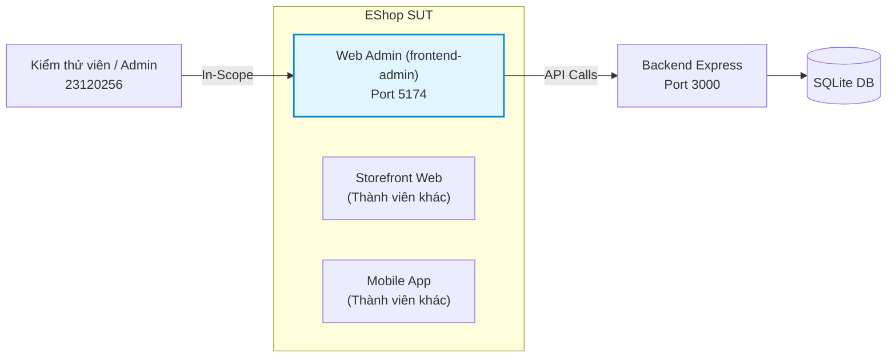
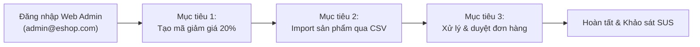
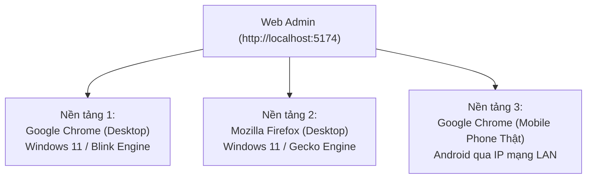

# HW03 – Tổng Quan Lựa Chọn Phạm Vi & Kế Hoạch Kiểm Thử
## Phân Hệ Web Admin (`frontend-admin`) — EShop SUT

> **Môn học:** Kiểm thử phần mềm (Software Testing) – FIT@HCMUS  
> **Bài tập:** HW03 – GUI & Usability Testing  
> **Sinh viên:** Trần Đại Hiệp – **MSSV:** 23120256  
> **Email:** 23120256@student.hcmus.edu.vn  
> **Hệ thống kiểm thử (SUT):** [EShop](https://github.com/ttbhanh/eshop-sut) (Phân hệ Web Admin)  
> **Địa chỉ chạy thực tế:** `http://localhost:5174` (Frontend Admin) | `http://localhost:3000` (Backend API)  

---

## 1. Thông Tin & Ranh Giới Phạm Vi Kiểm Thử (Scope Boundaries)

### 1.1 Đối tượng kiểm thử được lựa chọn
Trong hệ sinh thái ứng dụng EShop, đồ án này tập trung chuyên sâu vào phân hệ **Web Admin (`frontend-admin`)** — cổng thông tin quản trị vận hành nội bộ dành cho Quản lý cửa hàng và Quản trị viên hệ thống.

### 1.2 Phân định ranh giới phạm vi (In-Scope vs Out-of-Scope)

- **Trong phạm vi kiểm thử (In-Scope — 4 Tabs cốt lõi):**
  1. **Tab Dashboard (FR-13):** Màn hình hiển thị các thẻ tổng quan KPI kinh doanh (Tổng doanh thu đơn đã giao, Tổng số đơn hàng).
  2. **Tab Sản phẩm & CSV Import (FR-15, FR-16):** Form quản lý thêm/sửa sản phẩm, tính năng tải file mẫu `template.csv`, nạp file dữ liệu CSV, bảng xem trước (preview) và danh sách sản phẩm.
  3. **Tab Mã giảm giá (FR-17):** Form thiết lập mã khuyến mãi (mã code, loại phần trăm/cố định, giá trị, hạn dùng, giới hạn/người) và bảng quản trị danh sách coupon.
  4. **Tab Đơn hàng (FR-18, FR-10):** Bảng danh sách đơn đặt hàng từ khách hàng, hiển thị thông tin người nhận, địa chỉ giao hàng và hệ thống nút chuyển đổi trạng thái đơn hàng.

- **Ngoài phạm vi kiểm thử (Out-of-Scope):**
  - **Tab Danh mục (Categories - FR-14)** và **Tab Quản lý người dùng (Users - FR-19):** Được các thành viên khác trong nhóm phụ trách kiểm thử.
  - **Giao diện Storefront Mua hàng (Pool A, Pool B) & Mobile App:** Không nằm trong phạm vi đồ án cá nhân này nhằm đảm bảo tính độc lập tuyệt đối giữa các thành viên theo đúng quy định tại Mục 5 của Đề thi HW03.

### 1.3 Cơ sở & Lý do chọn phạm vi
- **Tuân thủ quy định đề bài:** Tránh trùng lặp màn hình và luồng thao tác với các thành viên khác trong nhóm kiểm thử.
- **Tính chất nghiệp vụ trọng yếu:** Phân hệ Web Admin quyết định toàn bộ dòng tiền, dữ liệu kho vận, chính sách khuyến mãi và chuỗi giao nhận của cửa hàng.
- **Mật độ thành phần giao diện phong phú:** Chứa đầy đủ các dạng UI phức tạp gồm bảng dữ liệu động, biểu mẫu đa trường, bộ chọn ngày tháng, xử lý tập tin tải lên và các nút kích hoạt chuyển đổi trạng thái.

---

## 2. Định Hướng 4 Khía Cạnh Giao Diện (Interface Aspects: IA-01 $\rightarrow$ IA-04)

Bám sát 4 khía cạnh giao diện chuẩn của đề bài để định hướng xây dựng bộ **Checklist 48 mục kiểm thử** trong Task 1:

| Khía Cạnh | Tên Khía Cạnh | Định Hướng Kiểm Thử Trên Phân Hệ Web Admin |
|:---:|:---|:---|
| **IA-01** | **General UI Standards** *(Tiêu chuẩn giao diện chung)* | • Đánh giá tính nhất quán về font chữ, phân cấp thị giác (typography). • Kiểm tra độ tương phản màu sắc giữa chữ và nền theo chuẩn WCAG 2.1 AA. • Kiểm tra bố cục hiển thị thẻ KPI trên Dashboard và tính đáp ứng (responsive) khi thay đổi kích thước cửa sổ. |
| **IA-02** | **Forms** *(Biểu mẫu & Nhập liệu)* | • Kiểm tra các trường dữ liệu form: validation tên sản phẩm, giá bán, link hình ảnh. • Kiểm tra bộ chọn ngày hết hạn (Date Picker) và ràng buộc giá trị % của mã giảm giá. • Kiểm tra tính năng chọn file CSV, bảng xem trước (preview) dữ liệu trước khi nạp vào hệ thống. |
| **IA-03** | **Navigation** *(Điều hướng & Bố cục thao tác)* | • Kiểm tra thanh Sidebar menu: trạng thái kích hoạt (Active tab) khi chuyển đổi giữa các trang. • Đánh giá bố cục bảng dữ liệu đơn hàng và sản phẩm. • Đánh giá vị trí và khoảng cách các nút thao tác (khoảng cách giữa nút Duyệt và nút Hủy đơn) theo định luật Fitts. |
| **IA-04** | **Feedback / State** *(Phản hồi & Trạng thái)* | • Đánh giá phản hồi người dùng sau thao tác: thông báo thành công, cảnh báo lỗi (Toast/Alert/Modal). • Kiểm tra hiển thị trạng thái màu sắc của Badges đơn hàng (`pending`, `confirmed`, `shipping`, `delivered`, `canceled`). • Kiểm tra nhãn trạng thái mã giảm giá khi hết hạn và phản hồi khi xóa dữ liệu. |

---

## 3. Kịch Bản Usability Mục Tiêu (Task 2 Goal-Oriented Scenario)

Nhằm thu thập dữ liệu trải nghiệm người dùng chân thực và khách quan từ **7 người tham gia thực tế**, kịch bản được xây dựng theo hình thức **Giao mục tiêu mở (Goal-Oriented)**, tuyệt đối không hướng dẫn từng bước bấm chuột (không "cầm tay chỉ việc"):

### 3.1 Bối cảnh & Nhiệm vụ giao cho người tham gia
> *"Bạn vừa được nhận vào làm Quản lý cửa hàng thời trang EShop. Hôm nay là ngày đầu tiên bạn tiếp quản hệ thống quản trị. Hãy truy cập vào trang Admin và hoàn thành 3 mục tiêu công việc sau theo cách bạn thấy tự nhiên và thuận tiện nhất:*
> 1. *Tạo một mã giảm giá khuyến mãi 20% cho dịp khai trương sắp tới.*
> 2. *Nạp thêm các sản phẩm mới vào kho hàng thông qua tính năng nhập tệp CSV của hệ thống.*
> 3. *Kiểm tra danh sách đơn đặt hàng mới và tiến hành xử lý, chuyển giao đơn hàng đang chờ sang trạng thái giao hàng cho bưu tá."*

### 3.2 Phương pháp đo lường: Thang đo SUS (System Usability Scale)
Sau khi hoàn thành hoặc dừng kịch bản, mỗi người dùng sẽ điền bảng khảo sát **SUS gồm 10 câu hỏi chuẩn hóa quốc tế** của John Brooke (thang đo Likert 1: Rất không đồng ý $\rightarrow$ 5: Rất đồng ý):
1. Tôi nghĩ rằng tôi sẽ thích sử dụng hệ thống quản trị này thường xuyên.
2. Tôi thấy hệ thống quản trị này phức tạp một cách không cần thiết.
3. Tôi thấy hệ thống quản trị này dễ sử dụng.
4. Tôi nghĩ rằng tôi sẽ cần sự hỗ trợ của một chuyên gia kỹ thuật để sử dụng hệ thống này.
5. Tôi nhận thấy các chức năng trong hệ thống này được tích hợp rất tốt.
6. Tôi cho rằng có quá nhiều điều không nhất quán trong hệ thống này.
7. Tôi nghĩ hầu hết mọi người sẽ học cách sử dụng hệ thống này rất nhanh chóng.
8. Tôi thấy hệ thống quản trị này rất rườm rà và khó thao tác.
9. Tôi cảm thấy rất tự tin khi sử dụng hệ thống quản trị này.
10. Tôi cần phải học rất nhiều điều trước khi có thể sử dụng thành thạo hệ thống này.

---

## 4. Kế Hoạch Kiểm Thử Đa Nền Tảng (Task 3 Cross-Platform Plan)

Phân hệ Web Admin sẽ được kiểm thử đối chiếu trên **3 nền tảng thiết bị và trình duyệt độc lập**:

1. **Nền tảng 1 — Google Chrome (Desktop):** Trình duyệt chính trên hệ điều hành Windows 11 (Blink rendering engine). Đánh giá hiển thị chuẩn ở độ phân giải 1920x1080.
2. **Nền tảng 2 — Mozilla Firefox (Desktop):** Trình duyệt độc lập trên Windows 11 (Gecko rendering engine). Đánh giá tương thích CSS Grid/Flexbox và hoạt động của HTML5 Date Picker.
3. **Nền tảng 3 — Google Chrome trên điện thoại thật (Mobile Phone via LAN):** Thiết bị di động thật kết nối cùng mạng Wi-Fi/LAN với máy chủ phát triển qua địa chỉ IP cục bộ (ví dụ: `http://192.168.1.x:5174`). Đánh giá khả năng hiển thị co giãn (Responsive), thanh menu co gọn, thanh cuộn bảng dữ liệu ngang và độ nhạy của các nút bấm cảm ứng.

*Mọi hình ảnh bằng chứng cross-platform sẽ được chụp nguyên bản (Rule 9) kèm watermark email `23120256@student.hcmus.edu.vn` và hiển thị rõ thanh URL trình duyệt.*

---
*Tài liệu được lập và theo dõi bởi sinh viên Trần Đại Hiệp (MSSV: 23120256).*
