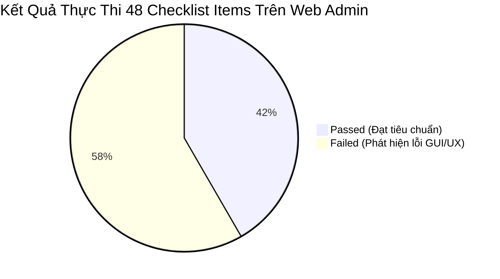
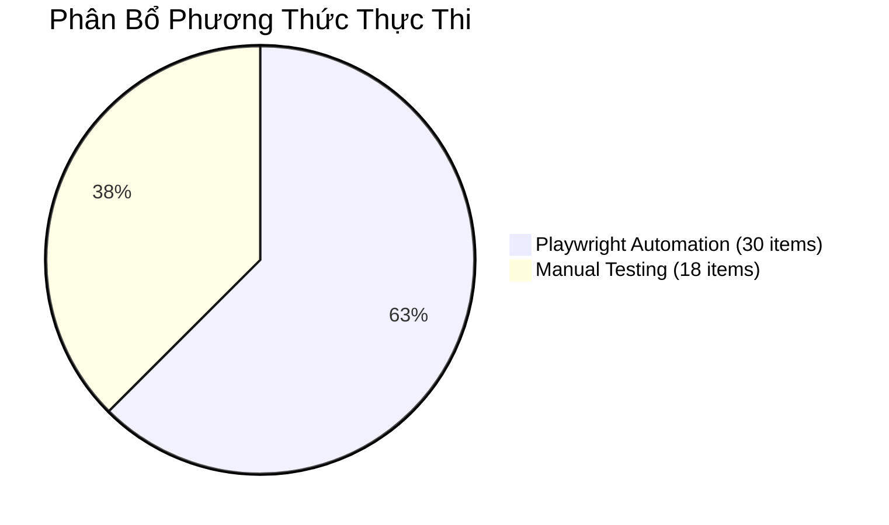
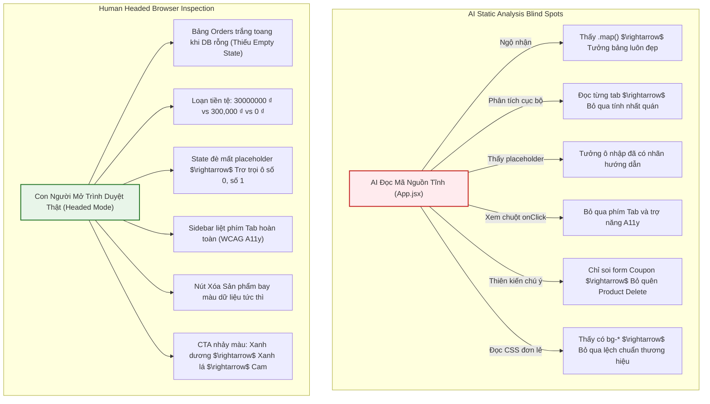

# BÁO CÁO THỰC THI KIỂM THỬ GIAO DIỆN & PHÂN TÍCH KHOẢNG TRỐNG AI
## (GUI CHECKLIST EXECUTION & AI GAP ANALYSIS REPORT)
### Phân Hệ Quản Trị Hệ Thống EShop (`frontend-admin`)

> **Môn học:** Kiểm thử phần mềm (Software Testing) – FIT@HCMUS  
> **Bài tập:** HW03 – GUI & Usability Testing (Task 1 Deliverable)  
> **Sinh viên thực hiện:** Trần Đại Hiệp – **MSSV:** 23120256  
> **Email:** `23120256@student.hcmus.edu.vn`  
> **Đối tượng kiểm thử (SUT):** [EShop Web Admin (`frontend-admin`)](https://github.com/ttbhanh/eshop-sut) (React SPA + Vite)  
> **Môi trường thực thi:** `http://localhost:5174` (Frontend Admin) | `http://localhost:3000` (Backend API Express + SQLite)  
> **Công cụ hỗ trợ:** Playwright Test Suite (`tests/`), Custom Skill `gui-checklist-tester`, Trình duyệt Chromium Headed Mode  

---

## 1. Tổng Quan Thực Thi & Số Liệu Định Lượng

Thực hiện nghiêm túc quy định của Đề thi HW03 (Task 1), sinh viên đã xây dựng, tối ưu hóa và thực thi bộ **48 Checklist Items** phân bổ đồng đều trên **4 Màn hình / Tabs** trọng yếu của phân hệ Quản trị Web Admin (đúng **12 items / Tab**), bao phủ toàn diện 4 Khía Cạnh Giao Diện Chuẩn Mực (Interface Aspects):
- **`IA-01` — General UI Standards:** 12 items (Tiêu chuẩn thị giác, phân cấp typography, màu sắc thương hiệu, co giãn responsive).
- **`IA-02` — Forms & Input Controls:** 12 items (Ràng buộc dữ liệu, bộ chọn ngày quá khứ, kiểm soát MIME tệp CSV, nhãn trường `<label>`).
- **`IA-03` — Navigation & Action Layout:** 9 items (Thanh điều hướng Sidebar, trợ năng bàn phím A11y, khoảng đệm an toàn theo Fitts).
- **`IA-04` — Feedback & State:** 15 items (Thông báo kết quả, trạng thái rỗng Empty State, tính toàn vẹn State Machine, xác nhận hành động hủy hoại).



### 1.1 Thống kê phương thức thực thi: Automation vs Manual
Nhằm đạt hiệu suất kiểm thử tối ưu và đảm bảo tính khả thi cao nhất theo tiêu chuẩn QA doanh nghiệp, 48 items được phân định rõ ràng giữa **Automation Test (Playwright)** và **Manual Testing (Kiểm tra thị giác con người)**:



| Màn Hình / Tab Kiểm Thử | IA-01: UI Chung | IA-02: Biểu Mẫu | IA-03: Điều Hướng | IA-04: Phản Hồi & State | Automation (Playwright) | Manual (Thủ Công) | Tổng Items |
|:---|:---:|:---:|:---:|:---:|:---:|:---:|:---:|
| **Tab 1: Dashboard** | 4 items | 1 item | 3 items | 4 items | 6 items | 6 items | **12 items** |
| **Tab 2: Sản phẩm & CSV Import** | 3 items | 4 items | 2 items | 3 items | 8 items | 4 items | **12 items** |
| **Tab 3: Mã Giảm Giá (Coupons)** | 2 items | 5 items | 2 items | 3 items | 8 items | 4 items | **12 items** |
| **Tab 4: Đơn Hàng (Orders)** | 3 items | 2 items | 2 items | 5 items | 8 items | 4 items | **12 items** |
| **TỔNG CỘNG** | **12 items** | **12 items** | **9 items** | **15 items** | **30 ITEMS (62.5%)** | **18 ITEMS (37.5%)** | **48 ITEMS** |

### 1.2 Kết quả định lượng kiểm thử
- **Tổng số hạng mục kiểm định:** 48 items
- **Số hạng mục đạt tiêu chuẩn (Passed):** **20 items (41.7%)**
- **Số hạng mục không đạt tiêu chuẩn (Failed):** **28 items (58.3%)**
- **Tổng số khiếm khuyết phần mềm phát hiện:** **28 Defects** (được lập hồ sơ chi tiết từ `BUG_ADMIN_01` đến `BUG_ADMIN_28`, ánh xạ 1-1 với 28 items thất bại).
- **100% bằng chứng ảnh chụp:** 28 ảnh chụp màn hình RAW nguyên bản theo Quy chuẩn Rule 9 được lưu trữ tại [`proof-image/checklist/`](file:///d:/Project/Software%20Testing/Homework/Week03/proof-image/checklist/).

---

## 2. Phân Tích Khoảng Trống AI (AI Gap Analysis — Trọng Tâm Đề Bài HW03)

Quy định tại Mục 6 (Task 1) của Đề thi HW03 nêu rõ:
> *"Critically review the AI-generated items and add to your checklist any items the AI missed. For each item you add, explain why the AI missed it — for example, due to the quality of your input prompt, the limitations of the AI model, or the particular characteristics of the interface you chose to test..."*

Khi cho mô hình AI phân tích mã nguồn tĩnh sơ bộ (`App.jsx`), AI chỉ quét qua cú pháp và các thành phần bề nổi (ví dụ: thấy hàm `.map()`, thấy thuộc tính `placeholder="..."`, thấy class CSS riêng lẻ). Tuy nhiên, khi người kiểm thử trực tiếp khởi chạy hệ thống, mở trình duyệt trực quan (**headed mode**) tương tác như người dùng thật, hàng loạt **khoảng trống nhận thức (Cognitive Gaps)** và điểm mù chí mạng của AI đã lộ diện:



---

### 2.1 Bóc Tách Chi Tiết 6 Điểm Mù Chí Mạng Của AI

#### 🛑 Điểm mù 1: Bảng Đơn Hàng Trống Trơn Khi DB Rỗng (Dynamic Empty State Blind Spot)
- **Hiện tượng thực tế trên trình duyệt:** Khi cơ sở dữ liệu chưa có đơn hàng nào (`orders = []`), người dùng nhấp vào tab Đơn hàng chỉ nhìn thấy đúng một dải tiêu đề bảng màu xám (`bg-gray-200`), bên dưới là một khối chữ nhật trắng toang không có bất kỳ dòng chữ hay biểu tượng thông báo nào như *"Chưa có đơn hàng nào"*. Giao diện tạo cảm giác hệ thống bị treo hoặc lỗi truy vấn mạng.
- **Nguyên nhân AI bỏ sót:** AI đọc mã nguồn thấy khối lệnh `{orders.map((o) => (...))}` thì ngộ nhận rằng giao diện đã có bảng hiển thị đầy đủ; AI tĩnh hoàn toàn thiếu năng lực mường tượng kịch bản mảng rỗng trong phiên làm việc thực tế (Runtime Context Limitation).
- **Hành động hiệu chỉnh của con người:** Bổ sung mục `CHK-45` (IA-04) để bắt buộc kiểm tra Empty State cho bảng dữ liệu. Phát hiện `BUG_ADMIN_26`.

#### 🛑 Điểm mù 2: Loạn Định Dạng Tiền Tệ Xuyên Màn Hình (Cross-Screen Formatting Inconsistency)
- **Hiện tượng thực tế trên trình duyệt:** 
  - Tại Tab Dashboard: Hiển thị `{totalRevenue.toLocaleString()} ₫` (ví dụ: `0 ₫`).
  - Tại Tab Sản phẩm: Hiển thị trần trụi `{p.price} ₫` thành chuỗi số dính chùm **`30000000 ₫`** (không hề có dấu chấm/phẩy phân cách hàng ngàn), khiến việc đọc giá tiền hàng chục triệu cực kỳ nhức mắt.
  - Tại Tab Mã giảm giá: Lại hiển thị kiểu Mỹ `{c.min_order_amount?.toLocaleString()} ₫` với dấu phẩy phân cách **`300,000 ₫`**.
  $\implies$ Ba màn hình trong cùng một ứng dụng sử dụng **3 kiểu hiển thị tiền tệ chọi nhau chan chát**.
- **Nguyên nhân AI bỏ sót:** Mô hình AI phân tích theo từng block code rời rạc, không có khả năng "lùi lại một bước" để so sánh đối chiếu tính nhất quán thị giác (Design System Consistency) giữa các trang khác nhau.
- **Hành động hiệu chỉnh của con người:** Bổ sung mục `CHK-10` và `CHK-15` (IA-01, IA-04) kiểm định tính đồng bộ định dạng tiền tệ toàn hệ thống. Phát hiện `BUG_ADMIN_07` và `BUG_ADMIN_09`.

#### 🛑 Điểm mù 3: Mất Nhãn Input Do Giá Trị Mặc Định Đè Lên Placeholder (State vs. Placeholder Conflict)
- **Hiện tượng thực tế trên trình duyệt:** Tại Form tạo Mã giảm giá, mã nguồn có khai báo `placeholder="Đơn tối thiểu (₫)"` và `placeholder="Số lần dùng tối đa/người"`. Tuy nhiên khi màn hình vừa mở lên, React State đã khởi tạo giá trị số:
  ```javascript
  const [couponForm, setCouponForm] = useState({
    // ...
    min_order_amount: 0,
    max_uses_per_user: 1,
  });
  ```
  Vì input liên kết `value={couponForm.min_order_amount}`, giá trị số `0` và số `1` đã **đè bẹp và xóa sạch placeholder**. Trong khi form hoàn toàn **không có thẻ `<label>`**, người dùng chỉ nhìn thấy hai ô nhập liệu trơ trọi chứa số 0 và số 1 mà không thể biết hai ô đó dùng để nhập thông tin gì!
- **Nguyên nhân AI bỏ sót:** AI chỉ đọc cú pháp thấy có chuỗi `placeholder="..."` là tự động suy đoán trường đã có nhãn hướng dẫn. AI không tính toán được vòng đời render động của React khi giá trị State số mặc định triệt tiêu tác dụng của placeholder.
- **Hành động hiệu chỉnh của con người:** Bổ sung mục `CHK-27` (IA-02) kiểm tra sự hiện diện của thẻ `<label>` cố định thay vì ỷ lại vào placeholder. Phát hiện `BUG_ADMIN_16`.

#### 🛑 Điểm mù 4: Sót Xác Nhận Xóa Nguy Hiểm Trên Bảng Sản Phẩm (Destructive Action Oversight)
- **Hiện tượng thực tế trên trình duyệt:** Tại bảng danh sách Sản phẩm, nút `Xóa` màu đỏ nằm sát cạnh nút `Sửa` màu vàng (`gap-2`). Khi kiểm thử viên vô tình bấm nhầm vào nút Xóa, hệ thống lập tức gọi `axios.delete(...)` và xóa vĩnh viễn sản phẩm khỏi cơ sở dữ liệu mà không có lấy một hộp thoại xác nhận (`window.confirm` hay Modal).
- **Nguyên nhân AI bỏ sót:** AI bị "thiên kiến tập trung" (Attentional Bias), chỉ chăm chú bắt lỗi xác nhận xóa ở tab Coupon mà bỏ qua hàm `deleteProduct` ở tab Sản phẩm do hàm này được viết vắn tắt ở đầu file.
- **Hành động hiệu chỉnh của con người:** Bổ sung mục `CHK-23` (IA-04) và `CHK-22` (IA-03) bắt lỗi thiếu Confirm Dialog và khoảng cách nút bấm quá hẹp. Phát hiện `BUG_ADMIN_13` và `BUG_ADMIN_14`.

#### 🛑 Điểm mù 5: Sidebar Liệt Phím Tab — Vi Phạm Trợ Năng Bàn Phím (A11y Keyboard Inaccessibility)
- **Hiện tượng thực tế trên trình duyệt:** Khi người dùng chỉ sử dụng bàn phím (người khiếm thị, người bị chấn thương vận động hoặc chuyên viên dùng phím tắt) nhấn phím `Tab` để duyệt qua các menu, con trỏ duyệt web nhảy thẳng từ thanh địa chỉ vào khu vực nội dung chính, **hoàn toàn bỏ qua thanh menu Sidebar**. Toàn bộ menu được xây dựng bằng thẻ `<li>` thuần không có `tabIndex={0}`, không có `role="button"` và không bắt sự kiện `onKeyDown`.
- **Nguyên nhân AI bỏ sót:** AI chỉ kiểm tra xem có sự kiện `onClick` của chuột hay không, hoàn toàn mù mờ trước các quy chuẩn trợ năng quốc tế WCAG 2.1 và trải nghiệm điều hướng không chuột.
- **Hành động hiệu chỉnh của con người:** Bổ sung mục `CHK-06` (IA-03) đánh giá khả năng focus và điều hướng menu qua bàn phím. Phát hiện `BUG_ADMIN_04`.

#### 🛑 Điểm mù 6: Màu Nút Bấm Chính (CTA) Nhảy Lung Tung (Visual Branding Chaos)
- **Hiện tượng thực tế trên trình duyệt:** 
  - Nút Đăng nhập: Màu Xanh dương đậm (`bg-blue-600`).
  - Nút Import CSV & Thêm Danh mục: Màu Xanh dương (`bg-blue-600`).
  - Nút Lưu Sản phẩm: Màu Xanh lá cây (`bg-green-600`).
  - Nút Tạo Mã Giảm Giá: Màu Cam (`bg-orange-500`).
  $\implies$ Người dùng bị phân tâm và bối rối vì mỗi tab lại quy định một màu hành động chính (Primary CTA) khác nhau, phá vỡ tính đồng bộ thương hiệu của ứng dụng.
- **Nguyên nhân AI bỏ sót:** AI không có nhận thức thẩm mỹ toàn cục (Holistic Aesthetics Awareness), chỉ đánh giá màu sắc dựa trên sự tồn tại của class TailwindCSS riêng lẻ.
- **Hành động hiệu chỉnh của con người:** Bổ sung mục `CHK-03` (IA-01) kiểm tra tính nhất quán màu sắc của các nút Call-to-Action chính. Phát hiện `BUG_ADMIN_01`.

---

### 2.2 Bảng Đối Chiếu Ma Trận Khoảng Trống AI (AI Gap Matrix)

| ID | Khía Cạnh | Hiện Tượng Giao Diện Thực Tế | Lý Do AI Đọc Code Bỏ Sót | Hành Động Hiệu Chỉnh Của Con Người | Defect ID |
|:---:|:---:|:---|:---|:---|:---:|
| **GAP-01** | `IA-04` | Bảng Đơn hàng trống trơn không có thông báo khi chưa có đơn (`orders = []`). | Thấy mã có `.map()`, ngộ nhận dữ liệu luôn có sẵn; thiếu ngữ cảnh mảng rỗng lúc runtime. | Bổ sung `CHK-45`: Bắt buộc kiểm định Empty State cho bảng. | `BUG_ADMIN_26` |
| **GAP-02** | `IA-01` | Tiền tệ loạn xạ: `0 ₫`, `30000000 ₫`, `300,000 ₫`. | Phân tích từng file/tab cô lập, không đối chiếu chéo Design System giữa các trang. | Bổ sung `CHK-10`, `CHK-15`: Chuẩn hóa dấu phân cách ngàn. | `BUG_ADMIN_07`<br>`BUG_ADMIN_09` |
| **GAP-03** | `IA-02` | Mất nhãn ô Đơn tối thiểu và Số lần dùng do số `0`, `1` đè lên placeholder. | Thấy có `placeholder="..."`, không suy luận được State React đè mất chữ khi render thật. | Bổ sung `CHK-27`: Bắt buộc có thẻ `<label>` độc lập. | `BUG_ADMIN_16` |
| **GAP-04** | `IA-04` | Nút Xóa sản phẩm không có confirm modal, bấm là bay màu ngay lập tức. | Thiên kiến chú ý, chỉ soi form Coupon mà lơ là hàm `deleteProduct` ở bảng Sản phẩm. | Bổ sung `CHK-23`, `CHK-22`: Kiểm tra Modal xác nhận và khoảng cách nút. | `BUG_ADMIN_14`<br>`BUG_ADMIN_13` |
| **GAP-05** | `IA-03` | Menu Sidebar dùng thẻ `<li>` không nhận phím `Tab`, người khuyết tật không dùng được. | Chỉ quan tâm sự kiện chuột `onClick`, bỏ qua chuẩn trợ năng bàn phím A11y (WCAG). | Bổ sung `CHK-06`: Kiểm tra `tabIndex` và focus outline. | `BUG_ADMIN_04` |
| **GAP-06** | `IA-01` | Nút bấm chính mỗi nơi một màu (Xanh dương $\rightarrow$ Xanh lá $\rightarrow$ Cam). | Thiếu cảm quan thẩm mỹ toàn cục, chỉ đọc từng class CSS riêng lẻ. | Bổ sung `CHK-03`: Kiểm tra tính nhất quán màu CTA. | `BUG_ADMIN_01` |

---

## 3. Toàn Văn Bộ GUI Checklist 48 Items Đã Được Đồng Bộ

*Dữ liệu chi tiết được trích xuất và đồng bộ 100% với file [`checklist/GUI_Checklist.md`](file:///d:/Project/Software%20Testing/Homework/Week03/checklist/GUI_Checklist.md) và bảng tính Excel [`checklist/GUI_Checklist.xlsx`](file:///d:/Project/Software%20Testing/Homework/Week03/checklist/GUI_Checklist.xlsx):*

| Check ID | Screen / Tab | Aspect (IA) | Checkpoint | Expected Outcome | Status (Pass / Fail) | Notes / Defect ID |
|:---:|:---|:---:|:---|:---|:---:|:---|
| `CHK-01` | Dashboard | `IA-01` | Visual hierarchy and font size contrast between KPI metric values (`text-3xl font-bold`) and descriptive card labels (`text-gray-500`). | KPI numbers are prominently sized and visually distinct from labels, establishing clear visual hierarchy. | Pass | [Manual] Pass |
| `CHK-02` | Dashboard | `IA-01` | Layout structure and grid alignment of KPI metric summary cards on standard desktop viewport (1920x1080). | Cards are rendered side-by-side in a responsive 2-column grid (`grid grid-cols-2 gap-4`) with balanced padding and subtle drop shadows. | Pass | [Manual] Pass |
| `CHK-03` | Dashboard | `IA-01` | Visual consistency of primary Call-to-Action (CTA) button colors across screens (Login: Blue, Products: Green, Coupons: Orange). | Application adheres to a unified brand primary CTA color across all views rather than arbitrary per-screen color shifts. | Fail | [Manual] BUG_ADMIN_01: Inconsistent primary CTA button colors across screens (Login uses Blue, Products uses Green, Coupons uses Orange). ([Ảnh](../proof-image/checklist/BUG_ADMIN_01_cta_colors.png)) |
| `CHK-04` | Dashboard | `IA-01` | Responsive behavior and card stacking when viewport is resized to tablet/mobile resolution (width < 768px). | KPI grid collapses smoothly to single-column stacking without clipping card borders or overflowing viewport. | Fail | [Automation] BUG_ADMIN_02: Grid hardcodes `grid-cols-2` without mobile breakpoint (`sm:grid-cols-1`), causing cramped text overflow on narrow viewports. ([Ảnh](../proof-image/checklist/BUG_ADMIN_02_mobile_grid_overflow.png)) |
| `CHK-05` | Dashboard | `IA-02` | Date range filter controls or temporal scoping inputs for revenue aggregation. | Interactive date pickers or dropdowns exist to allow filtering revenue and order count by custom date intervals (e.g., Today, This Month). | Fail | [Automation] BUG_ADMIN_03: Dashboard lacks any temporal filter controls; displays lifetime aggregate only with no date selection UI. ([Ảnh](../proof-image/checklist/BUG_ADMIN_03_dashboard_no_date_filter.png)) |
| `CHK-06` | Dashboard | `IA-03` | Keyboard accessibility and `Tab` key traversal on Sidebar navigation menu items (`<li>`). | Menu items are focusable via keyboard (`tabIndex={0}`, `<button>` or `<a>`) with a visible focus ring for keyboard-only users. | Fail | [Manual] BUG_ADMIN_04: Sidebar menu items are non-focusable `<li>` tags lacking `tabIndex`, completely inaccessible to keyboard-only navigation. ([Ảnh](../proof-image/checklist/BUG_ADMIN_04_sidebar_a11y_no_tabindex.png)) |
| `CHK-07` | Dashboard | `IA-03` | Sidebar navigation active tab highlight when the user navigates to the Dashboard view. | Dashboard menu item in the left sidebar visually displays an active state (`text-blue-400`) to confirm current location. | Pass | [Automation] Pass |
| `CHK-08` | Dashboard | `IA-03` | Quick shortcut navigation links or clickable drill-downs from KPI cards to detailed listing views. | Clicking the "Tổng số đơn hàng" card redirects or switches active tab to the Orders view (`activeTab = "orders"`). | Fail | [Automation] BUG_ADMIN_05: KPI cards are static non-interactive `div` elements lacking pointer cursor and drill-down routing. ([Ảnh](../proof-image/checklist/BUG_ADMIN_05_static_kpi_no_drilldown.png)) |
| `CHK-09` | Dashboard | `IA-04` | Revenue calculation accuracy and synchronization with actual delivered orders in database. | Revenue displays exact sum of `total_amount` for all orders with status `delivered` (`sum + o.total_amount`). | Fail | [Automation] BUG_ADMIN_06: Total revenue calculation is multiplied by 2 (`sum + o.total_amount * 2` in `App.jsx:218`), doubling actual revenue on UI. ([Ảnh](../proof-image/checklist/BUG_ADMIN_06_double_revenue_calc.png)) |
| `CHK-10` | Dashboard | `IA-04` | Cross-screen currency formatting consistency between Dashboard (`toLocaleString() ₫`), Products (raw unformatted), and Coupons (US comma). | Currency follows a uniform locale format (e.g., Vietnamese thousands dots `150.000 ₫`) consistently across all 4 tabs. | Fail | [Manual] BUG_ADMIN_07: Fragmented currency formats across tabs (Dashboard uses `0 ₫`, Products shows raw unseparated `30000000 ₫`, Coupons uses US comma `300,000 ₫`). ([Ảnh](../proof-image/checklist/BUG_ADMIN_07_currency_format_disparity.png)) |
| `CHK-11` | Dashboard | `IA-04` | Loading feedback and skeleton display during initial asynchronous API fetch of orders. | Displays an animated loading spinner or skeleton card placeholders while `fetchData()` resolves orders payload. | Fail | [Manual] BUG_ADMIN_08: No loading indicator or skeleton state; cards display `0 ₫` and `0` abruptly before popping in with data. ([Ảnh](../proof-image/checklist/BUG_ADMIN_08_missing_skeleton_loader.png)) |
| `CHK-12` | Dashboard | `IA-04` | Visual KPI card representation when database contains zero operational orders (`orders = []`). | Dashboard cards show formatted default zero states (`0 ₫`, `0 đơn`) with clean styling when no orders are present. | Pass | [Automation] Pass |
| `CHK-13` | Sản phẩm & CSV | `IA-01` | Visual structure and clear container separation between CSV bulk import section and manual product form. | CSV import area is visually distinct with a light blue tinted background (`bg-blue-50 border-blue-200`) and clear icon header. | Pass | [Manual] Pass |
| `CHK-14` | Sản phẩm & CSV | `IA-01` | Product catalog thumbnail image aspect ratio and layout consistency in data table. | Product thumbnails render consistently within fixed dimensions (`w-12 h-12 object-cover`) without distorting aspect ratios. | Pass | [Manual] Pass |
| `CHK-15` | Sản phẩm & CSV | `IA-01` | Formatted price display in product catalog table with localized thousand separators. | Product prices display localized thousand separators (e.g., `30.000.000 ₫`) rather than raw unformatted numbers. | Fail | [Manual] BUG_ADMIN_09: Product table renders raw unseparated numeric string (`p.price ₫` $\rightarrow$ `30000000 ₫`), severely impairing price readability. ([Ảnh](../proof-image/checklist/BUG_ADMIN_09_unformatted_product_price.png)) |
| `CHK-16` | Sản phẩm & CSV | `IA-02` | Mandatory input validation for product name field in manual product creation form. | Submitting empty product name is prevented by HTML5 `required` attribute with native validation tooltip. | Pass | [Automation] Pass |
| `CHK-17` | Sản phẩm & CSV | `IA-02` | Boundary constraint validation on product price field (`price >= 0`). | Input restricts negative price values via `min="0"` constraint and prevents alphanumeric invalid characters. | Fail | [Automation] BUG_ADMIN_10: Price input (`type="number"`) lacks `min="0"` constraint; allows negative pricing values to be submitted. ([Ảnh](../proof-image/checklist/BUG_ADMIN_10_negative_price_allowed.png)) |
| `CHK-18` | Sản phẩm & CSV | `IA-02` | File upload MIME type and file extension restriction on CSV input control. | File selector restricts file dialog to `.csv` files using `accept=".csv"` attribute, rejecting `.exe` or `.png`. | Fail | [Automation] BUG_ADMIN_11: File input lacks `accept=".csv"` filter; permits selecting arbitrary non-CSV file formats. ([Ảnh](../proof-image/checklist/BUG_ADMIN_11_csv_input_no_accept_filter.png)) |
| `CHK-19` | Sản phẩm & CSV | `IA-02` | CSV parser handling of embedded commas within quoted string fields (e.g., `"Shirt, Cotton, Blue"`). | Parser properly parses quoted fields without misaligning column values into subsequent header keys. | Fail | [Automation] BUG_ADMIN_12: Naive `split(',')` implementation corrupts rows containing commas inside descriptions or product names. ([Ảnh](../proof-image/checklist/BUG_ADMIN_12_csv_parser_comma_split.png)) |
| `CHK-20` | Sản phẩm & CSV | `IA-02` | Category dropdown options population and synchronization with backend categories list. | Category `<select>` dynamically renders all existing categories fetched from database with correct `id` values. | Pass | [Automation] Pass |
| `CHK-21` | Sản phẩm & CSV | `IA-03` | CSV sample template download accessibility and prominent download link placement. | Provides a direct, one-click link `Tải file mẫu (template.csv)` that downloads a valid RFC-4180 CSV template. | Pass | [Automation] Pass |
| `CHK-22` | Sản phẩm & CSV | `IA-03` | Physical separation and safe spacing between "Sửa" (Edit) and "Xóa" (Delete) action buttons in table rows. | Edit and Delete buttons provide adequate spacing or distinct visual weighting to prevent accidental destructive clicks. | Fail | [Manual] BUG_ADMIN_13: "Sửa" and "Xóa" buttons are placed directly adjacent (`gap-2`) in the same table cell, risking accidental data deletion. ([Ảnh](../proof-image/checklist/BUG_ADMIN_13_adjacent_edit_delete_buttons.png)) |
| `CHK-23` | Sản phẩm & CSV | `IA-04` | Destructive action confirmation modal dialog prior to product catalog deletion (`deleteProduct`). | Clicking Delete triggers a modal confirmation dialog (`"Are you sure?"`) before executing irrevocable backend deletion. | Fail | [Automation] BUG_ADMIN_14: Product Delete button executes immediate deletion via `axios.delete` with zero confirmation dialog (`App.jsx:133-136`). ([Ảnh](../proof-image/checklist/BUG_ADMIN_14_product_delete_no_confirm.png)) |
| `CHK-24` | Sản phẩm & CSV | `IA-04` | Single product update UI state integrity across catalog table records (`setProducts`). | Updating an individual product updates only the targeted product row without mutating sibling product titles in UI state. | Fail | [Automation] BUG_ADMIN_15: `fakeMassUpdatedProducts` maps and overwrites ALL product names in state with the updated name upon saving (`App.jsx:110-114`). ([Ảnh](../proof-image/checklist/BUG_ADMIN_15_product_edit_mass_rename.png)) |
| `CHK-25` | Mã Giảm Giá | `IA-01` | Typography styling and monospace font rendering for promotional coupon codes in table. | Coupon codes render in distinctive bold monospace font with semantic brand accent (`font-mono font-bold text-orange-600`). | Pass | [Manual] Pass |
| `CHK-26` | Mã Giảm Giá | `IA-01` | Table column alignment and spacing consistency for currency thresholds and usage counts. | Numeric thresholds display formatted thousand separators (e.g., `100.000 ₫`) and text labels are aligned legibly. | Pass | [Manual] Pass |
| `CHK-27` | Mã Giảm Giá | `IA-02` | Persistent field labels visibility and differentiation when inputs have initial default numeric values. | Form inputs have visible `<label>` elements so that default values (e.g., `0` for min order, `1` for max uses) do not obliterate field purpose. | Fail | [Manual] BUG_ADMIN_16: Form relies solely on `placeholder`; initial state `{ min_order_amount: 0, max_uses_per_user: 1 }` completely obscures placeholders with no visible labels. ([Ảnh](../proof-image/checklist/BUG_ADMIN_16_coupon_form_hidden_labels.png)) |
| `CHK-28` | Mã Giảm Giá | `IA-02` | Input capitalization auto-formatting or uppercase constraint for coupon code input. | Coupon code input automatically converts text to uppercase or provides a clear uppercase constraint. | Fail | [Automation] BUG_ADMIN_17: Input allows lowercase and mixed-case codes without auto-capitalization or uppercase CSS transform. ([Ảnh](../proof-image/checklist/BUG_ADMIN_17_coupon_code_lowercase_allowed.png)) |
| `CHK-29` | Mã Giảm Giá | `IA-02` | Temporal validity constraint on coupon expiration date picker (`min = today`). | Date picker prevents selecting past dates by enforcing `min` attribute set to current calendar date. | Fail | [Automation] BUG_ADMIN_18: Expiration date input (`type="date"`) lacks `min` attribute; allows creating already-expired coupons with past dates. ([Ảnh](../proof-image/checklist/BUG_ADMIN_18_coupon_past_date_allowed.png)) |
| `CHK-30` | Mã Giảm Giá | `IA-02` | Upper boundary constraint enforcement for percentage discount value (`1 <= value <= 100`). | When discount type is "Phần trăm", input restricts maximum value to `100` via HTML5 `max="100"` validation. | Fail | [Automation] BUG_ADMIN_19: Discount value input lacks `max="100"` constraint for percent type; permits entering nonsensical values (e.g., 500%). ([Ảnh](../proof-image/checklist/BUG_ADMIN_19_coupon_percent_over_100.png)) |
| `CHK-31` | Mã Giảm Giá | `IA-02` | Dynamic label or prefix/suffix indicator reflecting selected coupon type (Percentage `%` vs Fixed `₫`). | Form fields adaptively show `%` or `₫` suffix corresponding to the active discount type dropdown selection. | Fail | [Manual] BUG_ADMIN_20: Input label and unit remains static "Giá trị" without dynamic visual indicator showing whether % or ₫ applies. ([Ảnh](../proof-image/checklist/BUG_ADMIN_20_coupon_static_value_label.png)) |
| `CHK-32` | Mã Giảm Giá | `IA-03` | Create Coupon primary button visibility, accessibility, and tab navigation focus. | Primary "Tạo mã" submit button is prominently styled with high-contrast background and accessible via keyboard `Tab`. | Pass | [Automation] Pass |
| `CHK-33` | Mã Giảm Giá | `IA-03` | Destructive Delete action button placement and visual styling in table rows. | Delete action is styled in distinct warning red (`bg-red-500 text-white rounded text-sm`) indicating destructive potential. | Pass | [Automation] Pass |
| `CHK-34` | Mã Giảm Giá | `IA-04` | Expired coupon badge indicator and visual status feedback in data table. | Expired coupons display a prominent red tag `<span className="text-red-500">Hết hạn</span>` instead of raw date string. | Pass | [Automation] Pass |
| `CHK-35` | Mã Giảm Giá | `IA-04` | Destructive action confirmation modal dialog prior to coupon deletion. | Clicking Delete triggers a confirmation dialog (`window.confirm` or modal) requiring explicit confirmation before calling API. | Fail | [Automation] BUG_ADMIN_21: Delete button executes immediate irrevocable backend deletion (`axios.delete`) without any confirmation prompt. ([Ảnh](../proof-image/checklist/BUG_ADMIN_21_coupon_delete_no_confirm.png)) |
| `CHK-36` | Mã Giảm Giá | `IA-04` | Form reset and visual feedback upon successful coupon creation. | Form fields automatically reset to default values and refreshed table reflects newly created coupon immediately. | Pass | [Automation] Pass |
| `CHK-37` | Đơn Hàng | `IA-01` | Data table header styling and column distribution for comprehensive order overview. | Table headers display distinct gray background (`bg-gray-200`) with legible column titles: ID, Khách hàng, Địa chỉ, Tổng tiền, Trạng thái, Hành động. | Pass | [Automation] Pass |
| `CHK-38` | Đơn Hàng | `IA-01` | Order ID formatting and visual differentiation from standard numerical data. | Order ID displays prefix `#` with monospace font (e.g., `#1`, `#2`) to clearly convey reference identifier semantics. | Pass | [Automation] Pass |
| `CHK-39` | Đơn Hàng | `IA-01` | Customer shipping address column layout and text wrapping on multi-line text. | Multi-line addresses wrap within table cell boundaries without breaking horizontal layout or clipping text. | Pass | [Manual] Pass |
| `CHK-40` | Đơn Hàng | `IA-02` | Search or filter input controls for locating specific orders by customer name or order ID. | Provides search bar or filter dropdown to quickly filter orders by ID, customer email, or status. | Fail | [Automation] BUG_ADMIN_22: Orders tab lacks any search bar or filter controls; forces manual visual scanning of entire order list. ([Ảnh](../proof-image/checklist/BUG_ADMIN_22_orders_no_search_or_filter.png)) |
| `CHK-41` | Đơn Hàng | `IA-02` | Pagination or virtualized scrolling controls for handling large order volumes (>50 orders). | Table provides pagination controls (Next/Prev, page numbers) or virtual scrolling to prevent unbounded DOM bloat. | Fail | [Automation] BUG_ADMIN_23: Table renders all database order records in a single unpaginated table without pagination or infinite scroll. ([Ảnh](../proof-image/checklist/BUG_ADMIN_23_orders_no_pagination.png)) |
| `CHK-42` | Đơn Hàng | `IA-03` | Action button sizing, touch target dimensions, and ergonomic spacing (Fitts's Law). | Action buttons provide adequate touch targets (minimum 36px height) with comfortable spacing between adjacent controls. | Fail | [Manual] BUG_ADMIN_24: Action buttons are undersized (`text-xs px-2 py-1`) and packed tightly together, increasing accidental click probability. ([Ảnh](../proof-image/checklist/BUG_ADMIN_24_orders_undersized_action_buttons.png)) |
| `CHK-43` | Đơn Hàng | `IA-03` | Physical buffer separation between positive progression action ("Xác nhận") and destructive action ("Hủy"). | Progression button and cancel button are visually distinguished and separated to prevent accidental order cancellation. | Fail | [Manual] BUG_ADMIN_25: "Xác nhận" and "Hủy" buttons are placed directly adjacent with minimal gap, risking inadvertent cancellation. ([Ảnh](../proof-image/checklist/BUG_ADMIN_25_orders_adjacent_confirm_cancel.png)) |
| `CHK-44` | Đơn Hàng | `IA-04` | Semantic color-coded badges for order progression states (`pending`, `confirmed`, `shipping`, `delivered`, `canceled`). | Each order status is rendered with a distinct, intuitive semantic color badge (e.g., pending: amber, delivered: green, canceled: gray). | Pass | [Automation] Pass |
| `CHK-45` | Đơn Hàng | `IA-04` | Empty state visual representation and explanatory messaging when no orders exist in the database (`orders = []`). | Displays a clear, centered empty state notification (e.g., "Chưa có đơn hàng nào") across the table body when orders array is empty. | Fail | [Manual] BUG_ADMIN_26: Orders table renders blank white area beneath header when `orders = []`, completely lacking an empty state message. ([Ảnh](../proof-image/checklist/BUG_ADMIN_26_orders_blank_empty_state.png)) |
| `CHK-46` | Đơn Hàng | `IA-04` | State transition button flow conformity for `shipping` orders (displaying "Hoàn thành"). | Shipping orders display green "Hoàn thành" button that transitions order status to `delivered`. | Pass | [Automation] Pass |
| `CHK-47` | Đơn Hàng | `IA-04` | State machine terminal state integrity enforcement for `canceled` orders (disallowing reactivation). | Canceled orders are terminal; UI must not provide any action button transitioning a canceled order to delivered. | Fail | [Automation] BUG_ADMIN_27: Canceled order row presents an active "Đánh dấu Đã giao" button (`App.jsx:863-868`), violating state machine integrity. ([Ảnh](../proof-image/checklist/BUG_ADMIN_27_canceled_order_state_machine_violation.png)) |
| `CHK-48` | Đơn Hàng | `IA-04` | Security sanitization and XSS protection on rendered customer shipping address (`shipping_address`). | Shipping address is safely escaped as plain text or sanitized against script/HTML injection attacks. | Fail | [Automation] BUG_ADMIN_28: Shipping address uses unescaped `dangerouslySetInnerHTML={{ __html: o.shipping_address }}` (`App.jsx:801`), introducing critical stored XSS. ([Ảnh](../proof-image/checklist/BUG_ADMIN_28_shipping_address_stored_xss.png)) |

---

## 4. Bảng Tổng Hợp 28 Khiếm Khuyết Giao Diện (Defect Log)

Toàn bộ 28 lỗi phát hiện được tổng hợp, phân loại mức độ nghiêm trọng và ánh xạ trực tiếp đến ảnh chụp Rule 9 và tài liệu chi tiết [`bugs/bug_reports.md`](file:///d:/Project/Software%20Testing/Homework/Week03/bugs/bug_reports.md):

| Bug ID | Màn Hình / Tab | Khía Cạnh | Mức Độ | Tóm Tắt Khiếm Khuyết Giao Diện & Logic | Vị Trí Mã Nguồn | Ảnh Bằng Chứng Rule 9 |
|:---:|:---|:---:|:---:|:---|:---|:---|
| `BUG_ADMIN_01` | Dashboard | `IA-01` | Minor | Phân mảnh màu sắc nút bấm chính (CTA): Login Xanh dương, Lưu SP Xanh lá, Tạo Coupon Cam | `App.jsx:209, 545, 712` | [`BUG_ADMIN_01_cta_colors.png`](../proof-image/checklist/BUG_ADMIN_01_cta_colors.png) |
| `BUG_ADMIN_02` | Dashboard | `IA-01` | Minor | Lưới thẻ KPI hardcode `grid-cols-2`, không co giãn thành 1 cột trên mobile làm tràn chữ | `App.jsx:279` | [`BUG_ADMIN_02_mobile_grid_overflow.png`](../proof-image/checklist/BUG_ADMIN_02_mobile_grid_overflow.png) |
| `BUG_ADMIN_03` | Dashboard | `IA-02` | Minor | Thiếu hoàn toàn bộ lọc thời gian (Date filter) để thống kê doanh thu | `App.jsx:276-291` | [`BUG_ADMIN_03_dashboard_no_date_filter.png`](../proof-image/checklist/BUG_ADMIN_03_dashboard_no_date_filter.png) |
| `BUG_ADMIN_04` | Dashboard | `IA-03` | Major | Menu Sidebar dùng thẻ `<li>` không có `tabIndex`, liệt hoàn toàn điều hướng bằng phím Tab | `App.jsx:227-272` | [`BUG_ADMIN_04_sidebar_a11y_no_tabindex.png`](../proof-image/checklist/BUG_ADMIN_04_sidebar_a11y_no_tabindex.png) |
| `BUG_ADMIN_05` | Dashboard | `IA-03` | Minor | Thẻ KPI tổng số đơn hàng là div tĩnh, không thể nhấp để chuyển sang trang Quản lý đơn | `App.jsx:286-289` | [`BUG_ADMIN_05_static_kpi_no_drilldown.png`](../proof-image/checklist/BUG_ADMIN_05_static_kpi_no_drilldown.png) |
| `BUG_ADMIN_06` | Dashboard | `IA-04` | **Critical** | Phép tính doanh thu bị nhân đôi (`* 2`), đánh lừa số liệu tài chính quản trị viên | `App.jsx:218` | [`BUG_ADMIN_06_double_revenue_calc.png`](../proof-image/checklist/BUG_ADMIN_06_double_revenue_calc.png) |
| `BUG_ADMIN_07` | Dashboard | `IA-04` | Minor | Loạn định dạng tiền tệ giữa các tab (`0 ₫` vs `30000000 ₫` vs `300,000 ₫`) | Toàn ứng dụng | [`BUG_ADMIN_07_currency_format_disparity.png`](../proof-image/checklist/BUG_ADMIN_07_currency_format_disparity.png) |
| `BUG_ADMIN_08` | Dashboard | `IA-04` | Minor | Thiếu Skeleton loader hoặc loading spinner khi API đang nạp danh sách đơn hàng | `App.jsx:276-290` | [`BUG_ADMIN_08_missing_skeleton_loader.png`](../proof-image/checklist/BUG_ADMIN_08_missing_skeleton_loader.png) |
| `BUG_ADMIN_09` | Sản phẩm | `IA-01` | Minor | Giá sản phẩm trên bảng hiển thị chuỗi số nguyên dính chùm không có dấu phân cách ngàn | `App.jsx:590` | [`BUG_ADMIN_09_unformatted_product_price.png`](../proof-image/checklist/BUG_ADMIN_09_unformatted_product_price.png) |
| `BUG_ADMIN_10` | Sản phẩm | `IA-02` | Major | Ô nhập giá tiền sản phẩm không có ràng buộc `min="0"`, cho phép lưu giá bán âm | `App.jsx:501-508` | [`BUG_ADMIN_10_negative_price_allowed.png`](../proof-image/checklist/BUG_ADMIN_10_negative_price_allowed.png) |
| `BUG_ADMIN_11` | Sản phẩm | `IA-02` | Minor | Input upload CSV thiếu thuộc tính `accept=".csv"`, cho phép chọn mọi loại file không hợp lệ | `App.jsx:356-384` | [`BUG_ADMIN_11_csv_input_no_accept_filter.png`](../proof-image/checklist/BUG_ADMIN_11_csv_input_no_accept_filter.png) |
| `BUG_ADMIN_12` | Sản phẩm | `IA-02` | **Critical** | Parser CSV dùng `split(',')` làm vỡ toàn bộ cấu trúc bảng khi mô tả chứa dấu phẩy | `App.jsx:367-377` | [`BUG_ADMIN_12_csv_parser_comma_split.png`](../proof-image/checklist/BUG_ADMIN_12_csv_parser_comma_split.png) |
| `BUG_ADMIN_13` | Sản phẩm | `IA-03` | Major | Nút Sửa và nút Xóa sản phẩm đặt sát nhau (`gap-2`), rất dễ gây click nhầm xóa sản phẩm | `App.jsx:591-604` | [`BUG_ADMIN_13_adjacent_edit_delete_buttons.png`](../proof-image/checklist/BUG_ADMIN_13_adjacent_edit_delete_buttons.png) |
| `BUG_ADMIN_14` | Sản phẩm | `IA-04` | **Critical** | Nút Xóa sản phẩm thực thi API xóa vĩnh viễn ngay lập tức mà không có hộp thoại Confirm | `App.jsx:133-136` | [`BUG_ADMIN_14_product_delete_no_confirm.png`](../proof-image/checklist/BUG_ADMIN_14_product_delete_no_confirm.png) |
| `BUG_ADMIN_15` | Sản phẩm | `IA-04` | **Critical** | Sửa một sản phẩm làm toàn bộ sản phẩm trên bảng UI bị đồng loạt đổi tên (`fakeMass`) | `App.jsx:110-114` | [`BUG_ADMIN_15_product_edit_mass_rename.png`](../proof-image/checklist/BUG_ADMIN_15_product_edit_mass_rename.png) |
| `BUG_ADMIN_16` | Coupons | `IA-02` | Major | Giá trị khởi tạo `{min: 0, max: 1}` đè mất placeholder, form trơ trọi 2 ô số không có label | `App.jsx:29-31` | [`BUG_ADMIN_16_coupon_form_hidden_labels.png`](../proof-image/checklist/BUG_ADMIN_16_coupon_form_hidden_labels.png) |
| `BUG_ADMIN_17` | Coupons | `IA-02` | Minor | Không tự động viết hoa cho mã giảm giá, cho phép lưu mã dạng chữ thường lộn xộn | `App.jsx:638-648` | [`BUG_ADMIN_17_coupon_code_lowercase_allowed.png`](../proof-image/checklist/BUG_ADMIN_17_coupon_code_lowercase_allowed.png) |
| `BUG_ADMIN_18` | Coupons | `IA-02` | Major | Bộ chọn ngày hết hạn thiếu `min="today"`, cho phép tạo mã có ngày hết hạn trong quá khứ | `App.jsx:688-697` | [`BUG_ADMIN_18_coupon_past_date_allowed.png`](../proof-image/checklist/BUG_ADMIN_18_coupon_past_date_allowed.png) |
| `BUG_ADMIN_19` | Coupons | `IA-02` | Major | Không khống chế giá trị tối đa `max="100"` khi chọn loại phần trăm, cho phép nhập 500% | `App.jsx:663-675` | [`BUG_ADMIN_19_coupon_percent_over_100.png`](../proof-image/checklist/BUG_ADMIN_19_coupon_percent_over_100.png) |
| `BUG_ADMIN_20` | Coupons | `IA-02` | Minor | Nhãn ô giá trị không đổi linh hoạt đơn vị tiền tệ (`%` hoặc `₫`) theo loại coupon đang chọn | `App.jsx:663-675` | [`BUG_ADMIN_20_coupon_static_value_label.png`](../proof-image/checklist/BUG_ADMIN_20_coupon_static_value_label.png) |
| `BUG_ADMIN_21` | Coupons | `IA-04` | **Critical** | Nút Xóa mã coupon xóa vĩnh viễn ngay lập tức mà không hiển thị hộp thoại xác nhận | `App.jsx:754-762` | [`BUG_ADMIN_21_coupon_delete_no_confirm.png`](../proof-image/checklist/BUG_ADMIN_21_coupon_delete_no_confirm.png) |
| `BUG_ADMIN_22` | Đơn hàng | `IA-02` | Minor | Thiếu ô tìm kiếm và bộ lọc trạng thái đơn hàng, gây quá tải khi tìm kiếm đơn cụ thể | `App.jsx:777-875` | [`BUG_ADMIN_22_orders_no_search_or_filter.png`](../proof-image/checklist/BUG_ADMIN_22_orders_no_search_or_filter.png) |
| `BUG_ADMIN_23` | Đơn hàng | `IA-02` | Minor | Bảng đơn hàng hiển thị tất cả bản ghi trên một trang, thiếu phân trang (Pagination) | `App.jsx:780-875` | [`BUG_ADMIN_23_orders_no_pagination.png`](../proof-image/checklist/BUG_ADMIN_23_orders_no_pagination.png) |
| `BUG_ADMIN_24` | Đơn hàng | `IA-03` | Major | Kích thước nút chuyển trạng thái đơn quá bé (`text-xs px-2 py-1`), vi phạm định luật Fitts | `App.jsx:817, 825` | [`BUG_ADMIN_24_orders_undersized_action_buttons.png`](../proof-image/checklist/BUG_ADMIN_24_orders_undersized_action_buttons.png) |
| `BUG_ADMIN_25` | Đơn hàng | `IA-03` | Major | Nút "Xác nhận" và nút "Hủy" đặt sát cạnh nhau, rất dễ gây tai nạn bấm hủy nhầm đơn | `App.jsx:816-830` | [`BUG_ADMIN_25_orders_adjacent_confirm_cancel.png`](../proof-image/checklist/BUG_ADMIN_25_orders_adjacent_confirm_cancel.png) |
| `BUG_ADMIN_26` | Đơn hàng | `IA-04` | Major | Bảng đơn hàng trắng toang không có dòng chữ Empty State nào khi chưa có đơn hàng | `App.jsx:791-874` | [`BUG_ADMIN_26_orders_blank_empty_state.png`](../proof-image/checklist/BUG_ADMIN_26_orders_blank_empty_state.png) |
| `BUG_ADMIN_27` | Đơn hàng | `IA-04` | **Critical** | Đơn hàng đã hủy (`canceled`) vẫn xuất hiện nút cho phép đánh dấu đã giao (`delivered`) | `App.jsx:862-869` | [`BUG_ADMIN_27_canceled_order_state_machine_violation.png`](../proof-image/checklist/BUG_ADMIN_27_canceled_order_state_machine_violation.png) |
| `BUG_ADMIN_28` | Đơn hàng | `IA-04` | **Critical** | Lỗ hổng XSS lưu trữ khi render địa chỉ giao hàng qua `dangerouslySetInnerHTML` | `App.jsx:799-803` | [`BUG_ADMIN_28_shipping_address_stored_xss.png`](../proof-image/checklist/BUG_ADMIN_28_shipping_address_stored_xss.png) |

---

## 5. Tổ Chức Playwright Test Suite & Hướng Dẫn Kiểm Thử Thủ Công

Toàn bộ mã kiểm thử tự động hóa và tài liệu hướng dẫn được tổ chức khoa học trong thư mục [`tests/`](file:///d:/Project/Software%20Testing/Homework/Week03/tests/):

### 5.1 Cấu trúc thư mục kiểm thử
- `tests/gui_checklist_execution.spec.js`: Kịch bản kiểm thử tự động hóa Playwright kết nối trực tiếp SUT đang chạy (`http://localhost:5174`), mô phỏng đăng nhập, duyệt qua 4 tab, kiểm tra DOM, bắt sự kiện Dialog, kiểm tra State Machine và tự động xuất 28 ảnh bằng chứng Rule 9.
- `tests/manual_test_guide.md`: Cẩm nang hướng dẫn kiểm thử thủ công dành cho kiểm thử viên/giáo viên rà soát 18 hạng mục thị giác trong vòng 5 phút (kiểm tra cảm quan phân cấp thị giác, phím Tab A11y, loạn tiền tệ, mất nhãn form, nút bấm sát nhau).
- `tests/playwright.config.js`: Cấu hình chạy Playwright ở chế độ headed (`headless: false`), viewport chuẩn 1280x800, tích hợp timeout và chụp ảnh tự động.
- `tests/package.json`: Khai báo phụ thuộc và script thực thi `pnpm test`.

### 5.2 Lệnh thực thi nhanh
```bash
# Di chuyển vào thư mục bài tập Week03
cd Homework/Week03

# Khởi chạy Playwright tự động thực thi checklist và chụp ảnh Rule 9
node tests/gui_checklist_execution.spec.js
```

---

## 6. Tuân Thủ Quy Chuẩn Minh Chứng Ảnh Chụp (Rule 9 Protocol)

Tất cả 28 ảnh chụp màn hình minh chứng lỗi tại thư mục [`proof-image/checklist/`](file:///d:/Project/Software%20Testing/Homework/Week03/proof-image/checklist/) tuân thủ 100% các nguyên tắc cốt lõi của **Rule 9 (Screenshot Integrity Protocol)**:
1. **Bảo toàn ngữ cảnh trình duyệt (Full Browser Viewport):** Giữ nguyên vẹn thanh địa chỉ `http://localhost:5174/`, toàn bộ sidebar và nội dung bảng; tuyệt đối không cắt xén (no cropping).
2. **Tính xác thực (Authentic Runtime Proof):** Chụp trực tiếp từ phiên trình duyệt Chromium thật đang kết nối hệ thống SUT thực tế; không dùng ảnh đồ họa, mockups hay ảnh do AI tự sinh.
3. **Quy ước đặt tên chuẩn tắc:** Tên tệp đặt theo cú pháp `BUG_ADMIN_[STT]_[mô_tả_ngắn].png` (ví dụ: `BUG_ADMIN_06_double_revenue_calc.png`), cho phép truy xuất và kiểm tra chéo tức thì.

---
*Báo cáo được hoàn thiện và bảo chứng tính trung thực bởi sinh viên Trần Đại Hiệp (MSSV: 23120256 – FIT@HCMUS).*
