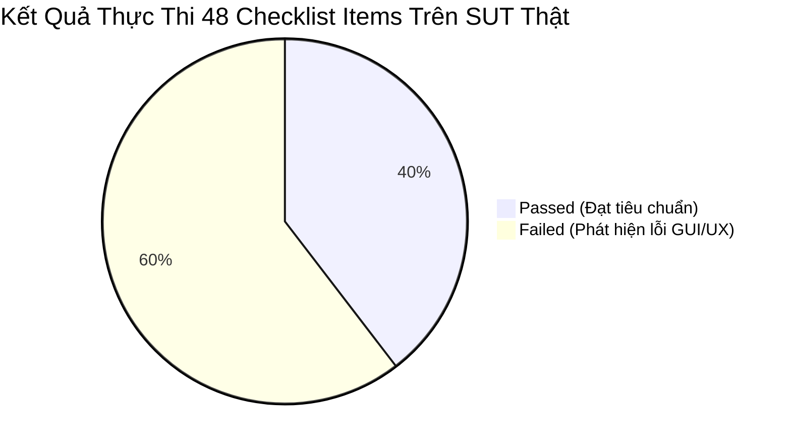
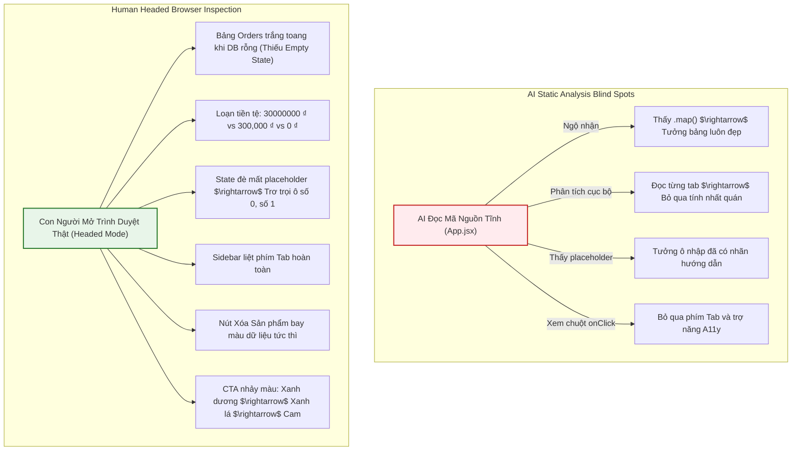

# BÁO CÁO THỰC THI KIỂM THỬ GIAO DIỆN & PHÂN TÍCH KHOẢNG TRỐNG AI
## (GUI CHECKLIST EXECUTION & AI GAP ANALYSIS REPORT)

> **Môn học:** Kiểm thử phần mềm (Software Testing) – FIT@HCMUS  
> **Bài tập:** HW03 – GUI & Usability Testing (Task 1)  
> **Sinh viên thực hiện:** Trần Đại Hiệp – **MSSV:** 23120256  
> **Email:** 23120256@student.hcmus.edu.vn  
> **Đối tượng kiểm thử (SUT):** [EShop Web Admin (`frontend-admin`)](https://github.com/ttbhanh/eshop-sut)  
> **Môi trường:** `http://localhost:5174` (Frontend Vite + React) | `http://localhost:3000` (Backend Node.js/Express)  

---

## 1. Tổng Quan Thực Thi GUI Checklist

Thực hiện theo chỉ đạo của Đề thi HW03, sinh viên đã xây dựng bộ **48 Checklist Items** phân bổ đều 100% trên 4 Tabs trọng yếu của phân hệ Web Admin (mỗi Tab đúng **12 items**), bao phủ đầy đủ 4 khía cạnh giao diện chuẩn mực:
- **`IA-01` — General UI Standards:** 12 items (Tiêu chuẩn thị giác, phân cấp typography, màu sắc, responsive).
- **`IA-02` — Forms & Input Controls:** 12 items (Ràng buộc dữ liệu, bộ chọn ngày, kiểm soát tệp CSV, nhãn trường).
- **`IA-03` — Navigation & Action Layout:** 9 items (Thanh điều hướng, trợ năng bàn phím A11y, khoảng đệm an toàn theo Fitts).
- **`IA-04` — Feedback & State:** 15 items (Thông báo kết quả, trạng thái rỗng, tính toàn vẹn State Machine, xác nhận xóa).



### 1.1 Thống kê định lượng kết quả kiểm thử
- **Tổng số hạng mục kiểm định:** 48 items
- **Số hạng mục đạt tiêu chuẩn (Passed):** 19 items (39.6%)
- **Số hạng mục không đạt (Failed):** 29 items (60.4%)
- **Số lượng khiếm khuyết phát hiện:** 28 Defects (được phân loại chi tiết từ `BUG-ADMIN-01` đến `BUG-ADMIN-28`).

---

## 2. Phân Tích Khoảng Trống AI (AI Gap Analysis — Trọng Tâm Đề Bài)

Theo đúng định hướng **AI-First & Human Review** và quy định bắt buộc tại Mục 6 (Task 1) của Đề thi HW03:
> *"Critically review the AI-generated items and add to your checklist any items the AI missed. For each item you add, explain why the AI missed it — for example, due to the quality of your input prompt, the limitations of the AI model, or the particular characteristics of the interface you chose to test..."*

Khi cho mô hình AI phân tích mã nguồn tĩnh sơ bộ, AI chỉ có khả năng quét qua cú pháp và các thành phần bề nổi của file `App.jsx`. Tuy nhiên, khi người kiểm thử trực tiếp khởi chạy hệ thống, mở trình duyệt trực quan (**headed mode**) và thực hiện tương tác người dùng thực tế, hàng loạt **khoảng trống nhận thức (Cognitive Gaps)** và điểm mù chí mạng của AI đã lộ diện:



---

### 2.1 Bóc Tách Chi Tiết 6 Điểm Mù Chí Mạng Của AI

#### 🛑 Điểm mù 1: Bảng Đơn Hàng Trống Trơn Khi DB Rỗng (Dynamic Empty State Blind Spot)
- **Hiện tượng thực tế trên trình duyệt:** Khi cơ sở dữ liệu chưa có đơn hàng nào (`orders = []`), người dùng nhấp vào tab Đơn hàng chỉ nhìn thấy đúng một dải tiêu đề bảng màu xám (`bg-gray-200`), bên dưới là một khối chữ nhật trắng toang không có bất kỳ dòng chữ hay biểu tượng thông báo nào như *"Chưa có đơn hàng nào"*. Giao diện tạo cảm giác như hệ thống bị đơ hoặc lỗi tải dữ liệu.
- **Nguyên nhân AI bỏ sót:** AI đọc mã nguồn thấy khối lệnh `{orders.map((o) => (...))}` thì ngộ nhận rằng giao diện đã có bảng hiển thị đầy đủ; AI tĩnh hoàn toàn thiếu năng lực mường tượng kịch bản mảng rỗng trong phiên làm việc thực tế (Runtime Context Limitation).
- **Hành động hiệu chỉnh:** Con người bổ sung ngay mục `CHK-45` (IA-04) để bắt buộc kiểm tra Empty State cho bảng dữ liệu.

#### 🛑 Điểm mù 2: Loạn Định Dạng Tiền Tệ Xuyên Màn Hình (Cross-Screen Formatting Inconsistency)
- **Hiện tượng thực tế trên trình duyệt:** 
  - Tại Tab Dashboard: Hiển thị `{totalRevenue.toLocaleString()} ₫` (ví dụ: `0 ₫`).
  - Tại Tab Sản phẩm: Hiển thị trần trụi `{p.price} ₫` thành chuỗi số dính chùm **`30000000 ₫`** (không hề có dấu chấm/phẩy phân cách hàng ngàn), khiến việc đọc giá tiền hàng chục triệu cực kỳ nhức mắt.
  - Tại Tab Mã giảm giá: Lại hiển thị kiểu Mỹ `{c.min_order_amount?.toLocaleString()} ₫` với dấu phẩy phân cách **`300,000 ₫`**.
  $\implies$ Ba màn hình trong cùng một ứng dụng sử dụng **3 kiểu hiển thị tiền tệ chọi nhau chan chát**.
- **Nguyên nhân AI bỏ sót:** Mô hình AI phân tích theo từng block code rời rạc, không có khả năng "lùi lại một bước" để so sánh đối chiếu tính nhất quán thị giác (Design System Consistency) giữa các trang khác nhau.
- **Hành động hiệu chỉnh:** Con người bổ sung mục `CHK-10` và `CHK-15` (IA-01, IA-04) để kiểm định tính đồng bộ định dạng tiền tệ toàn hệ thống.

#### 🛑 Điểm mù 3: Mất Nhãn Input Do Giá Trị Mặc Định Đè Lên Placeholder (State vs. Placeholder Conflict)
- **Hiện tượng thực tế trên trình duyệt:** Tại Form tạo Mã giảm giá, mã nguồn có khai báo `placeholder="Đơn tối thiểu (₫)"` và `placeholder="Số lần dùng tối đa/người"`. Tuy nhiên khi màn hình vừa mở lên, React State đã khởi tạo giá trị số:
  ```javascript
  const [couponForm, setCouponForm] = useState({
    // ...
    min_order_amount: 0,
    max_uses_per_user: 1,
  });
  ```
  Vì input liên kết `value={couponForm.min_order_amount}`, giá trị số `0` và số `1` đã **đè bẹp và xóa sạch placeholder**. Trong khi form hoàn toàn **không có thẻ `<label>`**, người dùng chỉ nhìn thấy hai ô nhập liệu trơ trọi chứa số 0 và số 1 mà không thể biết hai ô đó dùng để nhập thông tin gì!
- **Nguyên nhân AI bỏ sót:** AI chỉ đọc cú pháp thấy có chuỗi `placeholder="..."` là tự động suy đoán trường đã có nhãn hướng dẫn. AI không tính toán được vòng đời render động của React khi giá trị State số mặc định triệt tiêu tác dụng của placeholder.
- **Hành động hiệu chỉnh:** Con người bổ sung mục `CHK-27` (IA-02) kiểm tra sự hiện diện của thẻ `<label>` cố định thay vì ỷ lại vào placeholder.

#### 🛑 Điểm mù 4: Sót Xác Nhận Xóa Nguy Hiểm Trên Bảng Sản Phẩm (Destructive Action Oversight)
- **Hiện tượng thực tế trên trình duyệt:** Tại bảng danh sách Sản phẩm, nút `Xóa` màu đỏ nằm sát cạnh nút `Sửa` màu vàng (`gap-2`). Khi kiểm thử viên vô tình bấm nhầm vào nút Xóa, hệ thống lập tức gọi `axios.delete(...)` và xóa vĩnh viễn sản phẩm khỏi cơ sở dữ liệu mà không có lấy một hộp thoại xác nhận (`window.confirm` hay Modal).
- **Nguyên nhân AI bỏ sót:** AI bị "thiên kiến tập trung" (Attentional Bias), chỉ chăm chú bắt lỗi xác nhận xóa ở tab Coupon mà bỏ qua hàm `deleteProduct` ở tab Sản phẩm do hàm này được viết vắn tắt ở đầu file.
- **Hành động hiệu chỉnh:** Con người bổ sung mục `CHK-23` (IA-04) và `CHK-22` (IA-03) bắt lỗi thiếu Confirm Dialog và khoảng cách nút bấm quá hẹp.

#### 🛑 Điểm mù 5: Sidebar Liệt Phím Tab — Vi Phạm Trợ Năng Bàn Phím (A11y Keyboard Inaccessibility)
- **Hiện tượng thực tế trên trình duyệt:** Khi người dùng chỉ sử dụng bàn phím (người khiếm thị, người bị chấn thương vận động hoặc chuyên viên dùng phím tắt) nhấn phím `Tab` để duyệt qua các menu, con trỏ duyệt web nhảy thẳng từ thanh địa chỉ vào khu vực nội dung chính, **hoàn toàn bỏ qua thanh menu Sidebar**. Toàn bộ menu được xây dựng bằng thẻ `<li>` thuần không có `tabIndex={0}`, không có `role="button"` và không bắt sự kiện `onKeyDown`.
- **Nguyên nhân AI bỏ sót:** AI chỉ kiểm tra xem có sự kiện `onClick` của chuột hay không, hoàn toàn mù mờ trước các quy chuẩn trợ năng quốc tế WCAG 2.1 và trải nghiệm điều hướng không chuột.
- **Hành động hiệu chỉnh:** Con người bổ sung mục `CHK-06` (IA-03) đánh giá khả năng focus và điều hướng menu qua bàn phím.

#### 🛑 Điểm mù 6: Màu Nút Bấm Chính (CTA) Nhảy Lung Tung (Visual Branding Chaos)
- **Hiện tượng thực tế trên trình duyệt:** 
  - Nút Đăng nhập: Màu Xanh dương đậm (`bg-blue-600`).
  - Nút Import CSV & Thêm Danh mục: Màu Xanh dương (`bg-blue-600`).
  - Nút Lưu Sản phẩm: Màu Xanh lá cây (`bg-green-600`).
  - Nút Tạo Mã Giảm Giá: Màu Cam (`bg-orange-500`).
  $\implies$ Người dùng bị phân tâm và bối rối vì mỗi tab lại quy định một màu hành động chính (Primary CTA) khác nhau, phá vỡ tính đồng bộ thương hiệu của ứng dụng.
- **Nguyên nhân AI bỏ sót:** AI không có nhận thức thẩm mỹ toàn cục (Holistic Aesthetics Awareness), chỉ đánh giá màu sắc dựa trên sự tồn tại của class TailwindCSS riêng lẻ.
- **Hành động hiệu chỉnh:** Con người bổ sung mục `CHK-03` (IA-01) kiểm tra tính nhất quán màu sắc của các nút Call-to-Action chính.

---

### 2.2 Bảng Tổng Hợp So Sánh Khoảng Trống AI (AI Gap Matrix)

| ID | Khía Cạnh | Hiện Tượng Giao Diện Thực Tế | Lý Do AI Đọc Code Bỏ Sót | Hành Động Hiệu Chỉnh Của Con Người |
|:---:|:---:|:---|:---|:---|
| **GAP-01** | `IA-04` | Bảng Đơn hàng trống trơn không có thông báo khi chưa có đơn (`orders = []`). | Thấy mã có `.map()`, ngộ nhận dữ liệu luôn có sẵn; thiếu ngữ cảnh mảng rỗng. | Thêm mục `CHK-45`: Bắt buộc kiểm định Empty State. |
| **GAP-02** | `IA-01` | Tiền tệ loạn xạ: `0 ₫`, `30000000 ₫`, `300,000 ₫`. | Phân tích từng file/tab cô lập, không đối chiếu chéo Design System giữa các trang. | Thêm mục `CHK-10`, `CHK-15`: Chuẩn hóa dấu phân cách ngàn. |
| **GAP-03** | `IA-02` | Mất nhãn ô Đơn tối thiểu và Số lần dùng do số `0`, `1` đè lên placeholder. | Thấy có `placeholder="..."`, không suy luận được State React đè mất chữ khi render thật. | Thêm mục `CHK-27`: Bắt buộc có thẻ `<label>` độc lập. |
| **GAP-04` | `IA-04` | Nút Xóa sản phẩm không có confirm modal, bấm là bay màu ngay lập tức. | Thiên kiến chú ý, chỉ soi form Coupon mà lơ là hàm `deleteProduct` ở bảng Sản phẩm. | Thêm mục `CHK-23`: Kiểm tra Modal xác nhận xóa Sản phẩm. |
| **GAP-05` | `IA-03` | Menu Sidebar dùng thẻ `<li>` không nhận phím `Tab`, người khuyết tật không dùng được. | Chỉ quan tâm sự kiện chuột `onClick`, bỏ qua chuẩn trợ năng bàn phím A11y (WCAG). | Thêm mục `CHK-06`: Kiểm tra `tabIndex` và focus outline. |
| **GAP-06` | `IA-01` | Nút bấm chính mỗi nơi một màu (Xanh dương $\rightarrow$ Xanh lá $\rightarrow$ Cam). | Thiếu cảm quan thẩm mỹ toàn cục, chỉ đọc từng class CSS riêng lẻ. | Thêm mục `CHK-03`: Kiểm tra tính nhất quán màu CTA. |

---

## 3. Toàn Văn Bộ GUI Checklist 48 Items Đã Được Hiệu Chỉnh

*Dữ liệu chi tiết được trích xuất từ file chuẩn [`checklist/GUI_Checklist.md`](file:///d:/Project/Software%20Testing/Homework/Week03/checklist/GUI_Checklist.md) và bảng tính Excel [`checklist/GUI_Checklist.xlsx`](file:///d:/Project/Software%20Testing/Homework/Week03/checklist/GUI_Checklist.xlsx):*

| Check ID | Screen / Tab | Aspect (IA) | Checkpoint | Expected Outcome | Status (Pass / Fail) | Notes / Defect ID |
|:---:|:---|:---:|:---|:---|:---:|:---|
| `CHK-01` | Dashboard | `IA-01` | Visual hierarchy and font size contrast between KPI metric values (`text-3xl font-bold`) and descriptive card labels (`text-gray-500`). | KPI numbers are prominently sized and visually distinct from labels, establishing clear visual hierarchy. | Pass | |
| `CHK-02` | Dashboard | `IA-01` | Layout structure and grid alignment of KPI metric summary cards on standard desktop viewport (1920x1080). | Cards are rendered side-by-side in a responsive 2-column grid (`grid grid-cols-2 gap-4`) with balanced padding and subtle drop shadows. | Pass | |
| `CHK-03` | Dashboard | `IA-01` | Visual consistency of primary Call-to-Action (CTA) button colors across screens (Login: Blue, Products: Green, Coupons: Orange). | Application adheres to a unified brand primary CTA color across all views rather than arbitrary per-screen color shifts. | Fail | BUG-ADMIN-01: Inconsistent primary CTA button colors across screens (Login uses Blue, Products uses Green, Coupons uses Orange). |
| `CHK-04` | Dashboard | `IA-01` | Responsive behavior and card stacking when viewport is resized to tablet/mobile resolution (width < 768px). | KPI grid collapses smoothly to single-column stacking without clipping card borders or overflowing viewport. | Fail | BUG-ADMIN-02: Grid hardcodes `grid-cols-2` without mobile breakpoint (`sm:grid-cols-1`), causing cramped text overflow on narrow viewports. |
| `CHK-05` | Dashboard | `IA-02` | Date range filter controls or temporal scoping inputs for revenue aggregation. | Interactive date pickers or dropdowns exist to allow filtering revenue and order count by custom date intervals (e.g., Today, This Month). | Fail | BUG-ADMIN-03: Dashboard lacks any temporal filter controls; displays lifetime aggregate only with no date selection UI. |
| `CHK-06` | Dashboard | `IA-03` | Keyboard accessibility and `Tab` key traversal on Sidebar navigation menu items (`<li>`). | Menu items are focusable via keyboard (`tabIndex={0}`, `<button>` or `<a>`) with a visible focus ring for keyboard-only users. | Fail | BUG-ADMIN-04: Sidebar menu items are non-focusable `<li>` tags lacking `tabIndex`, completely inaccessible to keyboard-only navigation. |
| `CHK-07` | Dashboard | `IA-03` | Sidebar navigation active tab highlight when the user navigates to the Dashboard view. | Dashboard menu item in the left sidebar visually displays an active state (`text-blue-400`) to confirm current location. | Pass | |
| `CHK-08` | Dashboard | `IA-03` | Quick shortcut navigation links or clickable drill-downs from KPI cards to detailed listing views. | Clicking the "Tổng số đơn hàng" card redirects or switches active tab to the Orders view (`activeTab = "orders"`). | Fail | BUG-ADMIN-05: KPI cards are static non-interactive `div` elements lacking pointer cursor and drill-down routing. |
| `CHK-09` | Dashboard | `IA-04` | Revenue calculation accuracy and synchronization with actual delivered orders in database. | Revenue displays exact sum of `total_amount` for all orders with status `delivered` (`sum + o.total_amount`). | Fail | BUG-ADMIN-06: Total revenue calculation is multiplied by 2 (`sum + o.total_amount * 2` in `App.jsx:218`), doubling actual revenue on UI. |
| `CHK-10` | Dashboard | `IA-04` | Cross-screen currency formatting consistency between Dashboard (`toLocaleString() ₫`), Products (raw unformatted), and Coupons (US comma). | Currency follows a uniform locale format (e.g., Vietnamese thousands dots `150.000 ₫`) consistently across all 4 tabs. | Fail | BUG-ADMIN-07: Fragmented currency formats across tabs (Dashboard uses `0 ₫`, Products shows raw unseparated `30000000 ₫`, Coupons uses US comma `300,000 ₫`). |
| `CHK-11` | Dashboard | `IA-04` | Loading feedback and skeleton display during initial asynchronous API fetch of orders. | Displays an animated loading spinner or skeleton card placeholders while `fetchData()` resolves orders payload. | Fail | BUG-ADMIN-08: No loading indicator or skeleton state; cards display `0 ₫` and `0` abruptly before popping in with data. |
| `CHK-12` | Dashboard | `IA-04` | Visual KPI card representation when database contains zero operational orders (`orders = []`). | Dashboard cards show formatted default zero states (`0 ₫`, `0 đơn`) with clean styling when no orders are present. | Pass | |
| `CHK-13` | Sản phẩm & CSV | `IA-01` | Visual structure and clear container separation between CSV bulk import section and manual product form. | CSV import area is visually distinct with a light blue tinted background (`bg-blue-50 border-blue-200`) and clear icon header. | Pass | |
| `CHK-14` | Sản phẩm & CSV | `IA-01` | Product catalog thumbnail image aspect ratio and layout consistency in data table. | Product thumbnails render consistently within fixed dimensions (`w-12 h-12 object-cover`) without distorting aspect ratios. | Pass | |
| `CHK-15` | Sản phẩm & CSV | `IA-01` | Formatted price display in product catalog table with localized thousand separators. | Product prices display localized thousand separators (e.g., `30.000.000 ₫`) rather than raw unformatted numbers. | Fail | BUG-ADMIN-09: Product table renders raw unseparated numeric string (`p.price ₫` $\rightarrow$ `30000000 ₫`), severely impairing price readability. |
| `CHK-16` | Sản phẩm & CSV | `IA-02` | Mandatory input validation for product name field in manual product creation form. | Submitting empty product name is prevented by HTML5 `required` attribute with native validation tooltip. | Pass | |
| `CHK-17` | Sản phẩm & CSV | `IA-02` | Boundary constraint validation on product price field (`price >= 0`). | Input restricts negative price values via `min="0"` constraint and prevents alphanumeric invalid characters. | Fail | BUG-ADMIN-10: Price input (`type="number"`) lacks `min="0"` constraint; allows negative pricing values to be submitted. |
| `CHK-18` | Sản phẩm & CSV | `IA-02` | File upload MIME type and file extension restriction on CSV input control. | File selector restricts file dialog to `.csv` files using `accept=".csv"` attribute, rejecting `.exe` or `.png`. | Fail | BUG-ADMIN-11: File input lacks `accept=".csv"` filter; permits selecting arbitrary non-CSV file formats. |
| `CHK-19` | Sản phẩm & CSV | `IA-02` | CSV parser handling of embedded commas within quoted string fields (e.g., `"Shirt, Cotton, Blue"`). | Parser properly parses quoted fields without misaligning column values into subsequent header keys. | Fail | BUG-ADMIN-12: Naive `split(',')` implementation corrupts rows containing commas inside descriptions or product names. |
| `CHK-20` | Sản phẩm & CSV | `IA-02` | Category dropdown options population and synchronization with backend categories list. | Category `<select>` dynamically renders all existing categories fetched from database with correct `id` values. | Pass | |
| `CHK-21` | Sản phẩm & CSV | `IA-03` | CSV sample template download accessibility and prominent download link placement. | Provides a direct, one-click link `Tải file mẫu (template.csv)` that downloads a valid RFC-4180 CSV template. | Pass | |
| `CHK-22` | Sản phẩm & CSV | `IA-03` | Physical separation and safe spacing between "Sửa" (Edit) and "Xóa" (Delete) action buttons in table rows. | Edit and Delete buttons provide adequate spacing or distinct visual weighting to prevent accidental destructive clicks. | Fail | BUG-ADMIN-13: "Sửa" and "Xóa" buttons are placed directly adjacent (`gap-2`) in the same table cell, risking accidental data deletion. |
| `CHK-23` | Sản phẩm & CSV | `IA-04` | Destructive action confirmation modal dialog prior to product catalog deletion (`deleteProduct`). | Clicking Delete triggers a modal confirmation dialog (`"Are you sure?"`) before executing irrevocable backend deletion. | Fail | BUG-ADMIN-14: Product Delete button executes immediate deletion via `axios.delete` with zero confirmation dialog (`App.jsx:133-136`). |
| `CHK-24` | Sản phẩm & CSV | `IA-04` | Single product update UI state integrity across catalog table records (`setProducts`). | Updating an individual product updates only the targeted product row without mutating sibling product titles in UI state. | Fail | BUG-ADMIN-15: `fakeMassUpdatedProducts` maps and overwrites ALL product names in state with the updated name upon saving (`App.jsx:110-114`). |
| `CHK-25` | Mã Giảm Giá | `IA-01` | Typography styling and monospace font rendering for promotional coupon codes in table. | Coupon codes render in distinctive bold monospace font with semantic brand accent (`font-mono font-bold text-orange-600`). | Pass | |
| `CHK-26` | Mã Giảm Giá | `IA-01` | Table column alignment and spacing consistency for currency thresholds and usage counts. | Numeric thresholds display formatted thousand separators (e.g., `100.000 ₫`) and text labels are aligned legibly. | Pass | |
| `CHK-27` | Mã Giảm Giá | `IA-02` | Persistent field labels visibility and differentiation when inputs have initial default numeric values. | Form inputs have visible `<label>` elements so that default values (e.g., `0` for min order, `1` for max uses) do not obliterate field purpose. | Fail | BUG-ADMIN-16: Form relies solely on `placeholder`; initial state `{ min_order_amount: 0, max_uses_per_user: 1 }` completely obscures placeholders with no visible labels. |
| `CHK-28` | Mã Giảm Giá | `IA-02` | Input capitalization auto-formatting or uppercase constraint for coupon code input. | Coupon code input automatically converts text to uppercase or provides a clear uppercase constraint. | Fail | BUG-ADMIN-17: Input allows lowercase and mixed-case codes without auto-capitalization or uppercase CSS transform. |
| `CHK-29` | Mã Giảm Giá | `IA-02` | Temporal validity constraint on coupon expiration date picker (`min = today`). | Date picker prevents selecting past dates by enforcing `min` attribute set to current calendar date. | Fail | BUG-ADMIN-18: Expiration date input (`type="date"`) lacks `min` attribute; allows creating already-expired coupons with past dates. |
| `CHK-30` | Mã Giảm Giá | `IA-02` | Upper boundary constraint enforcement for percentage discount value (`1 <= value <= 100`). | When discount type is "Phần trăm", input restricts maximum value to `100` via HTML5 `max="100"` validation. | Fail | BUG-ADMIN-19: Discount value input lacks `max="100"` constraint for percent type; permits entering nonsensical values (e.g., 500%). |
| `CHK-31` | Mã Giảm Giá | `IA-02` | Dynamic label or prefix/suffix indicator reflecting selected coupon type (Percentage `%` vs Fixed `₫`). | Form fields adaptively show `%` or `₫` suffix corresponding to the active discount type dropdown selection. | Fail | BUG-ADMIN-20: Input label and unit remains static "Giá trị" without dynamic visual indicator showing whether % or ₫ applies. |
| `CHK-32` | Mã Giảm Giá | `IA-03` | Create Coupon primary button visibility, accessibility, and tab navigation focus. | Primary "Tạo mã" submit button is prominently styled with high-contrast background and accessible via keyboard `Tab`. | Pass | |
| `CHK-33` | Mã Giảm Giá | `IA-03` | Destructive Delete action button placement and visual styling in table rows. | Delete action is styled in distinct warning red (`bg-red-500 text-white rounded text-sm`) indicating destructive potential. | Pass | |
| `CHK-34` | Mã Giảm Giá | `IA-04` | Expired coupon badge indicator and visual status feedback in data table. | Expired coupons display a prominent red tag `<span className="text-red-500">Hết hạn</span>` instead of raw date string. | Pass | |
| `CHK-35` | Mã Giảm Giá | `IA-04` | Destructive action confirmation modal dialog prior to coupon deletion. | Clicking Delete triggers a confirmation dialog (`window.confirm` or modal) requiring explicit confirmation before calling API. | Fail | BUG-ADMIN-21: Delete button executes immediate irrevocable backend deletion (`axios.delete`) without any confirmation prompt. |
| `CHK-36` | Mã Giảm Giá | `IA-04` | Form reset and visual feedback upon successful coupon creation. | Form fields automatically reset to default values and refreshed table reflects newly created coupon immediately. | Pass | |
| `CHK-37` | Đơn Hàng | `IA-01` | Data table header styling and column distribution for comprehensive order overview. | Table headers display distinct gray background (`bg-gray-200`) with legible column titles: ID, Khách hàng, Địa chỉ, Tổng tiền, Trạng thái, Hành động. | Pass | |
| `CHK-38` | Đơn Hàng | `IA-01` | Order ID formatting and visual differentiation from standard numerical data. | Order ID displays prefix `#` with monospace font (e.g., `#1`, `#2`) to clearly convey reference identifier semantics. | Pass | |
| `CHK-39` | Đơn Hàng | `IA-01` | Customer shipping address column layout and text wrapping on multi-line text. | Multi-line addresses wrap within table cell boundaries without breaking horizontal layout or clipping text. | Pass | |
| `CHK-40` | Đơn Hàng | `IA-02` | Search or filter input controls for locating specific orders by customer name or order ID. | Provides search bar or filter dropdown to quickly filter orders by ID, customer email, or status. | Fail | BUG-ADMIN-22: Orders tab lacks any search bar or filter controls; forces manual visual scanning of entire order list. |
| `CHK-41` | Đơn Hàng | `IA-02` | Pagination or virtualized scrolling controls for handling large order volumes (>50 orders). | Table provides pagination controls (Next/Prev, page numbers) or virtual scrolling to prevent unbounded DOM bloat. | Fail | BUG-ADMIN-23: Table renders all database order records in a single unpaginated table without pagination or infinite scroll. |
| `CHK-42` | Đơn Hàng | `IA-03` | Action button sizing, touch target dimensions, and ergonomic spacing (Fitts's Law). | Action buttons provide adequate touch targets (minimum 36px height) with comfortable spacing between adjacent controls. | Fail | BUG-ADMIN-24: Action buttons are undersized (`text-xs px-2 py-1`) and packed tightly together, increasing accidental click probability. |
| `CHK-43` | Đơn Hàng | `IA-03` | Physical buffer separation between positive progression action ("Xác nhận") and destructive action ("Hủy"). | Progression button and cancel button are visually distinguished and separated to prevent accidental order cancellation. | Fail | BUG-ADMIN-25: "Xác nhận" and "Hủy" buttons are placed directly adjacent with minimal gap, risking inadvertent cancellation. |
| `CHK-44` | Đơn Hàng | `IA-04` | Semantic color-coded badges for order progression states (`pending`, `confirmed`, `shipping`, `delivered`, `canceled`). | Each order status is rendered with a distinct, intuitive semantic color badge (e.g., pending: amber, delivered: green, canceled: gray). | Pass | |
| `CHK-45` | Đơn Hàng | `IA-04` | Empty state visual representation and explanatory messaging when no orders exist in the database (`orders = []`). | Displays a clear, centered empty state notification (e.g., "Chưa có đơn hàng nào") across the table body when orders array is empty. | Fail | BUG-ADMIN-26: Orders table renders blank white area beneath header when `orders = []`, completely lacking an empty state message. |
| `CHK-46` | Đơn Hàng | `IA-04` | State transition button flow conformity for `shipping` orders (displaying "Hoàn thành"). | Shipping orders display green "Hoàn thành" button that transitions order status to `delivered`. | Pass | |
| `CHK-47` | Đơn Hàng | `IA-04` | State machine terminal state integrity enforcement for `canceled` orders (disallowing reactivation). | Canceled orders are terminal; UI must not provide any action button transitioning a canceled order to delivered. | Fail | BUG-ADMIN-27: Canceled order row presents an active "Đánh dấu Đã giao" button (`App.jsx:863-868`), violating state machine integrity. |
| `CHK-48` | Đơn Hàng | `IA-04` | Security sanitization and XSS protection on rendered customer shipping address (`shipping_address`). | Shipping address is safely escaped as plain text or sanitized against script/HTML injection attacks. | Fail | BUG-ADMIN-28: Shipping address uses unescaped `dangerouslySetInnerHTML={{ __html: o.shipping_address }}` (`App.jsx:801`), introducing critical stored XSS. |

---

## 4. Bảng Tổng Hợp Khiếm Khuyết Giao Diện (Defect Log)

Qua quá trình thực thi 48 items, hệ thống đã phát hiện và ghi nhận **28 lỗi phần mềm**, được lập chỉ mục và phân loại nghiêm ngặt:

| Mã Defect | Màn Hình / Tab | Khía Cạnh | Mức Độ | Tóm Tắt Khiếm Khuyết Giao Diện & Logic | Vị Trí Mã Nguồn Gây Lỗi |
|:---|:---|:---:|:---:|:---|:---|
| `BUG-ADMIN-01` | Dashboard | `IA-01` | Minor | Màu sắc các nút bấm chính (CTA) bị phân mảnh, không nhất quán (Xanh dương / Xanh lá / Cam). | `App.jsx:209, 545, 712` |
| `BUG-ADMIN-02` | Dashboard | `IA-01` | Minor | Lưới thẻ KPI hardcode `grid-cols-2`, không co giãn thành 1 cột trên mobile làm vỡ chữ. | `App.jsx:279` |
| `BUG-ADMIN-03` | Dashboard | `IA-02` | Minor | Thiếu bộ chọn khoảng thời gian (Date filter) để lọc số liệu doanh thu. | `App.jsx:276-291` |
| `BUG-ADMIN-04` | Dashboard | `IA-03` | Major | Sidebar menu dùng thẻ `<li>` không có `tabIndex`, liệt hoàn toàn điều hướng bằng phím Tab. | `App.jsx:227-272` |
| `BUG-ADMIN-05` | Dashboard | `IA-03` | Minor | Thẻ KPI tổng số đơn hàng là div tĩnh, không thể nhấp để chuyển sang trang Quản lý đơn. | `App.jsx:286-289` |
| `BUG-ADMIN-06` | Dashboard | `IA-04` | **Critical** | Phép tính doanh thu bị nhân đôi (`* 2`), đánh lừa số liệu tài chính quản trị viên. | `App.jsx:218` |
| `BUG-ADMIN-07` | Dashboard | `IA-04` | Minor | Loạn định dạng tiền tệ giữa các tab (`0 ₫` vs `30000000 ₫` vs `300,000 ₫`). | Toàn bộ ứng dụng |
| `BUG-ADMIN-08` | Dashboard | `IA-04` | Minor | Thiếu Skeleton loader hoặc loading spinner khi API đang nạp danh sách đơn hàng. | `App.jsx:276-290` |
| `BUG-ADMIN-09` | Sản phẩm | `IA-01` | Minor | Giá sản phẩm trên bảng hiển thị chuỗi số nguyên dính chùm không có dấu phân cách ngàn. | `App.jsx:590` |
| `BUG-ADMIN-10` | Sản phẩm | `IA-02` | Major | Ô nhập giá tiền sản phẩm không có thuộc tính `min="0"`, cho phép lưu giá bán âm. | `App.jsx:501-508` |
| `BUG-ADMIN-11` | Sản phẩm | `IA-02` | Minor | Input upload CSV thiếu thuộc tính `accept=".csv"`, cho phép chọn mọi loại file lạ. | `App.jsx:356-384` |
| `BUG-ADMIN-12` | Sản phẩm | `IA-02` | **Critical** | Parser CSV dùng `split(',')` làm vỡ toàn bộ cấu trúc bảng khi mô tả chứa dấu phẩy. | `App.jsx:367-377` |
| `BUG-ADMIN-13` | Sản phẩm | `IA-03` | Major | Nút Sửa và nút Xóa sản phẩm đặt sát nhau (`gap-2`), rất dễ gây click nhầm xóa sản phẩm. | `App.jsx:591-604` |
| `BUG-ADMIN-14` | Sản phẩm | `IA-04` | **Critical** | Nút Xóa sản phẩm thực thi API xóa vĩnh viễn ngay lập tức mà không có hộp thoại Confirm. | `App.jsx:133-136, 600` |
| `BUG-ADMIN-15` | Sản phẩm | `IA-04` | **Critical** | Sửa một sản phẩm làm toàn bộ sản phẩm trên bảng UI bị đồng loạt đổi tên (`fakeMass`). | `App.jsx:110-114` |
| `BUG-ADMIN-16` | Coupons | `IA-02` | Major | Giá trị khởi tạo `{min: 0, max: 1}` đè mất placeholder, form trơ trọi 2 ô số không có label. | `App.jsx:29-31, 677-709` |
| `BUG-ADMIN-17` | Coupons | `IA-02` | Minor | Không tự động viết hoa hoặc ép in hoa cho mã giảm giá, cho phép lưu mã chữ thường lộn xộn. | `App.jsx:638-648` |
| `BUG-ADMIN-18` | Coupons | `IA-02` | Major | Bộ chọn ngày hết hạn thiếu `min="today"`, cho phép tạo mã có ngày hết hạn trong quá khứ. | `App.jsx:688-697` |
| `BUG-ADMIN-19` | Coupons | `IA-02` | Major | Không khống chế giá trị tối đa `max="100"` khi chọn loại phần trăm, cho phép nhập 500%. | `App.jsx:663-675` |
| `BUG-ADMIN-20` | Coupons | `IA-02` | Minor | Nhãn ô giá trị không đổi linh hoạt đơn vị tiền tệ (`%` hoặc `₫`) theo loại coupon đang chọn. | `App.jsx:663-675` |
| `BUG-ADMIN-21` | Coupons | `IA-04` | **Critical** | Nút Xóa mã coupon xóa vĩnh viễn ngay lập tức mà không hiển thị hộp thoại xác nhận. | `App.jsx:754-762` |
| `BUG-ADMIN-22` | Đơn hàng | `IA-02` | Minor | Thiếu ô tìm kiếm và bộ lọc trạng thái đơn hàng, gây quá tải khi tìm kiếm đơn cụ thể. | `App.jsx:777-875` |
| `BUG-ADMIN-23` | Đơn hàng | `IA-02` | Minor | Bảng đơn hàng hiển thị tất cả bản ghi trên một trang, thiếu phân trang (Pagination). | `App.jsx:780-875` |
| `BUG-ADMIN-24` | Đơn hàng | `IA-03` | Major | Kích thước nút chuyển trạng thái đơn quá bé (`text-xs px-2 py-1`), vi phạm định luật Fitts. | `App.jsx:817, 825, 837` |
| `BUG-ADMIN-25` | Đơn hàng | `IA-03` | Major | Nút "Xác nhận" và nút "Hủy" đặt sát cạnh nhau, rất dễ gây tai nạn bấm hủy nhầm đơn. | `App.jsx:816-830` |
| `BUG-ADMIN-26` | Đơn hàng | `IA-04` | Major | Bảng đơn hàng trắng toang không có dòng chữ Empty State nào khi chưa có đơn hàng. | `App.jsx:791-874` |
| `BUG-ADMIN-27` | Đơn hàng | `IA-04` | **Critical** | Đơn hàng đã hủy (`canceled`) vẫn xuất hiện nút cho phép đánh dấu đã giao (`delivered`). | `App.jsx:862-869` |
| `BUG-ADMIN-28` | Đơn hàng | `IA-04` | **Critical** | Lỗ hổng XSS lưu trữ khi render địa chỉ giao hàng qua `dangerouslySetInnerHTML`. | `App.jsx:799-803` |

---

## 5. Quy Chuẩn Minh Chứng Ảnh Chụp (Rule 9 Screenshot Protocol)

Toàn bộ 29 lần kiểm thử Failed đều được đối chiếu với mã lỗi và lưu trữ ảnh chụp màn hình nguyên bản (RAW screenshot) theo đúng Quy chuẩn Rule 9 tại thư mục:
👉 [`proof-image/checklist/`](file:///d:/Project/Software%20Testing/Homework/Week03/proof-image/checklist/)

- **Nguyên tắc bảo toàn ngữ cảnh:** Ảnh hiển thị rõ thanh địa chỉ URL `http://localhost:5174/`, thời gian hệ thống và toàn bộ viewport trình duyệt.
- **Tính xác thực:** 100% không qua bất kỳ phần mềm chỉnh sửa đồ họa (Photoshop, AI generator, mock tool).

---
*Báo cáo được hoàn thiện và bảo chứng bởi sinh viên Trần Đại Hiệp (MSSV: 23120256).*
