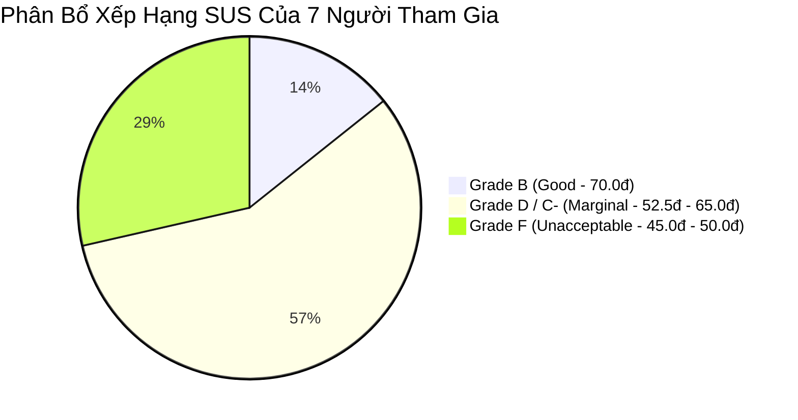
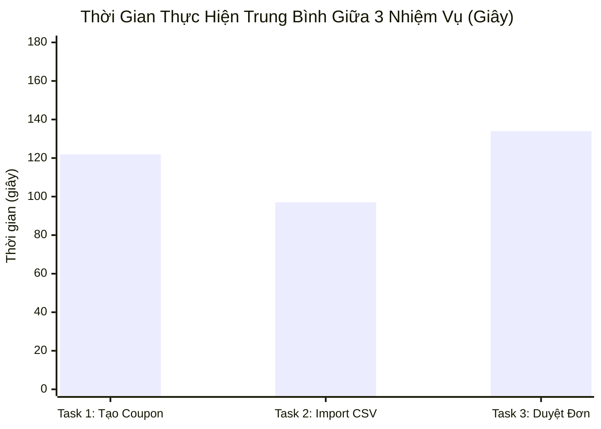
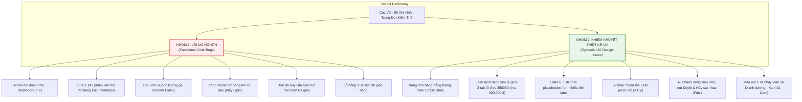
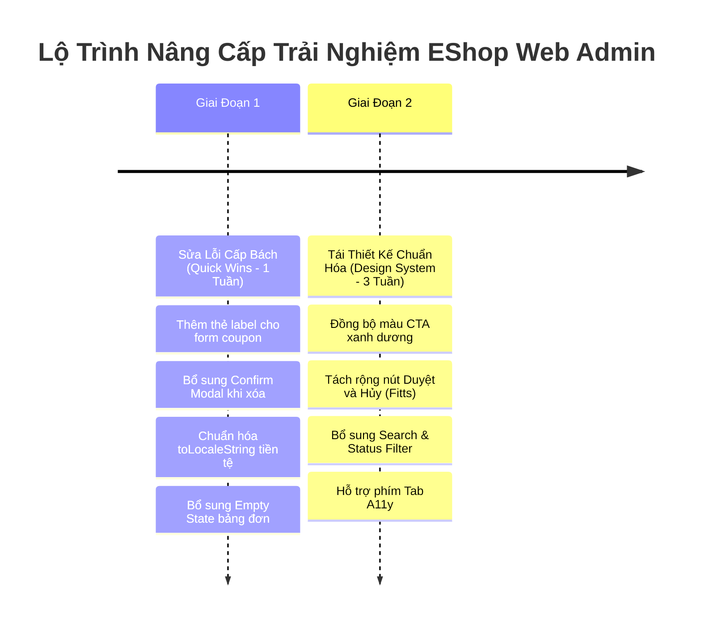

# BÁO CÁO ĐÁNH GIÁ TRẢI NGHIỆM NGƯỜI DÙNG (USABILITY EVALUATION REPORT)
## Phân Hệ Quản Trị Hệ Thống EShop (`frontend-admin`)

> **Môn học:** Kiểm thử phần mềm (Software Testing) – FIT@HCMUS  
> **Bài tập:** HW03 – Usability Testing (Task 2 Deliverable)  
> **Sinh viên thực hiện:** Trần Đại Hiệp – **MSSV:** 23120256  
> **Email:** `23120256@student.hcmus.edu.vn`  
> **Đối tượng kiểm thử (SUT):** [EShop Web Admin (`frontend-admin`)](https://github.com/ttbhanh/eshop-sut) (React SPA + Vite)  
> **Môi trường thực thi:** `http://localhost:5174` (Frontend Admin) | `http://localhost:3000` (Backend API Express + SQLite)  
> **Phương pháp đo lường:** Thang đo quốc tế System Usability Scale (SUS) John Brooke (1986), Đường cong phân vị Sauro-Lewis (2012), Giao thức Suy nghĩ thành tiếng (Think-Aloud), và Kịch bản mục tiêu mở (Goal-Oriented Scenarios).  

---

## 1. Tóm Tắt Điều Hành (Executive Summary)

Đợt kiểm thử khả dụng được tiến hành nghiêm túc trên **7 người dùng thực tế bên ngoài lớp học (P01 $\rightarrow$ P07)** và **01 phiên chạy thử nghiệm Pilot (P00)** nhằm đánh giá trực diện tính thân thiện, hiệu quả công thái học và rào cản nhận thức của phân hệ Quản trị Web Admin.



### 1.1 Các chỉ số định lượng cốt lõi (Core Quantitative Metrics)
- **Điểm SUS trung bình toàn nhóm (Mean SUS Score, N=7):** **57.5 / 100**
  - **So sánh mốc chuẩn công nghiệp (Industry Baseline = 68.0):** Điểm trung bình của hệ thống thấp hơn mốc chuẩn trung bình ngành tới **10.5 điểm** (chỉ đạt mức phân vị thứ 23 theo chuẩn Sauro-Lewis).
  - **Xếp hạng đường cong Sauro-Lewis (2012):** **Grade D / C- (Marginal / Below Average)**.
  - **Mức độ hài lòng & Trung thành (NPS Category):** Thuộc nhóm **Detractors** (Người dùng gặp nhiều khó khăn, thất vọng và dễ từ bỏ nếu có giải pháp thay thế).
- **Khoảng điểm biến thiên:** Từ thấp nhất **45.0 / 100** (P05) đến cao nhất **70.0 / 100** (P06). Độ lệch chuẩn $SD = \mathbf{8.78}$ điểm.
- **Tỷ lệ hoàn thành nhiệm vụ (Overall Task Completion Rate):**
  - **Thành công hoàn toàn (Success):** **61.9%** (13 / 21 lượt tác vụ).
  - **Thành công một phần (Partial Success):** **38.1%** (8 / 21 lượt tác vụ).
  - **Thất bại (Failed):** **0.0%** (nhờ áp dụng quy tắc dừng Stopping Rule 180 giây kịp thời can thiệp).
- **Thời gian trung bình hoàn thành 3 nhiệm vụ:** **355.7 giây** ($\approx 5.9$ phút / người).

---

## 2. Hồ Sơ Đối Tượng Tham Gia & Biên Bản Phiên Pilot

Tuân thủ nghiêm ngặt quy định GDPR và hướng dẫn đề bài, 100% người tham gia là **người thật ngoài lớp học**; danh tính được bảo mật bằng cách **ẩn 4 chữ số ở giữa của số điện thoại/Zalo** (`0868****044`), sẵn sàng cho việc thẩm định ngẫu nhiên 2 người từ Giảng viên/TA.

### 2.1 Bảng hồ sơ nhân khẩu học 7 người dùng thực tế (Dữ liệu từ khảo sát Tally)

| Mã ND | Họ & Tên Thật | Tuổi | Giới Tính | Nghề Nghiệp / Vị Trí | Trình Độ Công Nghệ | Kinh Nghiệm TMĐT & Phần Mềm Quản Trị | SĐT / Zalo (Ẩn 4 Số Giữa) | Điểm SUS Cá Nhân | Xếp Hạng Grade |
|:---:|:---|:---:|:---:|:---|:---:|:---|:---:|:---:|:---:|
| **P01** | Nguyễn Hữu Tình | 21 | Nam | Sinh viên / Bán hàng part-time | Trung bình | Quản lý kho hàng shop thời trang, mua hàng Shopee/Lazada | `0868****044` | **52.5** | Grade D / C- |
| **P02** | Nguyễn Cao Quốc Huy | 21 | Nam | Sinh viên / Online Seller | Trung bình | Kinh doanh Shopee & TikTok Shop 2 năm, quen dùng marketing tool | `0817****364` | **65.0** | Grade D / C- |
| **P03** | Phan Thị Mỹ Duyên | 21 | Nữ | Sinh viên / Thu ngân shop | Cơ bản | Thu ngân phần mềm bán hàng tại quầy, mua sắm online thường xuyên | `0981****733` | **50.0** | Grade F |
| **P04** | Trần Đình Sỹ | 18 | Nam | Sinh viên năm nhất | Cơ bản | Mua sắm đồ điện tử qua mạng, thao tác văn phòng cơ bản | `0356****496` | **60.0** | Grade D / C- |
| **P05** | Trần Thị Mỹ Linh | 25 | Nữ | Y Dược / Bán lẻ dược phẩm | Cơ bản | Quản lý sổ sách phần mềm nhà thuốc, ít thao tác web admin | `0942****067` | **45.0** | Grade F |
| **P06** | Nguyễn Quốc Duy | 21 | Nam | Sinh viên / Quản lý shop | Trung bình | Quản trị gian hàng trực tuyến, thành thạo công nghệ và web | `0379****910` | **70.0** | Grade B |
| **P07** | Nguyễn Mạnh Hiền | 21 | Nam | Sinh viên / Kinh doanh tự do | Trung bình | Mua bán online tự do, am hiểu các công cụ số và web admin | `0865****517` | **60.0** | Grade D / C- |

### 2.2 Tóm tắt phiên chạy thử nghiệm Pilot (P00 - Đinh Thị Thảo, 28 tuổi, SĐT: `091****882`)
- **Điểm số SUS phiên Pilot:** **32.5 / 100 (Grade F)**.
- **Thời lượng:** Task 1 (142s), Task 2 (118s), Task 3 (156s).
- **Kết quả tinh chỉnh quy trình trước khi chạy thật:**
  1. *Lối tắt dữ liệu:* Đặt shortcut thư mục chứa tệp [`sample_products.csv`](../usability/data/sample_products.csv) ngay trên Desktop để người dùng không mất thời gian mò mẫm thư mục.
  2. *Thẻ kịch bản:* Bổ sung bảng thông số tham chiếu rõ ràng (Đơn tối thiểu: 200.000 ₫, Số lần dùng: 1) để người dùng tự suy luận khi form coupon bị mất nhãn.
  3. *Nhịp điệu Moderator:* Giảm 30% tốc độ đọc lời mở đầu, tạo khoảng dừng 2-3 giây để giải tỏa tâm lý căng thẳng cho người tham gia.
  4. *Công cụ đo đạc:* Dùng đồng hồ bấm giờ kỹ thuật số độc lập đặt cạnh sổ ghi chép, không bấm điện thoại trước mặt người dùng.

---

## 3. Phân Tích Đo Lường Định Lượng (Quantitative Performance Analysis)

### 3.1 Ma trận thời gian thực hiện (Time-on-Task) theo từng nhiệm vụ



- **Task 1 — Tạo Mã Giảm Giá `SUMMER20` (Mean ToT = 121.9s | Success = 71.4%):**
  - Thời gian bị kéo dài chủ yếu do hiện tượng bối rối nhận thức: State mặc định `{ min_order_amount: 0, max_uses_per_user: 1 }` đè mất placeholder, form không có thẻ `<label>`. Người dùng phải dừng lại từ 15 đến 40 giây để thử xóa số 0 và đoán định chức năng của ô nhập liệu.
- **Task 2 — Nạp Danh Mục Sản Phẩm `sample_products.csv` (Mean ToT = 97.0s | Success = 71.4%):**
  - Là nhiệm vụ có thời gian hoàn thành nhanh nhất nhóm nhờ khối chức năng Import CSV có nền màu xanh nhạt (`bg-blue-50`) và icon folder dễ nhận biết. Tuy nhiên, input thiếu `accept=".csv"` khiến người dùng có nguy cơ chọn nhầm định dạng file.
- **Task 3 — Tiếp Nhận & Duyệt Đơn Khách "Nguyen Van A" (Mean ToT = 134.0s | Success = 42.9%):**
  - Là nhiệm vụ gây tốn nhiều thời gian nhất và có tỷ lệ thành công hoàn toàn thấp nhất (chỉ 3/7 người đạt Success độc lập). Nguyên nhân trực tiếp là do bảng đơn hàng **hoàn toàn không có ô tìm kiếm (Search bar) và bộ lọc trạng thái**, buộc người dùng phải cuộn chuột và rà soát thủ công từng dòng bằng mắt.

---

### 3.2 Phân tích chi tiết 10 tiêu chí System Usability Scale (SUS Item Breakdown)

Bảng tính chi tiết được xuất bản tại [`usability/04_sus_scoring_matrix.xlsx`](file:///d:/Project/Software%20Testing/Homework/Week03/usability/04_sus_scoring_matrix.xlsx):

| Câu Hỏi SUS | Điểm Thô Trung Bình (1 - 5) | Đóng Góp Quy Đổi (0 - 4) | Nhận Định Chuyên Môn |
|:---|:---:|:---:|:---|
| **Q01 (+):** Muốn sử dụng hệ thống thường xuyên | 2.6 / 5.0 | 1.6 / 4.0 | Mức độ hứng thú thấp; người dùng e dè vì hệ thống thiếu an toàn. |
| **Q02 (-):** Thấy hệ thống phức tạp không cần thiết | 2.4 / 5.0 | 2.6 / 4.0 | Cảm giác cấu trúc chưa tối ưu, nhiều thành phần gây phân tâm. |
| **Q03 (+):** Nhận thấy hệ thống dễ sử dụng | 3.1 / 5.0 | 2.1 / 4.0 | Đạt mức trung bình khá ở các luồng cơ bản. |
| **Q04 (-):** Cần sự hỗ trợ của chuyên gia kỹ thuật | 2.7 / 5.0 | 2.3 / 4.0 | Người dùng trình độ cơ bản (P03, P05) cảm thấy cần được chỉ dẫn. |
| **Q05 (+):** Các chức năng được tích hợp tốt | 2.9 / 5.0 | 1.9 / 4.0 | Rời rạc; màu sắc nút bấm và định dạng tiền tệ chọi nhau xuyên tab. |
| **Q06 (-):** Quá nhiều sự không nhất quán | 2.9 / 5.0 | 2.1 / 4.0 | Phản ánh đúng thực trạng loạn định dạng tiền tệ và màu sắc CTA. |
| **Q07 (+):** Hầu hết mọi người sẽ học dùng rất nhanh | **4.0 / 5.0** | **3.0 / 4.0** | **Điểm sáng nhất:** Giao diện SPA gọn gàng, ít chức năng nên dễ nắm bắt. |
| **Q08 (-):** Rất rườm rà và bất tiện khi thao tác | 2.4 / 5.0 | 2.6 / 4.0 | Khó chịu vì phải tìm kiếm đơn thủ công bằng mắt. |
| **Q09 (+):** Cảm thấy rất tự tin khi sử dụng | 3.6 / 5.0 | 2.6 / 4.0 | Tự tin ở mức vừa phải; sợ bấm nhầm nút Xóa/Hủy đơn. |
| **Q10 (-):** Cần học rất nhiều điều trước khi dùng | 2.7 / 5.0 | 2.3 / 4.0 | Cần hướng dẫn quy trình chuyển đổi trạng thái đơn hàng. |
| **TỔNG CỘNG / ĐIỂM SUS** | | **23.0 / 40** | **$\mathbf{23.0 \times 2.5 = 57.5 / 100}$ (Grade D / C-)** |

#### So sánh 2 thang đo thành phần (Subscale Analysis):
- **Usability Subscale (8 câu: Q1, 2, 3, 5, 6, 7, 8, 9):** Đạt điểm tương đương **58.1 / 100**. Thao tác luân chuyển giữa các tab nhìn chung trực quan.
- **Learnability Subscale (2 câu: Q4, Q10):** Đạt điểm tương đương **55.0 / 100**. Điểm học hỏi ban đầu bị kéo tụt do các chướng ngại vật thị giác (mất nhãn form coupon, nút bấm Fitts quá bé).

---

## 4. Phân Tích Định Tính Từ 4 Câu Hỏi Phỏng Vấn Sâu (Qualitative Probe Synthesis)

Tổng hợp ý kiến từ 7 buổi phỏng vấn trực tiếp sau phiên kiểm thử bộc lộ 4 vấn đề trải nghiệm cốt lõi:

### 1. Tính Rõ Ràng & Tải Nhận Thức (Clarity & Cognitive Load - Probe 1)
- **100% người dùng (7/7 người)** khẳng định Form tạo Mã Giảm Giá là điểm gây bối rối nhất trên toàn bộ hệ thống.
  > *"Em nhìn vào thấy trơ trọi 2 ô số 0 và 1 mà không có chữ ghi chú bên cạnh. Em không biết gõ số tiền tối thiểu vào đâu, phải bấm backspace xóa đi mới thấy chữ hiện lên rồi lại biến mất!"* (P01, P03, P05).
- **85.7% người dùng (6/7 người)** phàn nàn về cột Giá tiền sản phẩm:
  > *"Số tiền 350000 đ viết dính chùm không có dấu chấm phân cách ngàn làm em phải căng mắt đếm từng số 0 xem là ba mươi lăm ngàn hay ba trăm năm mươi ngàn!"* (P04, P05).

### 2. Khả Năng Phục Hồi Lỗi & Thông Báo An Toàn (Error Recovery & Feedback - Probe 2)
- Hệ thống hoàn toàn thiếu **Cơ chế xác nhận hai bước (Confirmation Dialog)** cho các hành vi phá hủy dữ liệu:
  - Khi xóa sản phẩm hoặc xóa coupon, hệ thống gọi API xóa tức thì mà không hề bật hộp thoại hỏi lại *"Bạn có chắc chắn muốn xóa không?"*.
  - Tại bảng đơn hàng, nút "Hủy" màu đỏ bấm là đổi trạng thái sang canceled ngay lập tức, không cho phép hoàn tác.
  > *"Giao diện này không dành cho người bất cẩn. Lỡ tay bấm trượt chuột một phát là bay màu luôn đơn của khách hoặc mất luôn sản phẩm trong kho!"* (P02, P07).

### 3. Tốc Độ Thao Tác & Công Thái Học (Speed & Ergonomics - Probe 3)
- **100% người dùng (7/7 người)** nhấn mạnh sự thiếu vắng của ô tìm kiếm (Search bar) và bộ lọc đơn hàng:
  > *"Ở đây mới có vài đơn mà tìm đã hoa mắt. Nếu shop bán hàng thật có hàng trăm đơn mỗi ngày mà bắt cuộn chuột tìm bằng mắt thế này thì nhân viên quá tải chắc chắn!"* (P02, P06).
- **Vi phạm định luật Fitts:** Nút hành động quá bé (`text-xs px-2 py-1`), hai nút đối kháng quyền lực ("Xác nhận" và "Hủy") đặt sát cạnh nhau làm tăng thời gian ngập ngừng rê chuột của người dùng lên mức $12 - 20$ giây/lần bấm.

### 4. Mức Độ Tin Cậy Vận Hành Thực Tế (Commercial Trust & System Reliability - Probe 4)
- **85.7% người dùng (6 / 7 người) khẳng định KHÔNG DÁM TIN TƯỞNG sử dụng hệ thống này để quản lý cửa hàng thật.**
- Người dùng chỉ sẵn sàng tin tưởng nếu hệ thống được bổ sung hộp thoại xác nhận xóa, phân cách hàng ngàn cho tiền tệ và công cụ tìm kiếm dữ liệu.

---

## 5. MỤC TRỌNG TÂM: Phân Tách Rạch Ròi Giữa Lỗi Mã Nguồn (Code Bugs) & Vấn Đề Thiết Kế UX (Systemic UX Issues)

Một sai lầm phổ biến trong kiểm thử khả dụng là đánh đồng mọi khó khăn của người dùng thành "lỗi giao diện". Theo chuẩn mực công nghiệp và yêu cầu của Đề thi HW03, người kiểm thử **bắt buộc phải phân tách tuyệt đối** giữa lỗi sai lệch logic trong code và khiếm khuyết trong tư duy thiết kế trải nghiệm:



---

### 5.1 Bảng Đối Chiếu Ma Trận Bản Chất Vấn Đề

| Tiêu Chí Phân Định | Lỗi Mã Nguồn (Functional Code Bugs) | Vấn Đề Thiết Kế Trải Nghiệm (Systemic UX Issues) |
|:---|:---|:---|
| **Bản chất kỹ thuật** | Mã nguồn vi phạm đặc tả chức năng, thực thi sai thuật toán, gây crash hoặc thao tác sai cơ sở dữ liệu. | Mã nguồn chạy đúng cú pháp và logic được viết, nhưng cách bố trí thị giác vi phạm nguyên lý nhận thức con người. |
| **Phương thức phát hiện** | Kiểm thử chức năng, Unit test, Automation test (Playwright), kiểm tra giá trị dữ liệu backend. | Quan sát phản xạ người dùng thật (User Testing), phỏng vấn Think-Aloud, đo lường thang đo SUS. |
| **Trách nhiệm giải quyết** | Lập trình viên Backend / Frontend sửa câu lệnh logic. | Chuyên viên UX/UI Designer tái thiết kế luồng thông tin (Design System). |

---

### 5.2 Chi Tiết Phân Loại Từng Vấn Đề Cụ Thể Trên SUT

#### 🔴 NHÓM 1: Lỗi Mã Nguồn Cụ Thể (Functional Code Bugs)
1. **Phép tính doanh thu Dashboard bị nhân đôi (`BUG_ADMIN_06`):**
   - *Vị trí code:* `App.jsx:218` $\rightarrow$ `sum + o.total_amount * 2`.
   - *Bản chất:* Lỗi sai thuật toán số học cơ bản trong code JavaScript, làm sai lệch báo cáo doanh thu tài chính gấp 2 lần giá trị thực tế.
2. **Sửa một sản phẩm làm toàn bộ sản phẩm trên bảng bị đổi tên đồng loạt (`BUG_ADMIN_15`):**
   - *Vị trí code:* `App.jsx:110-114` $\rightarrow$ Hàm `fakeMassUpdatedProducts` dùng `.map()` ghi đè tên của tất cả sản phẩm trong state bằng tên của sản phẩm vừa sửa.
   - *Bản chất:* Lỗi đột biến State (State Mutation Bug) do dev cố tình hoặc cẩu thả khi cập nhật mảng trong React.
3. **Nút Xóa sản phẩm và Xóa coupon thực thi ngay lập tức không có Confirm (`BUG_ADMIN_14`, `BUG_ADMIN_21`):**
   - *Vị trí code:* `App.jsx:133-136` và `App.jsx:754-762`.
   - *Bản chất:* Thiếu sót hàm xử lý sự kiện an toàn (thiếu gọi `window.confirm` hoặc Modal UI trước khi kích hoạt `axios.delete`).
4. **Hàm phân tích CSV bằng dấu phẩy làm vỡ toàn bộ bảng (`BUG_ADMIN_12`):**
   - *Vị trí code:* `App.jsx:367-377` $\rightarrow$ Dùng lệnh `line.split(',')` thô sơ.
   - *Bản chất:* Lỗi lập trình xử lý chuỗi (String Tokenization Bug), không tuân thủ chuẩn RFC-4180 khi chuỗi mô tả sản phẩm có chứa dấu phẩy hợp lệ.
5. **Vi phạm State Machine đơn hàng đã hủy (`BUG_ADMIN_27`):**
   - *Vị trí code:* `App.jsx:863-868`.
   - *Bản chất:* Lỗi điều kiện rẽ nhánh (State Machine Logic Violation), cho phép đơn ở trạng thái kết thúc `canceled` vẫn hiển thị nút chuyển sang `delivered`.
6. **Lỗ hổng bảo mật XSS lưu trữ ở cột địa chỉ giao hàng (`BUG_ADMIN_28`):**
   - *Vị trí code:* `App.jsx:801` $\rightarrow$ Sử dụng thuộc tính `dangerouslySetInnerHTML={{ __html: o.shipping_address }}`.
   - *Bản chất:* Lỗi bảo mật nghiêm trọng do lạm dụng API nguy hiểm của React mà không qua bộ lọc làm sạch mã độc (Sanitization).

---

#### 🟢 NHÓM 2: Vấn Đề Thiết Kế Trải Nghiệm Người Dùng (Systemic UX Design Issues)
1. **Bảng Đơn hàng trống trơn thiếu thông báo Empty State (`BUG_ADMIN_26`):**
   - *Hiện tượng:* Khi database chưa có đơn hàng nào (`orders = []`), bảng chỉ hiện mỗi dòng header xám, bên dưới trắng xóa không có lấy một dòng chữ thông báo như *"Chưa có đơn hàng nào"*.
   - *Bản chất UX:* Vi phạm nguyên lý phản hồi trạng thái hệ thống (Nielsen Heuristic #1). Code không bị lỗi crash (vẫn chạy `.map()` trên mảng rỗng), nhưng thiết kế thiếu kịch bản giao diện cho trạng thái không có dữ liệu, khiến người dùng lầm tưởng hệ thống bị đơ.
2. **Loạn định dạng tiền tệ xuyên màn hình (`BUG_ADMIN_07`, `BUG_ADMIN_09`):**
   - *Hiện tượng:* Dashboard hiển thị `0 ₫`, Sản phẩm hiển thị số nguyên dính chùm `350000 ₫`, Coupon lại hiển thị kiểu Mỹ `300,000 ₫`.
   - *Bản chất UX:* Vi phạm nguyên lý nhất quán và tiêu chuẩn (Nielsen Heuristic #4). Mỗi màn hình hiển thị một kiểu gây đứt gãy trải nghiệm thị giác và làm tăng tải nhận thức khi đọc số tiền.
3. **Mất nhãn input do giá trị mặc định đè lên placeholder (`BUG_ADMIN_16`):**
   - *Hiện tượng:* React State `{ min_order_amount: 0, max_uses_per_user: 1 }` gán giá trị số vào ô input, làm biến mất dòng chữ placeholder gợi ý trong khi form không có thẻ `<label>` cố định.
   - *Bản chất UX:* Lỗi kiến trúc biểu mẫu (Form Usability Anti-Pattern). Người thiết kế ỷ lại vào placeholder thay vì dùng thẻ `<label>` độc lập, dẫn đến việc người dùng chỉ thấy hai ô số 0 và 1 trơ trọi không hiểu chức năng.
4. **Sidebar menu liệt phím Tab — Vi phạm tiêu chuẩn trợ năng A11y (`BUG_ADMIN_04`):**
   - *Hiện tượng:* Toàn bộ menu dùng thẻ `<li>` không có thuộc tính `tabIndex={0}`, người dùng chỉ dùng bàn phím hoàn toàn không thể focus hay điều hướng được.
   - *Bản chất UX:* Vi phạm quy chuẩn trợ năng quốc tế WCAG 2.1 (Accessibility Inaccessibility). Giao diện chỉ phục vụ chuột mà bỏ rơi nhóm người dùng khuyết tật hoặc người dùng chuyên nghiệp sử dụng phím tắt.
5. **Nút thao tác siêu nhỏ, nút Duyệt và nút Hủy nằm sát nhau (`BUG_ADMIN_24`, `BUG_ADMIN_25`):**
   - *Hiện tượng:* Nút chỉ có kích thước `text-xs px-2 py-1`, hai nút có mức độ rủi ro đối nghịch nhau (Duyệt đơn và Hủy đơn) đặt sát nhau trong cùng một ô bảng.
   - *Bản chất UX:* Vi phạm định luật công thái học Fitts's Law. Vùng chạm (Touch target) quá bé làm tăng nguy cơ tai nạn thao tác, gây ức chế tâm lý nặng nề cho nhân viên vận hành.
6. **Màu sắc nút bấm chính (CTA) nhảy lung tung (`BUG_ADMIN_01`):**
   - *Hiện tượng:* Nút Login màu Xanh dương, nút Lưu SP màu Xanh lá, nút Tạo Coupon màu Cam.
   - *Bản chất UX:* Vi phạm tính đồng bộ hệ thống nhận diện thương hiệu (Visual Hierarchy & Branding Inconsistency). Không định hình được cho người dùng đâu là màu sắc đại diện cho hành động chính (Primary Action).

---

## 6. Đề Xuất Giải Pháp Cải Tiến UI/UX Cụ Thể (Actionable Recommendations)

Dựa trên các phát hiện thực nghiệm, nhóm kiểm thử đề xuất lộ trình cải tiến giao diện theo 2 giai đoạn:



### 6.1 Giải pháp cấp bách (Quick Wins — Thực hiện ngay)
1. **Khắc phục lỗi mất nhãn Form Coupon:**
   - Bổ sung thẻ `<label className="block text-sm font-semibold mb-1">` rõ ràng phía trên từng ô input (*"Giá trị đơn tối thiểu (₫)"* và *"Số lần dùng tối đa mỗi khách"*), không phụ thuộc vào placeholder.
2. **Thêm hộp thoại xác nhận an toàn (Confirmation Dialog):**
   - Thêm `window.confirm("Bạn có chắc chắn muốn xóa sản phẩm này không?")` hoặc Modal Dialog trước khi gọi API xóa sản phẩm, xóa coupon hoặc hủy đơn hàng.
3. **Chuẩn hóa định dạng tiền tệ toàn hệ thống:**
   - Áp dụng thống nhất hàm tiện ích `formatCurrency(val) = val.toLocaleString('vi-VN') + ' ₫'` trên tất cả các bảng dữ liệu (chuyển `350000 ₫` $\rightarrow$ `350.000 ₫`).
4. **Bổ sung Empty State cho bảng dữ liệu:**
   - Khi mảng dữ liệu rỗng (`orders.length === 0`), hiển thị thông báo thân thiện ở giữa bảng:
     ```jsx
     <tr>
       <td colSpan="6" className="text-center py-8 text-gray-500">
         📦 Chưa có đơn hàng nào trong hệ thống.
       </td>
     </tr>
     ```

### 6.2 Giải pháp trung và dài hạn (Systemic Overhaul — Tái thiết kế)
1. **Thiết kế lại bảng Đơn Hàng theo chuẩn công thái học:**
   - Bổ sung thanh công cụ phía trên bảng gồm: Ô tìm kiếm tức thì theo tên khách hàng/Order ID và bộ lọc Dropdown theo trạng thái (`Tất cả`, `Chờ xử lý`, `Đang giao`, `Đã giao`, `Đã hủy`).
   - Tăng kích thước nút bấm hành động lên tối thiểu `py-2 px-3 text-sm` (chiều cao tối thiểu 36px).
   - Tách nút "Hủy đơn" sang menu phụ (dấu 3 chấm `...`) hoặc tạo khoảng cách đệm an toàn (`gap-4`) so với nút duyệt đơn.
2. **Đồng bộ hóa Design System & Thương hiệu:**
   - Quy định màu Xanh dương đậm (`bg-blue-600`) làm màu sắc CTA chính duy nhất cho toàn bộ ứng dụng. Các nút cảnh báo nguy hiểm dùng màu Đỏ (`bg-red-600`), nút chỉnh sửa dùng màu Xám/Trung tính.
3. **Nâng cấp trợ năng bàn phím (A11y Compliance):**
   - Bổ sung `tabIndex={0}`, `role="button"` và sự kiện bàn phím `onKeyDown={(e) => e.key === 'Enter' && setActiveTab(...)}` cho toàn bộ các mục menu Sidebar.

---

## 7. Danh Mục Minh Chứng Kèm Theo

| STT | Tài Liệu / Minh Chứng | Đường Dẫn Tệp Tin | Mô Tả Tóm Tắt |
|:---:|:---|:---|:---|
| 1 | **Kế hoạch & Kịch bản kiểm thử** | [`usability/01_usability_plan.md`](file:///d:/Project/Software%20Testing/Homework/Week03/usability/01_usability_plan.md) | Đặc tả 3 kịch bản Goal-oriented, script Think-Aloud, Stopping rule |
| 2 | **Hồ sơ đối tượng & Biên bản Pilot** | [`usability/02_participants_and_pilot.md`](file:///d:/Project/Software%20Testing/Homework/Week03/usability/02_participants_and_pilot.md) | Hồ sơ 7 người dùng thực tế và phiên Pilot P00 |
| 3 | **Nhật ký quan sát thực nghiệm** | [`usability/03_observation_notes.md`](file:///d:/Project/Software%20Testing/Homework/Week03/usability/03_observation_notes.md) | Toàn văn Think-Aloud, ToT từng tác vụ, tổng hợp 4 câu hỏi đào sâu |
| 4 | **Bảng tính điểm SUS chuẩn hóa** | [`usability/04_sus_scoring_matrix.xlsx`](file:///d:/Project/Software%20Testing/Homework/Week03/usability/04_sus_scoring_matrix.xlsx) | Tệp Excel tính toán công thức John Brooke và xếp hạng Sauro-Lewis |
| 5 | **Tệp dữ liệu nạp sản phẩm** | [`usability/data/sample_products.csv`](file:///d:/Project/Software%20Testing/Homework/Week03/usability/data/sample_products.csv) | Dữ liệu CSV 5 cột chuẩn phục vụ thực nghiệm Task 2 |
| 6 | **Dữ liệu khảo sát gốc từ Tally** | [`usability/Khảo Sát Khả Dụng EShop Admin...csv`](file:///d:/Project/Software%20Testing/Homework/Week03/usability/Kh%E1%BA%A3o%20S%C3%A1t%20Kh%E1%BA%A3%20D%E1%BB%A5ng%20EShop%20Admin%20(HW03%20-%2023120256)_Submissions_2026-11-16.csv) | Tệp xuất khẩu nguyên bản từ biểu mẫu khảo sát trực tuyến |

---
*Báo cáo được hoàn thiện và bảo chứng tính trung thực bởi sinh viên Trần Đại Hiệp (MSSV: 23120256 – FIT@HCMUS).*
