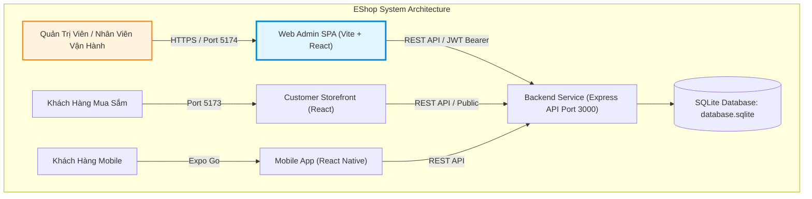
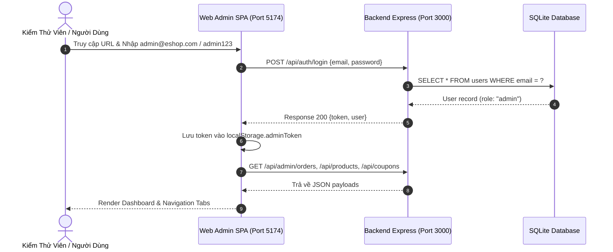
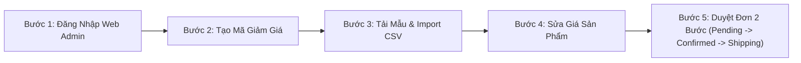

# ĐẶC TẢ PHẠM VI KIỂM THỬ GIAO DIỆN & TRẢI NGHIỆM NGƯỜI DÙNG (GUI & USABILITY SCOPE SPECIFICATION)
## Phân Hệ Quản Trị Hệ Thống EShop (Web Admin — `frontend-admin`)

> **Môn học:** Kiểm thử phần mềm (Software Testing) – FIT@HCMUS  
> **Đồ án:** HW03 – GUI & Usability Testing  
> **Sinh viên thực hiện:** Trần Đại Hiệp – MSSV: 23120256  
> **Đối tượng kiểm thử (SUT):** EShop Web Admin (`frontend-admin`)  
> **Phiên bản tài liệu:** 1.0 (Chính thức)  
> **Ngày ban hành:** 14/11/2026  

---

## 1. Tổng Quan & Cơ Sở Chọn Phạm Vi (Scope Justification)

### 1.1 Giới thiệu Hệ thống Dưới Kiểm Thử (SUT)
Hệ thống [EShop](https://github.com/ttbhanh/eshop-sut) là một nền tảng thương mại điện tử đa nền tảng được phát triển phục vụ mục đích thực hành kiểm thử phần mềm chuyên sâu. Kiến trúc tổng thể bao gồm 4 khối thành phần chính:
1. **Backend API Service:** Nền tảng Node.js / Express cung cấp các RESTful APIs, kết nối cơ sở dữ liệu SQLite (`backend/database.sqlite`).
2. **Frontend Web Storefront (`frontend-web`):** Cổng mua sắm dành cho khách hàng cuối (B2C), xây dựng bằng Vite + React.
3. **Frontend Web Admin (`frontend-admin`):** Cổng quản trị dành cho nhân sự quản lý vận hành cửa hàng, kế toán và quản trị viên hệ thống, xây dựng bằng Vite + React + TailwindCSS.
4. **Mobile App (`mobile`):** Ứng dụng di động mua hàng xây dựng bằng React Native / Expo.

Trong phạm vi đồ án **HW03 – GUI & Usability Testing**, đối tượng kiểm thử được lựa chọn độc quyền và tập trung chuyên sâu là **Phân hệ Web Admin (`frontend-admin`)**.



---

### 1.2 Ranh Giới Phạm Vi Kiểm Thử (Scope Boundaries)

Nhằm đảm bảo tính độc lập giữa các thành viên trong nhóm theo đúng quy định tại Mục 5 của Đề bài (*"Within each group, ensure that your selection is not duplicated among the members of the group: no two members may choose the same primary screen for the GUI checklist or the same usability flow"*), phạm vi kiểm thử được phân định rành mạch như sau:

#### A. Trong Phạm Vi Kiểm Thử (In-Scope — 4 Tabs Cốt Lõi)
Toàn bộ quy trình kiểm thử GUI Checklist (Task 1), Đánh giá Usability đa người dùng (Task 2) và Kiểm thử Cross-Platform / Responsive (Task 3) sẽ bao phủ trọn vẹn 4 tab nghiệp vụ trung tâm của Web Admin:
1. **Tab 1: Dashboard Thống Kê (FR-13):** Bảng tổng quan hiển thị các thẻ chỉ số KPI kinh doanh (Tổng doanh thu, Tổng số lượng đơn hàng) và bảng theo dõi nhanh.
2. **Tab 2: Quản Lý Sản Phẩm & Nhập Dữ Liệu Hàng Loạt (FR-15, FR-16):** Form tạo mới/chỉnh sửa sản phẩm, chức năng tải file mẫu `template.csv`, upload file CSV sản phẩm, bảng xem trước (preview) dữ liệu parse và bảng danh sách sản phẩm hiện hữu.
3. **Tab 3: Quản Lý Mã Giảm Giá (FR-17):** Form thiết lập khuyến mãi (Coupon Code, Loại giảm giá, Giá trị chiết khấu, Giá trị đơn tối thiểu, Ngày hết hạn, Giới hạn sử dụng/người) và bảng quản trị trạng thái hiệu lực của voucher.
4. **Tab 4: Quản Lý & Chuyển Đổi Trạng Thái Đơn Hàng (FR-18, FR-10):** Bảng quản trị danh sách đơn đặt hàng từ khách hàng, hiển thị thông tin người nhận, địa chỉ giao hàng, phương thức thanh toán và luồng điều khiển chuyển đổi State Machine của đơn hàng (`pending` $\rightarrow$ `confirmed` $\rightarrow$ `shipping` $\rightarrow$ `delivered` / `canceled`).

#### B. Ngoài Phạm Vi Kiểm Thử (Out-of-Scope)
- **Tab Danh Mục (FR-14 - Categories):** Đã được thành viên khác trong nhóm đảm nhiệm kiểm thử.
- **Tab Người Dùng (FR-19 - Users Management):** Nằm ngoài phạm vi của đồ án này.
- **Toàn bộ giao diện Storefront Khách Hàng (Pool A, Pool B):** Giao diện Trang chủ, Giỏ hàng, Chi tiết sản phẩm phía khách hàng không nằm trong đợt đánh giá này nhằm tập trung cao độ vào trải nghiệm quản trị Back-office.

---

### 1.3 Cơ Sở & Lý Do Lựa Chọn (Scope Justification)

Việc lựa chọn 4 tab cốt lõi của Web Admin được định hướng bởi các yếu tố kỹ thuật và thực tiễn kiểm thử phần mềm:
- **Mật độ thành phần giao diện phong phú:** Web Admin chứa đầy đủ các thành phần GUI phức tạp nhất của một ứng dụng Web hiện đại:
  - *Forms & Controls:* Input văn bản, Date Picker, Select dropdown, File Input, Radio toggle, Numeric constraint inputs.
  - *Data Presentation:* Thẻ KPI cards, Bảng dữ liệu đa cột (Data Tables), Tags/Badges trạng thái màu sắc, Popup cảnh báo.
  - *Action Triggers:* Nút bấm đa trạng thái (Primary, Secondary, Danger, Disabled), Nút tải file, Nút chuyển state động.
- **Độ nhạy cảm nghiệp vụ cao (High Business Impact):** Đây là phân hệ ảnh hưởng trực tiếp đến dòng tiền (Doanh thu Dashboard), độ chính xác kho vận (Nhập hàng CSV hàng loạt), chiến dịch Marketing (Mã giảm giá) và chuỗi cung ứng giao nhận (Đơn hàng). Bất kỳ khiếm khuyết nào về GUI hoặc Usability đều dẫn đến thiệt hại tài chính hoặc sai sót vận hành nghiêm trọng.
- **Sự hiện diện của các khiếm khuyết phần mềm điển hình (Rich Defect Profile):** Qua rà soát mã nguồn sơ bộ, phân hệ Web Admin chứa đựng các lỗi giao diện và logic tương tác kinh điển (nhân đôi doanh thu, state update lỗi làm đổi tên hàng loạt, parser CSV thủ công gây vỡ dữ liệu, lỗ hổng chèn mã XSS qua địa chỉ giao hàng, và vi phạm quy trình State Machine). Đây là mảnh đất màu mỡ để minh chứng năng lực kiểm định chất lượng phần mềm theo chuẩn ISTQB.

---

## 2. Kiến Trúc Kỹ Thuật & Môi Trường Kiểm Thử

### 2.1 Cấu Hình Môi Trường Vận Hành SUT

| Thành Phần | Công Nghệ / Nền Tảng | Địa Chỉ Cổng / Đường Dẫn | Ghi Chú Cấu Hình |
|:---|:---|:---|:---|
| **SUT Frontend** | React 18, Vite, TailwindCSS | `http://localhost:5174` (hoặc `5173`) | Ứng dụng Single Page Application (SPA) |
| **Backend API** | Node.js, Express.js | `http://localhost:3000/api` | RESTful API Server với CORS kích hoạt |
| **Cơ Sở Dữ Liệu** | SQLite 3 (`better-sqlite3`) | `eshop-sut/backend/database.sqlite` | File cơ sở dữ liệu quan hệ cục bộ |
| **Quản Trị Phiên** | JWT Token (`localStorage`) | Khóa: `adminToken` | Tự động đính kèm Header `Authorization: Bearer <token>` |

### 2.2 Tài Khoản Kiểm Thử Quản Trị Hệ Thống
- **URL Đăng nhập:** `http://localhost:5174/`
- **Email quản trị viên:** `admin@eshop.com`
- **Mật khẩu:** `admin123`
- **Phân quyền người dùng:** `role = "admin"` (Toàn quyền quản trị cơ sở dữ liệu)



---

## 3. Đặc Tả Kỹ Thuật & Phân Tích Lỗi Tiềm Ẩn Của 4 Tabs

### 3.1 Tab 1: Dashboard Thống Kê (FR-13)

#### A. Cấu Trúc Thành Phần Giao Diện
- **Header:** Tiêu đề trang `Tổng quan hệ thống`.
- **Thẻ KPI 1 (Doanh thu):** Thẻ thông tin nền trắng có viền bóng (`shadow`), tiêu đề phụ `Doanh thu (Đã giao)`, hiển thị giá trị số tiền định dạng tiền tệ Việt Nam Đồng (`₫`).
- **Thẻ KPI 2 (Số đơn hàng):** Thẻ thông tin hiển thị tiêu đề phụ `Tổng số đơn hàng`, hiển thị tổng số lượng đơn hàng ghi nhận trong hệ thống.

#### B. Phân Tích Kỹ Thuật Dưới Góc Nhìn Mã Nguồn
Trích xuất đoạn mã xử lý doanh thu tại [`eshop-sut/frontend-admin/src/App.jsx#L217-L220`](file:///d:/Project/Software%20Testing/eshop-sut/frontend-admin/src/App.jsx#L217-L220):
```javascript
const totalRevenue = orders.reduce((sum, o) => {
  if (o.status === "delivered") return sum + o.total_amount * 2;
  return sum;
}, 0);
```
- **Lỗi hiển thị & nghiệp vụ nghiêm trọng (Critical Calculation Defect):** Phép tính cố tình nhân đôi (`* 2`) số tiền thực tế của mỗi đơn hàng đã giao (`delivered`). Khiến số liệu doanh thu trên giao diện gấp đôi thực tế, đánh lừa nhận thức của người quản trị về hiệu quả tài chính.
- **Thiếu phân cấp thị giác & Trạng thái trống:** Khi hệ thống chưa có đơn hàng nào hoặc đang tải dữ liệu (`loading`), thẻ hiển thị giá trị `0 ₫` mà không có Skeleton Loader hoặc chỉ báo tải trang.

#### C. Khía Cạnh Kiểm Thử Bao Phủ
- **`IA-01` (General UI Standards):** Độ tương phản màu sắc của thẻ số liệu, khoảng cách lề (padding/margin), kích thước chữ font-size cho số liệu thống kê so với nhãn thẻ.
- **`IA-04` (Feedback & State):** Tính chính xác khi hiển thị số liệu thực, biểu diễn trạng thái tiền tệ `toLocaleString()`, xử lý khi danh sách đơn rỗng (`orders = []`).

---

### 3.2 Tab 2: Quản Lý Sản Phẩm & Nhập Dữ Liệu CSV (FR-15, FR-16)

#### A. Cấu Trúc Thành Phần Giao Diện
- **Khu vực CSV Import:**
  - Nút/Link tải file mẫu: `Tải file CSV mẫu (template.csv)`.
  - Input chọn tệp: Nút nạp file hỗ trợ định dạng `.csv`.
  - Nút hành động: `Tiến hành Import`.
  - Bảng xem trước (Preview Table): Hiển thị cấu trúc cột `name`, `price`, `description`, `imageUrl`, `category_id` từ file CSV trước khi nạp chính thức.
  - Hộp thông báo kết quả: Hiển thị số dòng thành công / thất bại sau khi import.
- **Form Quản Lý Sản Phẩm (Thêm / Sửa):**
  - Các ô nhập liệu: Tên sản phẩm, Giá (VND), Mô tả sản phẩm, Link ảnh (Image URL), Dropdown Danh mục.
  - Nút lưu dữ liệu: `Thêm sản phẩm` hoặc `Cập nhật sản phẩm`.
- **Bảng Danh Sách Sản Phẩm (Data Table):**
  - Hiển thị ID, Tên, Giá, Danh mục, Hình ảnh thu nhỏ (Thumbnail), và các nút Thao tác (Sửa, Xóa).

#### B. Phân Tích Kỹ Thuật Dưới Góc Nhìn Mã Nguồn
1. **Lỗi Parse CSV thủ công gây vỡ dữ liệu** ([`App.jsx#L367-L377`](file:///d:/Project/Software%20Testing/eshop-sut/frontend-admin/src/App.jsx#L367-L377)):
   ```javascript
   const lines = text.trim().split("\n");
   const headers = lines[0].split(",").map((h) => h.trim());
   const rows = lines.slice(1).map((line) => {
     const values = line.split(",").map((v) => v.trim());
     // ...
   });
   ```
   *Khiếm khuyết:* Hệ thống sử dụng phương thức nguyên thủy `line.split(",")` thay vì thư viện chuyên dụng (như PapaParse). Khi cột mô tả sản phẩm chứa dấu phẩy phân tách ý (ví dụ: `"Áo thun cotton, màu đỏ, size L"`), hàm split sẽ xé nhỏ chuỗi làm lệch hoàn toàn thứ tự các cột phía sau, đẩy chuỗi mô tả vào cột `price` hoặc `category_id` gây crash giao diện preview.
2. **Lỗi State UI làm biến đổi dữ liệu hàng loạt (`fakeMassUpdatedProducts`)** ([`App.jsx#L110-L114`](file:///d:/Project/Software%20Testing/eshop-sut/frontend-admin/src/App.jsx#L110-L114)):
   ```javascript
   const fakeMassUpdatedProducts = products.map((p) => ({
     ...p,
     name: productForm.name,
   }));
   setProducts(fakeMassUpdatedProducts);
   alert("Cập nhật thành công!");
   ```
   *Khiếm khuyết:* Khi người dùng chỉnh sửa một sản phẩm duy nhất, mã nguồn cập nhật state của toàn bộ sản phẩm trong danh sách thành tên của sản phẩm vừa sửa. Người dùng hoảng loạn khi thấy toàn bộ hàng chục sản phẩm trong kho bị đồng loạt đổi tên trên bảng giao diện.
3. **Lạm dụng Browser Native Alert:** Ứng dụng dùng hàm đồng bộ `alert("Cập nhật thành công!")` chặn luồng thực thi (blocking) gây ức chế trải nghiệm người dùng, vi phạm tiêu chuẩn thiết kế hiện đại.

#### C. Khía Cạnh Kiểm Thử Bao Phủ
- **`IA-02` (Forms & Data Input):** Kiểm tra validation form thêm/sửa, xử lý file input khi upload file rỗng hoặc file sai định dạng (`.txt`, `.exe`), kiểm tra bảng xem trước preview CSV.
- **`IA-04` (Feedback & State):** Phản hồi thông báo lỗi/thành công, trạng thái tải (Loading spinner khi gửi request qua mạng), tính trung thực của dữ liệu hiển thị trên bảng sau thao tác sửa.

---

### 3.3 Tab 3: Quản Lý Mã Giảm Giá (Coupons - FR-17)

#### A. Cấu Trúc Thành Phần Giao Diện
- **Form Tạo Mã Khuyến Mãi:**
  - Ô nhập Mã Coupon (`Mã code`, ví dụ: `SALE50`).
  - Dropdown chọn Loại giảm giá: `Phần trăm` hoặc `Số tiền cố định`.
  - Ô nhập Giá trị giảm (`Giá trị`).
  - Ô nhập Giá trị đơn hàng tối thiểu (`Đơn tối thiểu`).
  - Ô chọn Ngày hết hạn (`Ngày hết hạn` - HTML5 Date Picker).
  - Ô nhập Giới hạn số lần dùng trên mỗi tài khoản (`Số lần dùng tối đa/người`).
  - Nút bấm tạo mã: `Tạo mã` (màu cam).
- **Bảng Quản Trị Danh Sách Mã (Coupon Table):**
  - Cột hiển thị: Mã, Loại, Giá trị, Đơn tối thiểu, Hết hạn, Giới hạn/người, Hành động (Nút Xóa màu đỏ).

#### B. Phân Tích Kỹ Thuật Dưới Góc Nhìn Mã Nguồn
1. **Thiếu ràng buộc trường ngày hết hạn (Date Range Constraint)** ([`App.jsx#L688-L697`](file:///d:/Project/Software%20Testing/eshop-sut/frontend-admin/src/App.jsx#L688-L697)):
   ```jsx
   <input
     placeholder="Ngày hết hạn"
     type="date"
     className="border p-2 rounded"
     value={couponForm.expired_at}
     onChange={(e) => setCouponForm({ ...couponForm, expired_at: e.target.value })}
     required
   />
   ```
   *Khiếm khuyết:* Input date không hề có thuộc tính `min={new Date().toISOString().split('T')[0]}`. Cho phép quản trị viên chọn ngày hết hạn trong quá khứ (ví dụ năm 2020), mã vừa tạo ra lập tức rơi vào trạng thái "Hết hạn" vô nghĩa.
2. **Thiếu chặn biên tỷ lệ phần trăm (Unbounded Percentage Input):** Khi chọn loại `Phần trăm`, ô nhập liệu giá trị không có thuộc tính `max="100"`. Người dùng có thể nhập 500% hoặc -20%, dẫn đến sai lệch biểu diễn và tiềm ẩn nguy cơ sập nghiệp vụ thanh toán Storefront.
3. **Thao tác phá hủy dữ liệu thiếu bước xác nhận (Destructive Action without Confirmation)** ([`App.jsx#L754-L762`](file:///d:/Project/Software%20Testing/eshop-sut/frontend-admin/src/App.jsx#L754-L762)):
   ```javascript
   <button
     className="bg-red-500 text-white px-2 py-1 rounded text-sm"
     onClick={async () => {
       try {
         await axios.delete(`${API_URL}/admin/coupons/${c.id}`);
         fetchData();
       }
     }}
   >
     Xóa
   </button>
   ```
   *Khiếm khuyết:* Nhấp nút Xóa lập tức gửi request xóa vĩnh viễn coupon khỏi cơ sở dữ liệu mà không có bất kỳ hộp thoại Modal xác nhận (`Are you sure?`). Rất dễ gây mất mát dữ liệu nghiêm trọng khi bấm nhầm chuột.

#### C. Khía Cạnh Kiểm Thử Bao Phủ
- **`IA-02` (Forms & Validation):** Ràng buộc trường nhập liệu, kiểm thử biên giá trị giảm giá, tương thích của bộ chọn ngày trên các trình duyệt khác nhau.
- **`IA-04` (Feedback & State):** Nhãn hiển thị tag màu đỏ khi coupon đã quá hạn (`Hết hạn`), phản hồi trực quan sau khi xóa hoặc tạo mã thành công.

---

### 3.4 Tab 4: Quản Lý & Chuyển Đổi Trạng Thái Đơn Hàng (Orders - FR-18, FR-10)

#### A. Cấu Trúc Thành Phần Giao Diện
- **Bảng Danh Sách Đơn Hàng:**
  - Cột thông tin: ID Đơn, Khách hàng (Email/Tên), Địa chỉ giao hàng, Tổng tiền thanh toán, Trạng thái đơn (Badges màu sắc), Hành động (Nhóm nút chuyển trạng thái).
- **Hệ Thống Nút Chuyển Trạng Thái Động (State Transition Buttons):**
  - Đơn `pending`: Nút `Xác nhận` (tím) và nút `Hủy` (xám).
  - Đơn `confirmed`: Nút `Giao hàng` (xanh dương) và nút `Hủy` (xám).
  - Đơn `shipping`: Nút `Hoàn thành` (xanh lá).
  - Đơn `canceled`: Nút hiển thị đặc thù.

#### B. Phân Tích Kỹ Thuật Dưới Góc Nhìn Mã Nguồn
1. **Lỗ hổng bảo mật hiển thị mã độc XSS (Cross-Site Scripting Injection)** ([`App.jsx#L799-L803`](file:///d:/Project/Software%20Testing/eshop-sut/frontend-admin/src/App.jsx#L799-L803)):
   ```jsx
   <td
     className="p-3 font-mono text-sm"
     dangerouslySetInnerHTML={{
       __html: o.shipping_address || "Chưa cập nhật",
     }}
   />
   ```
   *Khiếm khuyết cực kỳ nguy hiểm:* Sử dụng thuộc tính `dangerouslySetInnerHTML` để render địa chỉ giao hàng của khách hàng mà không qua bất kỳ lớp khử khuẩn (sanitize) nào. Nếu khách hàng nhập địa chỉ chứa `` hoặc đánh cắp `localStorage.adminToken`, giao diện Admin sẽ thực thi mã độc ngay lập tức khi mở tab Đơn hàng.
2. **Vi phạm nghiêm trọng máy trạng thái nghiệp vụ (State Machine Violation)** ([`App.jsx#L862-L869`](file:///d:/Project/Software%20Testing/eshop-sut/frontend-admin/src/App.jsx#L862-L869)):
   ```jsx
   {o.status === "canceled" && (
     <button
       className="bg-green-500 text-white px-2 py-1 rounded text-xs"
       onClick={() => updateOrderStatus(o.id, "delivered")}
     >
       Đánh dấu Đã giao
     </button>
   )}
   ```
   *Khiếm khuyết:* Theo quy chuẩn nghiệp vụ thương mại điện tử (FR-10), một đơn hàng đã bị "Hủy" (`canceled`) là trạng thái kết thúc (Terminal State), tuyệt đối không thể sống lại và nhảy thẳng sang trạng thái "Đã giao thành công" (`delivered`). Nút bấm này phá vỡ toàn bộ tính toàn vẹn dữ liệu đơn hàng và doanh thu.
3. **Bố cục nút hành động quá nhỏ và dễ gây thao tác nhầm (Fitts's Law Violation):** Các nút bấm kích thước siêu nhỏ (`px-2 py-1 text-xs`), đặt sát cạnh nhau giữa nút Duyệt và nút Hủy mà không có khoảng đệm phân cách an toàn, rất dễ bấm trúng nút Hủy đơn của khách hàng.

#### C. Khía Cạnh Kiểm Thử Bao Phủ
- **`IA-03` (Navigation & Action Layout):** Bố cục cột thao tác, khoảng cách giữa các phím chức năng, tính hợp lý của vị trí nút bấm theo luồng mắt người dùng.
- **`IA-04` (Feedback & State Management):** Màu sắc phân biệt các trạng thái đơn (`pending`: vàng, `confirmed`: tím, `shipping`: xanh, `delivered`: xanh lá, `canceled`: đỏ/xám), tính nhất quán của vòng đời State Machine.

---

## 4. Đặc Tả Kịch Bản Usability E2E 5 Bước (Task 2 Foundation)

Để phục vụ bài kiểm thử trải nghiệm người dùng với **7 người tham gia thật** (Task 2), một kịch bản hoàn chỉnh từ đầu đến cuối (End-to-End Scenario) đã được thiết kế chuẩn mực, mô phỏng đúng ca làm việc thực tế của một nhân viên quản lý cửa hàng:

### 4.1 Mô Tả Kịch Bản Mục Tiêu (Goal-Oriented Scenario)
> *"Bạn vừa được tuyển dụng làm nhân viên vận hành cửa hàng EShop. Nhiệm vụ hôm nay của bạn là truy cập vào hệ thống quản trị, tạo một mã giảm giá khuyến mãi mới cho chiến dịch Giáng sinh, nạp thêm 2 sản phẩm mẫu từ file CSV vào kho hàng, điều chỉnh lại giá bán của một sản phẩm, và cuối cùng tiến hành xác nhận và chuyển giao đơn hàng đang chờ xử lý sang trạng thái đang giao cho shipper."*



### 4.2 Chi Tiết 5 Bước Thực Hiện

| Bước | Tên Bước Thao Tác | Hành Động Kỳ Vọng Của Người Tham Gia | Điểm Tắc Nghẽn Giao Diện Dự Kiến (Friction Points) |
|:---:|:---|:---|:---|
| **1** | **Đăng nhập hệ thống** | Truy cập URL, nhập email quản trị `admin@eshop.com` và mật khẩu `admin123`, nhấn `Login`. | Form đăng nhập đơn giản nhưng không có thông báo lỗi nếu nhập sai tài khoản; không có tính năng ẩn/hiện mật khẩu. |
| **2** | **Tạo mã giảm giá** | Điều hướng sang tab `Mã Giảm Giá`, nhập mã `XMAS2026`, chọn loại phần trăm, giảm 20%, hạn dùng trong tương lai, nhấn `Tạo mã`. | Không có định dạng tự động viết hoa (Auto-uppercase); bộ chọn ngày dễ nhầm lẫn; không có thông báo Toast báo tạo thành công. |
| **3** | **Tải mẫu & Import CSV** | Chuyển sang tab `Sản phẩm`, tải file `template.csv`, upload file vào hệ thống, quan sát bảng preview và nhấn `Tiến hành Import`. | Nút tải template chỉ tải dữ liệu thô; bảng preview hiển thị chen chúc; parser dễ lỗi nếu dữ liệu chứa ký tự đặc biệt. |
| **4** | **Chỉnh sửa giá sản phẩm** | Tìm sản phẩm vừa import hoặc sản phẩm có sẵn, nhấn `Sửa`, đổi giá bán từ `100.000` thành `150.000`, nhấn `Cập nhật`. | Lỗi hiển thị hàng loạt `fakeMassUpdatedProducts` khiến người dùng hoảng hốt khi thấy tất cả sản phẩm bị đổi tên; popup `alert()` khó chịu. |
| **5** | **Xử lý đơn hàng 2 bước** | Vào tab `Đơn hàng`, tìm đơn `pending`, nhấn `Xác nhận` (đơn chuyển sang `confirmed`), sau đó nhấn tiếp `Giao hàng` (đơn chuyển sang `shipping`). | Nút bấm kích thước quá bé (`text-xs`), nút `Xác nhận` và nút `Hủy` sát nhau gây sợ hãi bấm nhầm; bảng không có phân trang nếu đơn nhiều. |

---

### 4.3 Chuẩn Đo Lường Trải Nghiệm Chuẩn Hóa: SUS (System Usability Scale)

Hệ thống đánh giá định lượng sử dụng thang đo **SUS (System Usability Scale)** chuẩn quốc tế do John Brooke (1986) phát triển. Thang đo bao gồm 10 nhận định theo thang đo Likert 5 mức độ (từ 1: Hoàn toàn không đồng ý đến 5: Hoàn toàn đồng ý):

1. Tôi nghĩ rằng tôi sẽ thích sử dụng hệ thống quản trị này thường xuyên. *(Câu lẻ)*
2. Tôi thấy hệ thống quản trị này phức tạp một cách không cần thiết. *(Câu chẵn)*
3. Tôi thấy hệ thống quản trị này dễ sử dụng. *(Câu lẻ)*
4. Tôi nghĩ rằng tôi sẽ cần sự hỗ trợ của một chuyên gia kỹ thuật để có thể sử dụng hệ thống này. *(Câu chẵn)*
5. Tôi nhận thấy các chức năng khác nhau trong hệ thống này được tích hợp rất tốt. *(Câu lẻ)*
6. Tôi cho rằng có quá nhiều điều không nhất quán trong hệ thống này. *(Câu chẵn)*
7. Tôi tưởng tượng rằng hầu hết mọi người sẽ học cách sử dụng hệ thống này rất nhanh chóng. *(Câu lẻ)*
8. Tôi thấy hệ thống quản trị này rất rườm rà và khó thao tác. *(Câu chẵn)*
9. Tôi cảm thấy rất tự tin khi sử dụng hệ thống quản trị này. *(Câu lẻ)*
10. Tôi cần phải học rất nhiều điều trước khi có thể bắt đầu làm việc thuận thục với hệ thống này. *(Câu chẵn)*

#### Công Thức Tính Điểm SUS (Brooke, 1986):
Điểm số SUS tổng thể trên thang điểm 100 được tính theo công thức chuẩn:
$$SUS = 2.5 \times \left[ \sum_{i \in \{1,3,5,7,9\}} (R_i - 1) + \sum_{j \in \{2,4,6,8,10\}} (5 - R_j) \right]$$

Trong đó:
- $R_i$ là điểm đánh giá của câu hỏi số lẻ (đóng góp tích cực: $R_i - 1$, khoảng từ 0 đến 4).
- $R_j$ là điểm đánh giá của câu hỏi số chẵn (đóng góp tiêu cực: $5 - R_j$, khoảng từ 0 đến 4).
- Tổng điểm 10 câu nằm trong khoảng $[0, 40]$, sau khi nhân hệ số $2.5$ sẽ chuẩn hóa về thang điểm $[0, 100]$.

#### Bộ 4 Câu Hỏi Phỏng Vấn Sâu Bán Cấu Trúc (Open-Ended Probes):
1. **Độ rõ ràng (Clarity):** Bạn có gặp khó khăn gì khi đọc các chỉ số trên Dashboard hoặc phân biệt các trạng thái đơn hàng không?
2. **Khả năng phục hồi khi gặp lỗi (Error Recovery):** Khi gặp thông báo lỗi hoặc khi hệ thống đổi tên sản phẩm hàng loạt, bạn đã xử lý như thế nào để khôi phục?
3. **Tốc độ & Hiệu quả (Speed & Efficiency):** Thao tác nào trong 5 bước khiến bạn mất nhiều thời gian nhất hoặc cảm thấy rườm rà nhất?
4. **Mức độ tin cậy (Trust):** Bạn có cảm thấy yên tâm khi thực hiện các thao tác quan trọng như Xóa mã giảm giá hoặc Chuyển trạng thái đơn hàng không? Tại sao?

---

## 5. Ma Trận Phân Bổ 4 Khía Cạnh Giao Diện (Interface Aspects Coverage Matrix)

Để định hướng thiết kế **48 Checklist Items** hoàn chỉnh (vượt mức tối thiểu 40 items của đề bài) trong Task 1, ma trận đối chiếu chéo giữa 4 Tabs và 4 Khía Cạnh Giao Diện được xác lập chi tiết:

- **`IA-01` — General UI Standards (12 items):** Bố cục, lưới căn chỉnh (Grid/Alignment), typography, độ tương phản màu sắc (WCAG 2.1 AA), responsive trên các độ phân giải màn hình.
- **`IA-02` — Forms & Controls (16 items):** Nhãn trường nhập liệu, placeholder, ràng buộc dữ liệu (Validation), bộ chọn ngày/file, xử lý định dạng tệp CSV.
- **`IA-03` — Navigation & Action Layout (8 items):** Cây menu điều hướng Sidebar, tính kích hoạt của tab đang chọn (Active state), bố cục các nút thao tác theo định luật Fitts.
- **`IA-04` — Feedback & State (12 items):** Trạng thái tải dữ liệu (Loading/Skeleton), thông báo kết quả (Toast/Alert), hiển thị nhãn trạng thái (Badges/Pills), xác nhận hành động nguy hiểm.

### Bảng Ma Trận Phân Bổ Chi Tiết

| Khía Cạnh Giao Diện (Aspect) | Tab 1: Dashboard (FR-13) | Tab 2: Sản Phẩm & CSV (FR-15, FR-16) | Tab 3: Mã Giảm Giá (FR-17) | Tab 4: Đơn Hàng (FR-18, FR-10) | Tổng Số Checklist Items |
|:---|:---:|:---:|:---:|:---:|:---:|
| **IA-01: Tiêu chuẩn UI chung** | 4 items (Card layout, Font số liệu, Khoảng cách lề, Độ tương phản) | 3 items (Căn lề form, Bố cục bảng preview, Kích thước thumbnail) | 2 items (Bố cục form tạo mã, Font hiển thị mã coupon) | 3 items (Độ rộng cột bảng đơn, Màu sắc chữ địa chỉ, Responsive bảng) | **12 items** |
| **IA-02: Biểu mẫu & Nhập liệu** | 1 item (Bộ lọc thời gian/Search nếu có) | 6 items (Validation tên/giá SP, Input file CSV, Preview hàng lỗi, Reset form) | 5 items (Format mã in hoa, Min date hết hạn, Max % giảm giá, Ràng buộc số lần) | 4 items (Input tìm kiếm đơn, Dropdown lọc trạng thái, Tránh vỡ layout ô địa chỉ) | **16 items** |
| **IA-03: Điều hướng & Bố cục** | 2 items (Menu sidebar active state, Breadcrumbs) | 2 items (Chuyển tab mượt mà, Cuộn bảng dữ liệu ngang) | 2 items (Vị trí nút Tạo mã, Phân trang/Cuộn danh sách coupon) | 2 items (Khoảng cách nút Xác nhận vs Hủy, Vị trí nút Đã giao) | **8 items** |
| **IA-04: Phản hồi & Trạng thái** | 3 items (Hiển thị state doanh thu chuẩn, Skeleton loader, Format tiền VND) | 3 items (Toast nạp CSV thành công, Alert blocking, Phản hồi sửa SP) | 3 items (Tag "Hết hạn" đỏ, Modal confirm khi xóa coupon, Thông báo trùng mã) | 3 items (Màu sắc badge trạng thái đơn, Chặn nút khi đã hủy, Phản hồi khi đổi state) | **12 items** |
| **TỔNG CỘNG** | **10 items** | **14 items** | **12 items** | **12 items** | **48 ITEMS** |

---

## 6. Kết Luận & Định Hướng Thực Thi

Tài liệu Đặc tả phạm vi kiểm thử này đóng vai trò kim chỉ nam kỹ thuật cho toàn bộ các công việc tiếp theo của đồ án HW03:
1. **Đối với Task 1 (GUI Checklist):** Bám sát 48 items đã định hình trong Ma trận Mục 5 để tiến hành thiết kế checklist chi tiết bằng AI, thẩm định khoảng trống AI (AI Gap Analysis), thực thi kiểm thử và trích xuất bug report.
2. **Đối với Task 2 (Usability Evaluation):** Áp dụng kịch bản 5 bước tại Mục 4 để điều phối 7 buổi kiểm thử thực tế với người dùng, thu thập dữ liệu SUS và phỏng vấn chuyên sâu.
3. **Đối với Task 3 (Cross-Platform):** Dựa trên cấu trúc 4 tab để kiểm định tính toàn vẹn giao diện trên Google Chrome, Mozilla Firefox và Microsoft Edge / Mobile Viewport.

---
*Tài liệu được soạn thảo và kiểm soát chất lượng bởi Developer Trần Đại Hiệp (MSSV: 23120256).*
