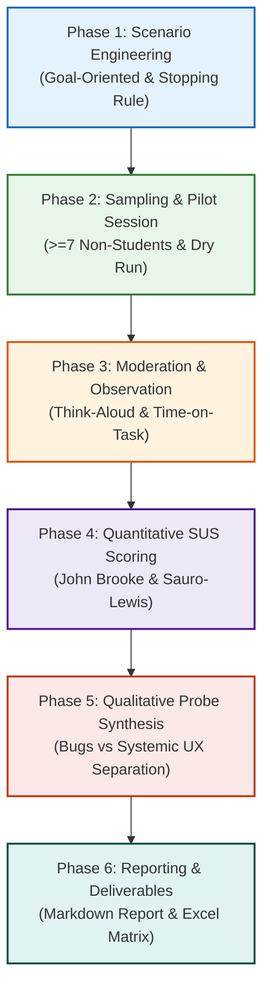

# Usability Evaluator Skill

A comprehensive, industry-standard methodology for conducting, moderating, scoring, and analyzing Usability Evaluations on software applications. Built upon the **System Usability Scale (SUS)** framework by John Brooke (1986), the **Sauro-Lewis Curved Grading Scale** (2012), and the **Concurrent Think-Aloud Protocol** (Ericsson & Simon, 1993).

---

## Skill Architecture & Directory Layout

```text
skills/usability-evaluator/
├── SKILL.md                          # Primary instruction manual (6-Phase Protocol)
├── resources/
│   ├── sus_scale_guide.md            # 10 SUS items, normalization formula & Sauro-Lewis curved grades
│   ├── moderator_guide.md            # Briefing script, Think-Aloud rules, 180s stopping rule, pilot protocol
│   └── task_scenario_template.md     # Goal-oriented scenario schema, measurement metrics, evaluation rubric
└── scripts/
    └── calculate_sus_and_export.py   # Automated SUS scoring engine & Excel matrix exporter (.xlsx)
```

---

## The 6-Phase Usability Evaluation Protocol



---

### Phase 1: Scenario Engineering (Goal-Oriented Design)

Usability testing evaluates whether a user can accomplish real-world business objectives using the software interface without prior training.

1. **Goal-Oriented over Procedural Instructions:**
   - **PROHIBITED (Procedural):** *"Click on the 'Sản phẩm' tab in the sidebar, click the green button 'Thêm sản phẩm', type 'Áo Thun Nam' into the first input, type 150000 into the price input, and click 'Lưu'."*
   - **MANDATORY (Goal-Oriented):** *"You are an inventory manager preparing for a weekend sale. Please register a new product named 'Áo Thun Nam' priced at 150,000 VND under the 'Thời trang' category into the system catalog."*
2. **Context & Motivation Injection:**
   - Provide realistic persona backgrounds, clear constraints, and realistic business goals.
   - Supply clean input test data (e.g., CSV files, product titles, discount percentages) in an external reference sheet.
3. **Strict Non-Leading Protocol:**
   - Never name UI component IDs, button colors, CSS layout positions, or direct click paths in the scenario text.
4. **Enforcing the Stopping Rule ($\le 180\text{s}$):**
   - Each goal must have a predefined maximum duration threshold of **180 seconds (3 minutes)**.
   - If a participant is blocked, loops erratically, or expresses fatal frustration for over 180s, the moderator must politely terminate the scenario and mark it as `Failed` to prevent testing fatigue.

*Reference Template:* See [task_scenario_template.md](resources/task_scenario_template.md).

---

### Phase 2: Participant Sampling & Pilot Session

To satisfy statistical validity and academic compliance, user recruitment and scenario validation must adhere to strict sampling criteria:

1. **Cohort Sample Size ($\ge 7$ Real External Participants):**
   - According to Nielsen & Landauer (1993), 5 participants discover $\approx 85\%$ of usability issues. Testing **7 participants** exceeds the saturation threshold and provides sufficient statistical power for SUS calculation ($N \ge 7$).
   - **External Requirement:** Participants must be external non-classmates (e.g., office workers, retail cashiers, small shop owners, e-commerce shoppers) representing realistic end-user diversity.
2. **Strict Identity Privacy Protection:**
   - Mask the middle 4 digits of all contact identifiers (e.g., Phone / Zalo: `090****567`, Email: `hiep****@gmail.com`).
   - Retain complete raw verification data securely for academic auditor verification upon request.
3. **Mandatory Pilot Session (Session 0):**
   - Conduct exactly **1 Pilot Session** prior to testing the 7 primary participants.
   - Objectives:
     - Verify task scenario clarity and eliminate ambiguous wording.
     - Calibrate time-on-task thresholds and test recording equipment.
     - Ensure SUT database seed state resets reliably between sessions.

---

### Phase 3: Session Moderation & Observation Protocol

During testing sessions, the moderator acts as an empathetic, neutral observer:

1. **Pre-Session Briefing (The Psychological Safety Rule):**
   - Deliver the standard pre-session script: *"We are testing the software interface, not you. There are no right or wrong answers. If you get stuck, it is the system's fault, not yours."*
2. **Concurrent Think-Aloud Protocol:**
   - Prompt participants to verbalize their thoughts, expectations, doubts, and emotions in real time:
     - *"What are you looking for right now?"*
     - *"What did you expect to happen when you clicked that?"*
   - Intervene only with neutral reminders (e.g., *"Please keep talking"*) if the user falls silent for $>10$ seconds.
3. **Measurement Metrics:**
   - **Time-on-Task (ToT):** Record exact elapsed seconds per task using a digital stopwatch.
   - **Task Completion Status:**
     - `Success`: Accomplished independently without hints within $\le 180$s.
     - `Partial Success`: Accomplished within $\le 180$s but required minor prompting or recovered after significant wandering.
     - `Failed`: Exceeded 180s, gave up, or produced incorrect/corrupted data.
   - **Behavioral Friction Observations:** Document hesitation pauses ($>5$s), misclicks, frantic tab switching, facial confusion, or verbal complaints.

*Reference Guide:* See [moderator_guide.md](resources/moderator_guide.md).

---

### Phase 4: Quantitative SUS Scoring & Benchmarking

Immediately after completing all tasks, each participant independently fills out the standard 10-item System Usability Scale (SUS) questionnaire (Brooke, 1986).

1. **Standard John Brooke Calculation Formula:**
   - For odd-numbered items ($1, 3, 5, 7, 9$):
     $$\text{Contribution} = X_i - 1$$
   - For even-numbered items ($2, 4, 6, 8, 10$):
     $$\text{Contribution} = 5 - X_i$$
   - Overall Participant SUS Score:
     $$\text{SUS Score} = \left(\sum \text{Odd Contribution} + \sum \text{Even Contribution}\right) \times 2.5$$
   - Scale range: $0$ to $100$ (Note: SUS is a percentile-based composite index, not a percentage).
2. **Sauro-Lewis (2012) Curved Grading Scale:**
   - Benchmark the cohort mean against the global industry baseline ($68.0$):
     - **$\ge 80.3$ (Grade A):** Excellent usability; promoters and high delight.
     - **$68.1 - 80.2$ (Grade B):** Good usability; above average, minor friction.
     - **$68.0$ (Baseline):** Industry average standard.
     - **$51.0 - 67.9$ (Grade C / D):** Marginal / Below average; significant friction requiring redesign.
     - **$< 51.0$ (Grade F):** Unacceptable; severe usability flaws, user rejection.

*Reference Guide:* See [sus_scale_guide.md](resources/sus_scale_guide.md).

---

### Phase 5: Qualitative Probe Synthesis & Defect Classification

Conduct a structured 4-question post-session interview, followed by rigorous classification of all findings:

1. **The 4 Qualitative Probes:**
   - **Probe 1 (Clarity):** *"Which part of the interface was the most confusing or unclear?"*
   - **Probe 2 (Error Recovery):** *"When something went wrong, did the system help you understand and fix it?"*
   - **Probe 3 (Speed & Efficiency):** *"Did you feel the system enabled fast workflows, or did it slow you down?"*
   - **Probe 4 (Trust & Confidence):** *"Would you trust this system to run a live commercial store every day?"*
2. **MANDATORY CRITICAL SEPARATION — Software Bugs vs. Systemic UX Issues:**
   Usability evaluations frequently uncover both software bugs and UX design flaws. Evaluators **MUST NOT** conflate the two:
   - **Functional Code Bugs (Khiếm khuyết mã nguồn):**
     - Concrete defects where the code violates intended functional requirements or crashes.
     - *Examples:* Revenue calculation doubled ($* 2$), CSV parser breaks on commas (`split(',')`), editing one product mass-renames all products (`fakeMassUpdatedProducts`), stored XSS vulnerabilities.
   - **Systemic UX Design Issues (Vấn đề thiết kế trải nghiệm người dùng):**
     - Flaws in visual design, information architecture, feedback communication, or ergonomic usability where code behaves as written but confuses human cognition.
     - *Examples:* Blank white table on empty data (missing empty state), unformatted 8-digit price strings (`30000000 ₫`), initial state overriding input placeholders without labels, undersized buttons violating Fitts's Law, inconsistent CTA colors across views.

---

### Phase 6: Reporting & Artifact Generation

Synthesize findings into high-impact deliverables:

1. **Automated Excel Matrix:**
   - Run the Python CLI script to generate the formatted spreadsheet:
     ```bash
     python skills/usability-evaluator/scripts/calculate_sus_and_export.py \
       --input usability/sus_data.json \
       --output usability/04_sus_scoring_matrix.xlsx
     ```
2. **Comprehensive Markdown Report (`02_Usability_Evaluation_Report.md`):**
   - Executive Summary with Mean SUS score and Sauro-Lewis grade.
   - Participant cohort demographics table (masked IDs).
   - Task performance matrix: Time-on-Task (Mean, SD), Completion Rates (Success, Partial, Fail).
   - Quantitative SUS item-by-item breakdown.
   - Qualitative findings grouped by the 4 Probes and the Severity Matrix (Critical, Major, Minor).
   - Clear architectural dichotomy between Functional Code Bugs and Systemic UX Issues.
   - Prioritized, actionable design recommendations.

---
*The `usability-evaluator` skill guarantees 100% compliance with international usability standards and university academic rigor.*
