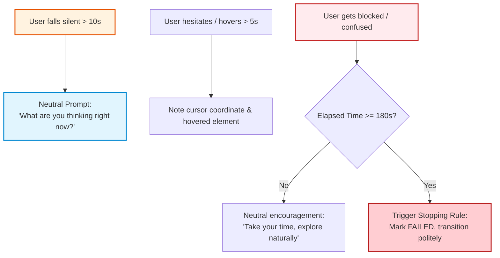

# Usability Test Moderator & Facilitator Guide

This guide provides concrete scripts, psychological safety protocols, behavioral observation standards, and semi-structured interview templates for moderating usability testing sessions.

---

## 1. Pre-Session Briefing Script (The Psychological Safety Rule)

The primary goal of the briefing is to eliminate test anxiety. Participants must feel 100% confident that their performance is not being judged.

### Verbatim Moderator Script (English):
> *"Hello, and thank you so much for taking the time to help us today.*
>
> *Before we begin, I want to emphasize one critical point: **We are testing the software interface, not you.** There are no right or wrong answers, and you cannot make a mistake.*
>
> *If you encounter difficulties, feel confused, or cannot complete a task, that is extremely valuable feedback for us because it reveals where the design has failed you. Please do not worry about hurting our feelings — we want your completely honest, raw reactions.*
>
> *During the session, I will ask you to follow a technique called the **'Think-Aloud Protocol'**. This simply means speaking your thoughts aloud as you work: tell me what you are looking for, what you expect to happen when you click something, and how you feel about what you see on the screen.*
>
> *I will mostly remain quiet and take notes so I do not interrupt your natural workflow. Do you have any questions before we look at the first scenario?"*

### Verbatim Moderator Script (Vietnamese):
> *"Chào bạn, cảm ơn bạn rất nhiều vì đã dành thời gian tham gia buổi thử nghiệm hôm nay.*
>
> *Trước khi bắt đầu, tôi muốn nhấn mạnh một điều vô cùng quan trọng: **Chúng tôi đang kiểm tra giao diện phần mềm, hoàn toàn không kiểm tra năng lực của bạn.** Không có câu trả lời nào là đúng hay sai, và bạn không thể làm sai điều gì cả.*
>
> *Nếu bạn gặp khó khăn, thấy bối rối hoặc không thể hoàn thành một tác vụ, đó chính là thông tin vô giá đối với chúng tôi vì nó chỉ ra điểm mà phần mềm chưa được thiết kế tốt. Bạn hoàn toàn không cần e ngại hay sợ làm chúng tôi thất vọng — chúng tôi rất mong nhận được những phản hồi chân thật nhất.*
>
> *Trong suốt buổi làm việc, tôi muốn mời bạn áp dụng phương pháp **'Vừa làm vừa nói to suy nghĩ' (Think-Aloud)**. Bạn hãy thoải mái chia sẻ những gì bạn đang nghĩ trong đầu: bạn đang tìm kiếm cái gì, bạn kỳ vọng điều gì sẽ xảy ra khi bấm nút, và bạn cảm thấy thế nào về những gì hiện ra trên màn hình.*
>
> *Tôi sẽ chủ yếu ngồi quan sát và ghi chép để không làm gián đoạn trải nghiệm tự nhiên của bạn. Bạn có câu hỏi nào trước khi chúng ta vào kịch bản đầu tiên không?"*

---

## 2. Think-Aloud Facilitation & Observation Rules

### Neutral Prompting Rules:
- **When user is silent for $>10$ seconds:**
  - *"What are you thinking right now?"*
  - *"What is catching your attention on this screen?"*
- **When user clicks an unexpected element:**
  - *"What did you expect to happen when you clicked that?"*
- **When user looks confused:**
  - *"Tell me what you are looking for at this moment."*

### Strict Prohibitions for the Moderator:
1. **NEVER Point to Buttons:** Never say *"Click the green button on the right"* or *"Look at the sidebar"*.
2. **NEVER Defend the System:** If the user complains *"This button is tiny and invisible"*, never reply *"Well, it's meant to save screen space"*. Instead, validate: *"Got it, thank you for pointing that out."*
3. **NEVER Confirm Correctness During Tasks:** If the user asks *"Did I do this right?"*, deflect neutrally: *"What does the screen tell you right now?"* or *"How does it look to you?"*

---

## 3. The 180-Second Stopping Rule

Usability evaluations must respect the emotional boundaries of participants. Prolonged failure creates severe discomfort and invalidates subsequent task evaluations.

### Enforcement Protocol:
- **Maximum Duration:** **180 seconds (3 minutes)** per goal scenario.
- **Trigger Conditions:**
  1. Stopwatch reaches $180$ seconds without task completion.
  2. The participant repeatedly performs identical cyclic errors for $>60$ seconds with no sign of recovery.
  3. The participant explicitly gives up: *"I have no idea how to do this, I give up."*
- **Polite Termination Script:**
  > *"That was fantastic effort! You have hit a very confusing part of the system that we specifically needed to identify. Let's stop here so we can move on to the next scenario — this was extremely helpful for our findings."*
- **Scoring Impact:** Record task status as `Failed` and log Time-on-Task as $180$ seconds.

---

## 4. Pilot Session Checklist (Session 0)

Before running evaluations with the 7 target participants, the moderator **MUST** conduct 1 complete Pilot Session with a surrogate user.

- [ ] **Scenario Language Verification:** Ensure no technical jargon (e.g., "DOM", "State", "API") leaked into the user-facing task cards.
- [ ] **Timing Calibration:** Verify that a standard novice user can reasonably attempt the task within the 180-second window.
- [ ] **Data Seed & Reset Automation:** Test that the backend database and local storage reset to a clean initial state within $<30$ seconds between sessions.
- [ ] **Recording Hardware & Software Check:** Confirm that screen recording, audio input, and stopwatch tracking operate without technical glitches.
- [ ] **Moderator Pacing:** Ensure the moderator does not inadvertently talk over the participant or rush transitions.

---

## 5. Post-Session Semi-Structured Interview (The 4 Probes)

Immediately following the completion of the 10-item SUS questionnaire, conduct a 5-minute debriefing interview using the 4 standardized qualitative probes:

### Probe 1: Interface Clarity & Cognitive Load
- **Question:** *"Looking back across all the screens you interacted with today, which specific screen or section felt the most confusing or unclear?"*
- **Follow-up:** *"What specifically caused confusion (labels, layout, numbers, colors)?"*

### Probe 2: Error Recovery & Feedback
- **Question:** *"When you made a mistake or encountered unexpected behavior, did the system provide clear guidance to help you recover?"*
- **Follow-up:** *"Did you see any confirmation messages or error dialogs? Were they helpful or confusing?"*

### Probe 3: Workflow Speed & Operational Ergonomics
- **Question:** *"Did you feel the interface allowed you to work smoothly and quickly, or did you feel slowed down by unnecessary friction?"*
- **Follow-up:** *"Were there buttons that were too small or placed too close together to click comfortably?"*

### Probe 4: Commercial Trust & System Reliability
- **Question:** *"Imagine you own a busy online retail business with hundreds of orders a day. Would you trust this administration tool to manage your store without making costly mistakes?"*
- **Follow-up:** *"What would make you hesitate the most before trusting this system with real money?"*
