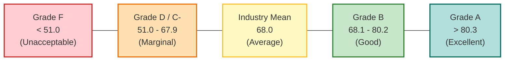

# System Usability Scale (SUS) Reference & Scoring Guide

The **System Usability Scale (SUS)**, created by John Brooke in 1986, is the de facto global industry standard for measuring the perceived usability of software systems, web applications, and digital interfaces.

---

## 1. Standard 10 Questionnaire Items (Bilingual English - Vietnamese)

Each item is scored on a 5-point Likert scale:
- `1` = Strongly Disagree / Hoàn toàn không đồng ý
- `2` = Disagree / Không đồng ý
- `3` = Neutral / Trung lập (Không có ý kiến)
- `4` = Agree / Đồng ý
- `5` = Strongly Agree / Hoàn toàn đồng ý

| Item # | Valence | English Item Statement | Bản Dịch Tiếng Việt Chuẩn Hóa |
|:---:|:---:|:---|:---|
| **Q01** | Positive (+) | I think that I would like to use this system frequently. | Tôi nghĩ rằng tôi sẽ muốn sử dụng hệ thống này thường xuyên. |
| **Q02** | Negative (-) | I found the system unnecessarily complex. | Tôi thấy hệ thống phức tạp một cách không cần thiết. |
| **Q03** | Positive (+) | I thought the system was easy to use. | Tôi nghĩ rằng hệ thống rất dễ sử dụng. |
| **Q04** | Negative (-) | I think that I would need the support of a technical person to be able to use this system. | Tôi nghĩ rằng tôi sẽ cần sự hỗ trợ của chuyên viên kỹ thuật để có thể sử dụng hệ thống này. |
| **Q05** | Positive (+) | I found the various functions in this system were well integrated. | Tôi nhận thấy các chức năng khác nhau trong hệ thống này được tích hợp rất tốt. |
| **Q06** | Negative (-) | I thought there was too much inconsistency in this system. | Tôi nghĩ rằng có quá nhiều sự thiếu nhất quán trong hệ thống này. |
| **Q07** | Positive (+) | I would imagine that most people would learn to use this system very quickly. | Tôi nghĩ rằng hầu hết mọi người sẽ học cách sử dụng hệ thống này rất nhanh. |
| **Q08** | Negative (-) | I found the system very cumbersome to use. | Tôi thấy hệ thống rất rườm rà, bất tiện khi sử dụng. |
| **Q09** | Positive (+) | I felt very confident using the system. | Tôi cảm thấy rất tự tin khi sử dụng hệ thống. |
| **Q10** | Negative (-) | I needed to learn a lot of things before I could get going with this system. | Tôi cần phải học rất nhiều điều trước khi có thể bắt đầu làm việc trôi chảy với hệ thống này. |

> [!NOTE]
> **Valence Alternation:** The alternating positive and negative polarity is an intentional psychometric design feature to mitigate acquiescence bias (the tendency of respondents to agree with all statements) and extreme response bias.

---

## 2. Mathematical Normalization & Scoring Formula

Raw scores range from 1 to 5. To convert raw responses into a standardized $0 - 100$ scale:

### Step 1: Calculate Normalized Item Contributions ($S_i$)
- For **Odd-numbered items** ($i \in \{1, 3, 5, 7, 9\}$):
  $$S_i = X_i - 1 \quad \implies \quad \text{Range: } 0 \text{ to } 4$$
- For **Even-numbered items** ($i \in \{2, 4, 6, 8, 10\}$):
  $$S_i = 5 - X_i \quad \implies \quad \text{Range: } 0 \text{ to } 4$$

### Step 2: Sum the Normalized Contributions
$$\text{Sum} = \sum_{i=1}^{10} S_i = \sum_{\text{odd}} (X_i - 1) + \sum_{\text{even}} (5 - X_i) \quad \implies \quad \text{Range: } 0 \text{ to } 40$$

### Step 3: Scale to 100
$$\text{SUS Score} = \text{Sum} \times 2.5 \quad \implies \quad \text{Range: } 0 \text{ to } 100$$

### Cohort Mean SUS Score:
$$\overline{\text{SUS}} = \frac{1}{N} \sum_{k=1}^{N} \text{SUS}_k$$

---

## 3. Sauro-Lewis (2012) Curved Grading Scale & Benchmarks

A common misconception is treating a SUS score as a percentage (e.g., thinking 68/100 is a "D" grade). Scientifically, SUS is a **percentile ranking** based on an empirical distribution of over 5,000 product evaluations (Sauro & Lewis, 2012; Bangor, Kortum, & Miller, 2008):

| SUS Score Range | Sauro-Lewis Grade | Percentile Rank | Adjective Rating | Acceptability Range | Net Promoter Category |
|:---:|:---:|:---:|:---:|:---:|:---:|
| **$\ge 80.3$** | **Grade A** | 90th – 100th | Excellent / Best Imaginable | Acceptable | **Promoters** (Loyal advocates) |
| **$68.1 - 80.2$** | **Grade B** | 50th – 89th | Good / Above Average | Acceptable | **Passives** (Satisfied, vulnerable) |
| **$68.0$** | **Industry Baseline** | **50th** | **Average** | **Marginal** | **Neutral** |
| **$51.0 - 67.9$** | **Grade C / D** | 15th – 49th | OK / Marginal / Below Average | Marginal | **Detractors** (Struggling users) |
| **$< 51.0$** | **Grade F** | 0 – 14th | Poor / Worst Imaginable | Not Acceptable | **Detractors** (High churn & frustration) |

---

## 4. Subscale Analysis: Usability vs. Learnability

Research by Lewis & Sauro (2009) demonstrated that SUS possesses a two-factor structure:
- **Usability Subscale (8 items):** Items 1, 2, 3, 5, 6, 7, 8, 9. Measures overall ergonomic ease, task flow, and operational efficiency.
- **Learnability Subscale (2 items):** Items 4 and 10. Specifically measures how easily a novice acquires system proficiency without technical guidance.

If Learnability scores lag significantly behind Usability scores, the product requires better onboarding, inline tooltips, and clearer default form states.

---

## 5. Administration Best Practices & Common Pitfalls

1. **Timing of Administration:**
   - Administer immediately following the completion of all evaluation tasks, while user impressions are fresh.
2. **Never Discuss Items:**
   - Do not explain or debate the wording of statements with participants. If a participant asks *"What does 'cumbersome' mean?"*, reply neutrally: *"Interpret it in whatever way makes sense to you based on your experience."*
3. **Handle Missing Items:**
   - If a participant accidentally leaves an item blank, industry convention assigns the neutral value of `3` to preserve calculation integrity.
4. **Never Change Wording:**
   - The psychometric validity of the SUS depends on preserving the exact wording validated across thousands of studies. The term *"system"* may be substituted with the product name (e.g., *"this software"* or *"EShop Web Admin"*), but other terms must remain untouched.
