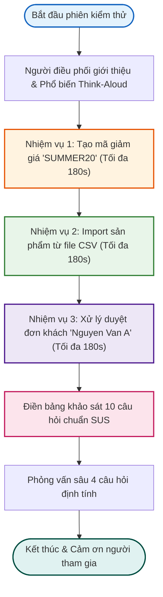
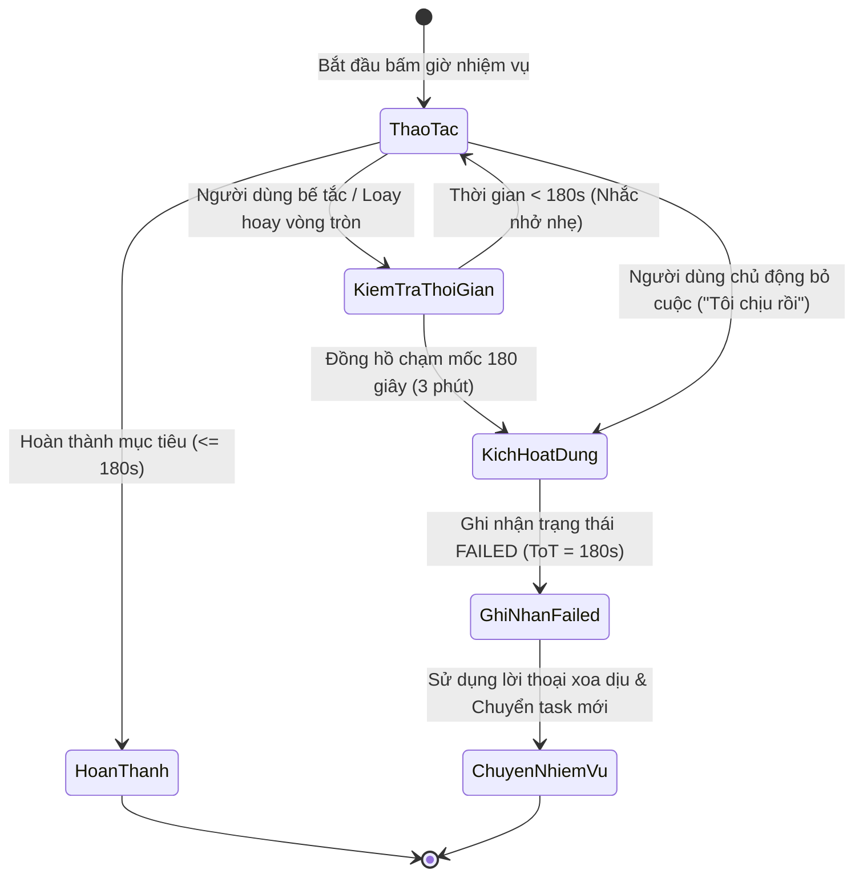

# KẾ HOẠCH & KỊCH BẢN KIỂM THỬ TRẢI NGHIỆM NGƯỜI DÙNG (USABILITY TESTING PLAN)
## Phân Hệ Quản Trị Hệ Thống EShop (`frontend-admin`)

> **Môn học:** Kiểm thử phần mềm (Software Testing) – FIT@HCMUS  
> **Bài tập:** HW03 – Task 2: Usability Evaluation  
> **Sinh viên thực hiện:** Trần Đại Hiệp – **MSSV:** 23120256  
> **Email:** `23120256@student.hcmus.edu.vn`  
> **Đối tượng kiểm thử (SUT):** [EShop Web Admin (`frontend-admin`)](https://github.com/ttbhanh/eshop-sut) (React SPA + Vite)  
> **Môi trường thực nghiệm:** `http://localhost:5174` (Frontend Admin) | `http://localhost:3000` (Backend API Express + SQLite)  
> **Phương pháp luận:** Giao mục tiêu mở (Goal-Oriented Scenarios), Giao thức Suy nghĩ thành tiếng (Concurrent Think-Aloud), Quy tắc dừng 180s (Stopping Rule), Thang đo Quốc tế SUS (John Brooke, 1986) & Đường cong Sauro-Lewis (2012).  

---

## 1. Mục Đích & Phạm Vi Đánh Giá

### 1.1 Mục tiêu nghiên cứu (Research Objectives)
1. **Đo lường tính khả dụng định lượng (Quantitative Usability):** Thu thập dữ liệu thời gian thực hiện tác vụ (Time-on-Task), tỷ lệ hoàn thành tác vụ (Task Completion Rate: Thành công / Thành công một phần / Thất bại) và chỉ số hài lòng tổng thể thông qua thang đo quốc tế **System Usability Scale (SUS)**.
2. **Khám phá điểm nghẽn tương tác định tính (Qualitative Friction Points):** Nhận diện những khó khăn nhận thức, sự bối rối thị giác, thao tác nhầm lẫn và rào cản thao tác mà người dùng thực tế gặp phải khi quản lý cửa hàng trực tuyến.
3. **Phân định ranh giới lỗi kỹ thuật và khiếm khuyết thiết kế (Defect Classification):** Tách bạch rõ ràng giữa **Lỗi mã nguồn (Functional Code Bugs)** và **Vấn đề thiết kế trải nghiệm người dùng (Systemic UX Design Issues)**.

### 1.2 Phạm vi nghiệp vụ kiểm thử (Target Scope)
Kiểm thử tập trung vào **3 màn hình quản trị cốt lõi** trong phạm vi đồ án cá nhân:
- **Tab Quản lý Mã Giảm Giá (Coupons):** Thiết lập chính sách khuyến mãi và ràng buộc giá trị đơn hàng.
- **Tab Quản lý Sản phẩm (Products & CSV Import):** Nạp dữ liệu danh mục hàng loạt qua tệp bảng tính CSV.
- **Tab Quản lý Đơn Hàng (Orders):** Quy trình tiếp nhận, xác nhận duyệt đơn và điều phối giao hàng.

---

## 2. Kịch Bản Kiểm Thử Chi Tiết 3 Mục Tiêu Nghiệp Vụ (Goal-Oriented Tasks)

Các nhiệm vụ được thiết kế theo chuẩn **Mục tiêu mở (Goal-Oriented)**: Đặt người dùng vào bối cảnh công việc thực tế, giao mục tiêu rõ ràng và cung cấp dữ liệu tham chiếu, **tuyệt đối không chỉ dẫn thao tác bấm chuột (No Procedural Instructions)** nhằm quan sát hành vi tự nhiên nhất của người dùng.



---

### 🎯 Nhiệm vụ 1 (Task 1): Thiết Lập Mã Giảm Giá Khuyến Mãi `SUMMER20`

- **Mã kịch bản:** `TS-01`
- **Màn hình mục tiêu:** Tab Quản lý Mã Giảm Giá (`activeTab = "coupons"`)
- **Vai trò người dùng (Persona):** Chuyên viên Tiếp thị & Bán hàng (Marketing Specialist)
- **Bối cảnh nghiệp vụ:** Cửa hàng EShop chuẩn bị triển khai chiến dịch kích cầu mua sắm mùa hè. Bạn cần đưa ra một chương trình ưu đãi hấp dẫn để thu hút các đơn hàng có giá trị cao, đồng thời thiết lập các chốt chặn điều kiện để tránh việc khách hàng lạm dụng mã gây thâm hụt ngân sách cửa hàng.
- **Phiếu giao nhiệm vụ cho người dùng (Task Card):**
  > *"Bạn hãy tạo một mã giảm giá khuyến mãi mới trên hệ thống mang tên **`SUMMER20`**, áp dụng mức giảm giá **20%**. Để đảm bảo hiệu quả kinh doanh, mã này chỉ có hiệu lực cho các đơn hàng từ **200.000 ₫** trở lên, mỗi khách hàng chỉ được áp dụng tối đa **1 lần**, và mã có thời hạn sử dụng đến hết ngày **31/12/2026**."*

#### Dữ liệu tham chiếu đầu vào (Reference Data Sheet):
| Tên Trường Thông Tin | Giá Trị Cần Thiết Lập | Ghi Chú Nghiệp Vụ |
|:---|:---|:---|
| **Mã Coupon (Code)** | `SUMMER20` | Viết hoa, không dấu, không khoảng trắng |
| **Loại giảm giá (Type)** | Phần trăm (`percent`) | Giảm theo tỷ lệ % giá trị đơn |
| **Giá trị giảm (Value)** | `20` | Giảm 20% |
| **Đơn tối thiểu (Min Order)** | `200000` | Tối thiểu 200.000 ₫ mới được dùng |
| **Số lần dùng tối đa/người** | `1` | Mỗi tài khoản chỉ dùng 1 lần |
| **Ngày hết hạn (Expiry Date)** | `2026-12-31` | Hết hạn cuối năm 2026 |

#### Tiêu chí đánh giá mức độ hoàn thành:
- **Thành công (Success - 100%):** Người dùng nhập đúng và đầy đủ các trường dữ liệu, bấm tạo mã thành công và mã `SUMMER20` xuất hiện ngay ngắn trong bảng danh sách phía dưới trong vòng $\le 180$ giây.
- **Thành công một phần (Partial Success - 50%):** Tạo được mã nhưng gặp lúng túng mất nhiều thời gian do giá trị mặc định của hệ thống, hoặc nhập nhầm loại giảm giá rồi phải tự chỉnh sửa lại.
- **Thất bại (Failed - 0%):** Vượt quá ngưỡng thời gian 180 giây, bỏ cuộc giữa chừng, hoặc không thể tạo được mã do không hiểu form nhập liệu.

#### Điểm nghẽn UX & Khiếm khuyết hệ thống dự kiến quan sát:
1. **Mất nhãn input do giá trị mặc định (`BUG_ADMIN_16`):** Khi vừa vào màn hình, React State `{ min_order_amount: 0, max_uses_per_user: 1 }` đè lên placeholder; form hoàn toàn không có thẻ `<label>`, người dùng chỉ nhìn thấy hai ô số `0` và `1` trơ trọi mà không biết dùng để làm gì.
2. **Nhãn "Giá trị" tĩnh (`BUG_ADMIN_20`):** Khi chuyển qua lại giữa "Phần trăm" và "Số tiền cố định", ô nhập liệu vẫn giữ nguyên nhãn tĩnh không đổi hậu tố `%` hay `₫`.
3. **Màu nút CTA phân mảnh (`BUG_ADMIN_01`):** Nút tạo mã mang màu cam (`bg-orange-500`), lệch chuẩn với màu xanh ở các màn hình khác.

---

### 🎯 Nhiệm vụ 2 (Task 2): Nhập Danh Sách Sản Phẩm Hàng Loạt Qua Tệp `sample_products.csv`

- **Mã kịch bản:** `TS-02`
- **Màn hình mục tiêu:** Tab Quản lý Sản phẩm (`activeTab = "products"`)
- **Vai trò người dùng (Persona):** Nhân viên Quản lý Kho & Danh mục (Inventory Associate)
- **Bối cảnh nghiệp vụ:** Nhà cung cấp vừa bàn giao một lô hàng thời trang mới gồm 3 mặt hàng may mặc. Thay vì tốn thời gian gõ từng sản phẩm bằng tay, bạn cần sử dụng tính năng nạp tệp CSV của hệ thống để đồng bộ toàn bộ lô hàng vào kho trong một lần thao tác.
- **Phiếu giao nhiệm vụ cho người dùng (Task Card):**
  > *"Bạn có một tệp dữ liệu bảng tính mang tên **`sample_products.csv`** lưu sẵn trên máy tính chứa danh sách 3 sản phẩm mới. Hãy kiểm tra tính năng nạp dữ liệu của hệ thống, tải tệp mẫu của cửa hàng nếu thấy cần thiết để kiểm tra cấu trúc, sau đó nạp tệp **`sample_products.csv`** vào kho hàng và xác nhận danh sách sản phẩm xuất hiện đầy đủ trên màn hình."*

#### Dữ liệu tham chiếu tệp `sample_products.csv`:
```csv
name,price,description,imageUrl,category_id
Áo Thun Basic Cotton,150000,Áo thun cotton thoáng mát co giãn 4 chiều,https://placehold.co/300,1
Quần Jean Nam Slimfit,350000,Quần jean denim cao cấp phong cách trẻ trung,https://placehold.co/300,1
Váy Nữ Mùa Hè Họa Tiết,280000,Váy voan nhẹ nhàng phù hợp dạo phố,https://placehold.co/300,1
```

#### Tiêu chí đánh giá mức độ hoàn thành:
- **Thành công (Success - 100%):** Người dùng tìm thấy khu vực Import CSV, chọn tệp `sample_products.csv`, xem trước (preview) dữ liệu hợp lệ và bấm xác nhận nạp thành công cả 3 sản phẩm vào bảng trong vòng $\le 180$ giây.
- **Thành công một phần (Partial Success - 50%):** Chọn nhầm tệp khác hoặc lúng túng giữa form thêm thủ công và khu vực CSV, nhưng sau đó tự định hướng lại và nạp thành công trong thời gian cho phép.
- **Thất bại (Failed - 0%):** Quá 180 giây, không tìm thấy nút upload CSV, hoặc thao tác nhầm vào nút xóa dữ liệu sẵn có trong kho.

#### Điểm nghẽn UX & Khiếm khuyết hệ thống dự kiến quan sát:
1. **Thiếu bộ lọc đuôi file (`BUG_ADMIN_11`):** Input file thiếu thuộc tính `accept=".csv"`, khi mở hộp thoại chọn tệp hệ thống cho phép chọn mọi loại file lạ, dễ gây nhầm lẫn.
2. **Giá tiền dính chùm không có dấu phân cách (`BUG_ADMIN_09`):** Sau khi nạp thành công, bảng danh mục hiển thị số tiền nguyên dính liền như `150000 ₫`, `350000 ₫` rất khó đọc bằng mắt thường.
3. **Nút Sửa và Xóa nằm quá sát nhau (`BUG_ADMIN_13`, `BUG_ADMIN_14`):** Nút Sửa màu vàng và nút Xóa màu đỏ nằm sát cạnh nhau trong cùng một ô; nếu bấm nhầm nút Xóa, sản phẩm biến mất ngay lập tức không có hộp thoại xác nhận.

---

### 🎯 Nhiệm vụ 3 (Task 3): Tiếp Nhận, Xử Lý & Duyệt Đơn Hàng Của Khách "Nguyen Van A"

- **Mã kịch bản:** `TS-03`
- **Màn hình mục tiêu:** Tab Quản lý Đơn Hàng (`activeTab = "orders"`)
- **Vai trò người dùng (Persona):** Chuyên viên Điều phối Đơn hàng (Fulfillment & Dispatch Officer)
- **Bối cảnh nghiệp vụ:** Khách hàng **"Nguyen Van A"** vừa đặt thành công một đơn hàng trực tuyến và đang chờ cửa hàng xác nhận. Là người phụ trách xử lý đơn, bạn cần tìm kiếm đơn hàng của khách, kiểm tra thông tin địa chỉ, tiến hành duyệt đơn để chuyển hàng cho kho chuẩn bị, cập nhật trạng thái giao hàng cho bưu tá, và xác nhận hoàn tất khi khách nhận hàng thành công.
- **Phiếu giao nhiệm vụ cho người dùng (Task Card):**
  > *"Hãy vào khu vực quản lý đơn hàng của hệ thống. Tìm đơn hàng mới nhất đang chờ xử lý của khách hàng mang tên **'Nguyen Van A'**. Tiến hành duyệt đơn hàng này, sau đó cập nhật quy trình để chuyển sang trạng thái đang giao hàng, và cuối cùng hoàn thành đơn hàng sau khi bưu tá đã giao thành công."*

#### Dữ liệu tham chiếu đơn hàng cần xử lý:
| Tiêu Chí | Thông Tin Đơn Hàng Cần Tìm & Xử Lý |
|:---|:---|
| **Tên khách hàng (Customer)** | `Nguyen Van A` |
| **Trạng thái ban đầu** | Đang chờ duyệt (`pending` - Huy hiệu màu vàng) |
| **Quy trình chuyển đổi trạng thái** | `pending` (Chờ xử lý) $\rightarrow$ Duyệt đơn $\rightarrow$ `confirmed` (Đã xác nhận) $\rightarrow$ Giao hàng $\rightarrow$ `shipping` (Đang giao) $\rightarrow$ Hoàn thành $\rightarrow$ `delivered` (Đã giao thành công) |

#### Tiêu chí đánh giá mức độ hoàn thành:
- **Thành công (Success - 100%):** Tìm đúng đơn của "Nguyen Van A", thực hiện chuẩn xác chuỗi chuyển đổi trạng thái đến mức `delivered` (huy hiệu màu xanh lá) mà không bấm nhầm nút Hủy đơn trong vòng $\le 180$ giây.
- **Thành công một phần (Partial Success - 50%):** Hoàn thành quy trình nhưng mất thời gian tìm kiếm do bảng không có ô tìm kiếm/lọc, hoặc bấm nhầm một lần nhưng kịp thời khắc phục.
- **Thất bại (Failed - 0%):** Quá 180 giây, bấm nhầm nút Hủy (`canceled`) làm hủy mất đơn của khách hàng, hoặc không phân biệt được trạng thái đơn.

#### Điểm nghẽn UX & Khiếm khuyết hệ thống dự kiến quan sát:
1. **Thiếu thanh tìm kiếm & bộ lọc (`BUG_ADMIN_22`):** Trang đơn hàng hoàn toàn không có ô tìm kiếm tên khách hay lọc theo trạng thái, buộc người dùng phải lướt bằng mắt để tìm đơn.
2. **Kích thước nút bấm siêu nhỏ vi phạm định luật Fitts (`BUG_ADMIN_24`):** Các nút chuyển trạng thái chỉ mang kích thước `text-xs px-2 py-1`, rất khó nhắm bấm chính xác bằng chuột trên laptop.
3. **Nút Xác nhận và nút Hủy đặt sát nhau nguy hiểm (`BUG_ADMIN_25`):** Nút màu tím (Xác nhận) và nút màu đỏ (Hủy) nằm cạnh nhau không có khoảng đệm, người dùng dễ bấm trượt làm hủy đơn khách hàng.
4. **Vi phạm State Machine (`BUG_ADMIN_27`):** Đơn đã hủy vẫn hiện nút cho phép đánh dấu đã giao, gây mâu thuẫn nhận thức về luồng trạng thái.

---

## 3. Lời Thoại Mở Đầu Dành Cho Người Điều Phối (Moderator Script)

Lời thoại được xây dựng dựa trên nguyên tắc **Tâm lý an toàn tuyệt đối (Psychological Safety)** theo chuẩn quốc tế của Nielsen Norman Group và Rubin & Chisnell (2008), đảm bảo người dùng hoàn toàn cởi mở, không có tâm lý e sợ bị đánh giá năng lực:

### 3.1 Lời thoại mở đầu chuẩn mực (Bản tiếng Việt):
> *"Xin chào bạn! Lời đầu tiên, tôi xin chân thành cảm ơn bạn đã dành thời gian quý báu để tham gia buổi thử nghiệm giao diện phần mềm cùng chúng tôi hôm nay.*
>
> *Trước khi chúng ta bắt đầu, tôi muốn chia sẻ với bạn một điều quan trọng nhất: **Hôm nay chúng tôi đang kiểm tra giao diện và tính dễ dùng của hệ thống phần mềm này, hoàn toàn không kiểm tra năng lực hay kiến thức của bạn.** Trong buổi làm việc này, không có bất kỳ câu trả lời hay thao tác nào là đúng hay sai cả, và bạn không thể làm hỏng bất cứ thứ gì trên máy tính này.*
>
> *Nếu trong quá trình thao tác, bạn gặp khó khăn, thấy bối rối, không tìm thấy nút bấm hoặc không hoàn thành được mục tiêu, bạn hãy yên tâm rằng **đó hoàn toàn là lỗi do phần mềm chưa được thiết kế tốt**, chứ tuyệt đối không phải lỗi của bạn. Những điểm bạn thấy vướng mắc chính là những phát hiện quý giá nhất giúp chúng tôi cải tiến phần mềm tốt hơn.*
>
> *Trong suốt buổi thử nghiệm, tôi muốn mời bạn sử dụng một phương pháp gọi là **'Suy nghĩ thành tiếng' (Think-Aloud Protocol)**. Điều này rất đơn giản: khi bạn nhìn vào màn hình và thực hiện nhiệm vụ, bạn hãy nói to những gì đang xuất hiện trong đầu bạn ra thành lời. Ví dụ: bạn đang tìm kiếm cái gì, bạn định nhấp vào đâu, bạn kỳ vọng điều gì sẽ xảy ra sau cú click đó, và bạn cảm thấy thế nào về những gì hiện lên trước mắt.*
>
> *Tôi sẽ ngồi cạnh bạn để ghi chép và đo thời gian, tôi sẽ giữ im lặng phần lớn thời gian để bạn có không gian trải nghiệm tự nhiên nhất. Thỉnh thoảng nếu bạn im lặng hơi lâu, tôi có thể xin phép hỏi nhẹ: 'Bạn đang nghĩ gì thế?' để nhắc bạn tiếp tục nói to suy nghĩ.*
>
> *Mỗi nhiệm vụ chúng ta sẽ có tối đa 3 phút để khám phá. Bạn có câu hỏi hay băn khoăn nào trước khi chúng ta đọc kịch bản nhiệm vụ đầu tiên không?"*

---

### 3.2 Lời thoại mở đầu chuẩn mực (Bản tiếng Anh đối chiếu):
> *"Hello, and welcome! Thank you so much for taking the time to join our usability testing session today.*
>
> *Before we begin, I want to emphasize our most critical ground rule: **We are testing the software interface, not you.** There are no right or wrong actions here, and you cannot break anything.*
>
> *If you get stuck, feel confused, or cannot complete a goal, please remember that **it is 100% the system's fault, never yours.** Identifying where the system fails to guide you is exactly why we are here today.*
>
> *Throughout the session, I encourage you to use the **'Think-Aloud Protocol'**. Simply verbalize your thoughts as you navigate: tell me what you are looking for, what you expect to happen when clicking a button, and how you feel about what you see on the screen.*
>
> *I will mostly remain silent and take notes. Each task has a comfort limit of 3 minutes. Do you have any questions before we jump into the first task?"*

---

### 3.3 Quy tắc ứng xử & Lời nhắc trung tính trong lúc quan sát (Neutral Moderation Rules):
1. **Nguyên tắc "Khuôn mặt lạnh" (Poker Face):** Không gật đầu, lắc đầu, cười trừ hay tỏ thái độ ngạc nhiên trước thao tác của người dùng.
2. **Cấm tuyệt đối hành vi chỉ trỏ (No Button Pointing):** Tuyệt đối không bao giờ nói: *"Nút ở góc bên phải kìa"* hoặc *"Bấm vào tab Sản phẩm đi"*.
3. **Mớm lời trung tính khi người dùng im lặng $>10$ giây:**
   - *"Bạn đang nhìn vào khu vực nào thế?"*
   - *"Điều gì đang khiến bạn băn khoăn vào lúc này?"*
   - *"Bạn kỳ vọng hệ thống sẽ phản hồi như thế nào sau thao tác vừa rồi?"*
4. **Ứng phó khi người dùng hỏi trợ giúp ("Tôi làm thế này có đúng không?"):**
   - Phản hồi trung tính: *"Theo cảm nhận của bạn thì hệ thống đang thông báo như thế nào?"* hoặc *"Bạn cứ thao tác theo cách bạn thấy hợp lý nhất nhé."*

---

## 4. Xác Lập Tiêu Chí Đo Lường & Quy Tắc Dừng (Stopping Rule)

### 4.1 Bảng Ma Trận Đánh Giá Kết Quả Tác Vụ (Task Completion Rubric)

| Mức Độ Hoàn Thành | Điểm Lượng Hóa | Tiêu Chí Xác Định Cụ Thể |
|:---:|:---:|:---|
| **Thành Công (Success)** | **1.0 (100%)** | Người dùng đạt được chính xác kết quả nghiệp vụ mà không cần bất kỳ sự can thiệp, gợi ý hay chỉ dẫn nào từ người điều phối, trong thời gian $\le 180$ giây. |
| **Thành Công Một Phần (Partial Success)** | **0.5 (50%)** | Người dùng đạt được kết quả nghiệp vụ trong thời gian $\le 180$ giây, nhưng cần người điều phối đọc lại đầu bài một lần, mất nhiều thời gian do thao tác nhầm lẫn rồi tự quay đầu lại, hoặc bỏ sót 1 điều kiện phụ không trọng yếu. |
| **Thất Bại (Failed)** | **0.0 (0%)** | Người dùng vượt quá ngưỡng thời gian 180 giây, thực hiện hành động hủy hoại không thể phục hồi (như bấm nhầm nút Hủy đơn hàng), hoặc chủ động bày tỏ sự bất lực và xin bỏ cuộc. |

---

### 4.2 Quy Tắc Dừng Tác Vụ Sau Tối Đa 3 Phút (The 180-Second Stopping Rule)

Để bảo vệ tâm lý người tham gia, ngăn ngừa sự ức chế kéo dài làm sai lệch kết quả của các tác vụ tiếp theo, quy tắc dừng được áp đặt nghiêm ngặt:



#### Điều kiện kích hoạt dừng tác vụ:
1. Đồng hồ bấm giờ chạm ngưỡng **180 giây (3 phút 00 giây)**.
2. Người dùng rơi vào vòng lặp thao tác sai lầm giống nhau quá 3 lần liên tiếp trong hơn 60 giây mà không có dấu hiệu nhận biết được lỗi.
3. Người dùng phát tín hiệu từ bỏ: *"Cái này khó quá, tôi không biết làm thế nào tiếp theo nữa, tôi xin dừng ở đây."*

#### Lời thoại kết thúc văn minh (Polite Termination Script):
> *"Cảm ơn bạn rất nhiều! Bạn đã làm rất tốt. Bạn vừa chạm vào đúng một điểm nghẽn giao diện cực kỳ khó hiểu mà chúng tôi đang muốn ghi nhận trên hệ thống này. Chúng ta hãy tạm dừng nhiệm vụ này ở đây để dành năng lượng bước sang nhiệm vụ tiếp theo nhé — dữ liệu bạn vừa tạo ra là vô cùng giá trị!"*

---

## 5. Thang Đo Quốc Tế SUS & Phỏng Vấn Sâu Định Tính (Post-Test Protocol)

### 5.1 Thang đo chuẩn hóa SUS (System Usability Scale - 10 câu hỏi)
Ngay sau khi kết thúc cả 3 nhiệm vụ, người dùng sẽ tự mình hoàn thành bảng khảo sát 10 câu hỏi chuẩn mực của John Brooke (1986) trên thang điểm từ 1 (Rất không đồng ý) đến 5 (Rất đồng ý):
- **Q01 (+):** Tôi nghĩ rằng tôi sẽ muốn sử dụng hệ thống này thường xuyên.
- **Q02 (-):** Tôi thấy hệ thống phức tạp một cách không cần thiết.
- **Q03 (+):** Tôi nghĩ rằng hệ thống rất dễ sử dụng.
- **Q04 (-):** Tôi nghĩ rằng tôi sẽ cần sự hỗ trợ của chuyên viên kỹ thuật để có thể sử dụng hệ thống này.
- **Q05 (+):** Tôi nhận thấy các chức năng khác nhau trong hệ thống này được tích hợp rất tốt.
- **Q06 (-):** Tôi nghĩ rằng có quá nhiều sự thiếu nhất quán trong hệ thống này.
- **Q07 (+):** Tôi nghĩ rằng hầu hết mọi người sẽ học cách sử dụng hệ thống này rất nhanh.
- **Q08 (-):** Tôi thấy hệ thống rất rườm rà, bất tiện khi sử dụng.
- **Q09 (+):** Tôi cảm thấy rất tự tin khi sử dụng hệ thống.
- **Q10 (-):** Tôi cần phải học rất nhiều điều trước khi có thể bắt đầu làm việc trôi chảy với hệ thống này.

---

### 5.2 Bộ 4 Câu Hỏi Phỏng Vấn Sâu Định Tính (The 4 Qualitative Probes)
Sau khi thu phiếu SUS, người điều phối dành 5 phút phỏng vấn trực tiếp:
1. **Probe 1 — Tính Rõ Ràng (Clarity):** *"Trong 3 tác vụ vừa làm, màn hình nào khiến bạn cảm thấy bối rối hoặc mất nhiều thời gian để hiểu thông tin nhất? Vì sao?"*
2. **Probe 2 — Phục Hồi Lỗi (Error Recovery):** *"Khi hệ thống báo lỗi hoặc khi bạn thao tác nhầm, bạn có nhận được thông báo hướng dẫn rõ ràng để sửa lại không?"*
3. **Probe 3 — Tốc Độ Thao Tác (Speed & Ergonomics):** *"Bạn thấy các nút bấm thao tác trên màn hình có kích thước vừa vặn và dễ bấm không, hay bạn cảm thấy sợ bấm nhầm?"*
4. **Probe 4 — Mức Độ Tin Cậy Nghiệp Vụ (Trust & Commercial Confidence):** *"Nếu bạn là chủ một cửa hàng thật có hàng trăm đơn mỗi ngày, bạn có dám tin tưởng giao hệ thống này cho nhân viên vận hành không? Điều gì khiến bạn lo lắng nhất?"*

---

## 6. Kế Hoạch Thu Mẫu & Quản Lý Đối Tượng (Sampling Plan)

- **Quy mô mẫu thực tế:** **1 buổi Pilot Session (Session 0)** + **7 buổi kiểm thử độc lập với 7 người dùng thật** ngoài lớp học (đạt ngưỡng bão hòa của Nielsen & Landauer, 1993).
- **Nguyên tắc bảo vệ danh tính (Privacy):** Toàn bộ danh sách người tham gia được che 4 số giữa SĐT/Zalo (ví dụ: `090****123`, `093****456`), lưu trữ an toàn và sẵn sàng cung cấp số liên lạc đầy đủ cho Giảng viên hoặc Trợ giảng thẩm tra ngẫu nhiên theo quy định của Đề thi.
- **Thiết bị ghi nhận:** Laptop kết nối máy chủ cục bộ `http://localhost:5174`, chuột quang tiêu chuẩn, đồng hồ bấm giờ kỹ thuật số, phần mềm quay màn hình phiên làm việc.

---
*Kế hoạch được lập bởi sinh viên Trần Đại Hiệp (MSSV: 23120256) – Tuân thủ nghiêm ngặt kỹ năng `usability-evaluator`.*
