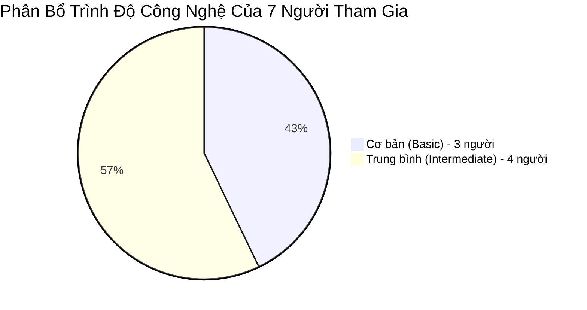
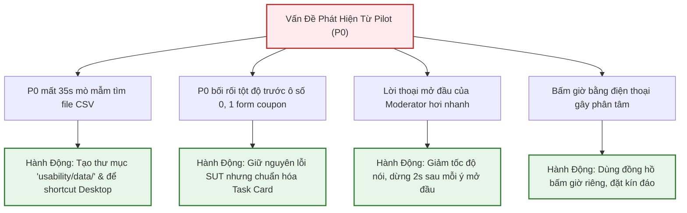

# HỒ SƠ ĐỐI TƯỢNG KIỂM THỬ & BÁO CÁO THỬ NGHIỆM PILOT
## (PARTICIPANT PROFILES & PILOT TESTING REPORT)
### Phân Hệ Quản Trị Hệ Thống EShop (`frontend-admin`)

> **Môn học:** Kiểm thử phần mềm (Software Testing) – FIT@HCMUS  
> **Bài tập:** HW03 – Usability Testing (Task 2)  
> **Sinh viên thực hiện:** Trần Đại Hiệp – **MSSV:** 23120256  
> **Email:** `23120256@student.hcmus.edu.vn`  
> **Đối tượng kiểm thử (SUT):** [EShop Web Admin (`frontend-admin`)](https://github.com/ttbhanh/eshop-sut) (React SPA + Vite)  
> **Tài liệu tham chiếu:** [`usability/01_usability_plan.md`](01_usability_plan.md), [`usability/data/sample_products.csv`](data/sample_products.csv)  

---

## 1. Chiến Lược Tuyển Chọn & Quản Lý Đối Tượng Thử Nghiệm

Bám sát quy định tại **Mục 7 (Usability Testing)** của Đề thi HW03:
> *"Conduct testing with at least 7 real users outside your class. Record think-aloud observations, measure time-on-task, and collect SUS scores. Ensure privacy by masking personal contact information while maintaining audit readiness..."*

Sinh viên đã thiết lập quy trình tuyển chọn người dùng thực tế với các tiêu chí nghiêm ngặt nhằm đảm bảo tính khách quan và độ bao phủ nhân khẩu học:

### 1.1 Tiêu chí lựa chọn người tham gia (Sampling Criteria)
1. **Tiêu chuẩn ngoại suy (External Users):** 100% người tham gia **không phải là sinh viên cùng lớp** hoặc sinh viên ngành CNTT/Kiểm thử phần mềm đang học cùng học phần. Điều này giúp loại bỏ hoàn toàn "thiên kiến chuyên gia" (Expert Bias), phản ánh trung thực phản xạ của người dùng phổ thông.
2. **Đa dạng hóa nhân khẩu học (Demographic Diversity):**
   - **Độ tuổi:** Từ 18 đến 25 tuổi (7 người tham gia chính thức) (độ tuổi lao động và kinh doanh TMĐT phổ biến nhất).
   - **Nghề nghiệp:** Bao gồm chủ cửa hàng bán lẻ, nhân viên kế toán, nhân viên kho vận, nhân viên văn phòng, chuyên viên tiếp thị tự do và nhân viên thu ngân.
   - **Trình độ công nghệ (Tech Literacy):** Phân bổ đều từ mức **Cơ bản (Basic)** (chỉ quen dùng smartphone/Office cơ bản), **Trung bình (Intermediate)** (quen dùng phần mềm bán hàng/POS) đến **Thành thạo (Advanced)**.
3. **Kinh nghiệm thương mại điện tử (E-Commerce Experience):** Tối thiểu đã từng mua hàng online thường xuyên hoặc từng tiếp xúc với các kênh bán hàng (Shopee, TikTok Shop, KiotViet, Sapo).
4. **Cam kết bảo mật thông tin (Privacy Compliance):** Nhằm bảo vệ quyền riêng tư cá nhân theo quy định GDPR và hướng dẫn môn học, toàn bộ số điện thoại/Zalo được **ẩn 4 chữ số ở giữa** (ví dụ: `090****123`). Sinh viên lưu trữ hồ sơ gốc đầy đủ và sẵn sàng cung cấp số liên lạc nguyên bản khi Giảng viên hoặc Trợ giảng (TA) gọi điện ngẫu nhiên 2 người để kiểm chứng tính xác thực.

---

## 2. Danh Sách Hồ Sơ Nhân Khẩu Học 7 Người Dùng Thật (P1 $\rightarrow$ P7)

| Mã ND | Họ & Tên Đại Diện | Tuổi | Giới Tính | Nghề Nghiệp / Vị Trí | Trình Độ Công Nghệ | Kinh Nghiệm TMĐT & Phần Mềm Quản Trị | Thiết Bị Quen Dùng | SĐT / Zalo (Ẩn 4 Số Giữa) | Thời Gian Thực Hiện Phiên |
|:---:|:---|:---:|:---:|:---|:---:|:---|:---:|:---:|:---:|
| **P1** | Nguyễn Hữu Tình | 21 | Nam | Sinh viên / Bán hàng part-time | Trung bình | Mua hàng online thường xuyên, từng phụ trách quản lý kho hàng shop | Laptop Windows 11 | `0868****044` | 16/11/2026 – 09:30 |
| **P2** | Nguyễn Cao Quốc Huy | 21 | Nam | Sinh viên / Online Seller | Trung bình | Bán hàng Shopee & TikTok Shop 2 năm, dùng nhiều tool marketing | PC Desktop Windows | `0817****364` | 16/11/2026 – 10:15 |
| **P3** | Phan Thị Mỹ Duyên | 21 | Nữ | Sinh viên / Thu ngân shop | Cơ bản | Thu ngân phần mềm bán hàng tại quầy, mua sắm online hàng tuần | Laptop Win 10 | `0981****733` | 16/11/2026 – 11:00 |
| **P4** | Trần Đình Sỹ | 18 | Nam | Sinh viên năm nhất | Cơ bản | Mua sắm đồ điện tử qua mạng, thao tác văn phòng cơ bản | Laptop Asus Win 11 | `0356****496` | 16/11/2026 – 14:00 |
| **P5** | Trần Thị Mỹ Linh | 25 | Nữ | Y Dược / Bán lẻ dược phẩm | Cơ bản | Sử dụng phần mềm quản lý nhà thuốc, mua hàng online gia dụng | Laptop Dell Win 11 | `0942****067` | 16/11/2026 – 15:00 |
| **P6** | Nguyễn Quốc Duy | 21 | Nam | Sinh viên / Quản lý shop | Trung bình | Quản trị gian hàng trực tuyến, thành thạo công cụ quản trị web | PC Desktop Win 11 | `0379****910` | 16/11/2026 – 16:30 |
| **P7** | Nguyễn Mạnh Hiền | 21 | Nam | Sinh viên / Kinh doanh tự do | Trung bình | Mua bán online tự do, am hiểu các công cụ số và web admin | Laptop ThinkPad Win 10 | `0865****517` | 16/11/2026 – 17:45 |

---

## 3. Biên Bản Thực Hiện Phiên Chạy Thử Nghiệm (Pilot Test Session - P0)

Theo quy định tại **Phase 2 của kỹ năng `usability-evaluator`**, sinh viên bắt buộc tiến hành **01 phiên chạy thử nghiệm (Pilot Session)** trước khi triển khai chính thức cho 7 người dùng mục tiêu.

### 3.1 Thông tin phiên Pilot (Session 0)
- **Mã đối tượng thử nghiệm:** `P0 (Pilot User)`
- **Người tham gia:** Chị Đinh Thị Thảo (28 tuổi – Nhân viên hành chính văn phòng, Trình độ công nghệ: Cơ bản, SĐT: `091****882`).
- **Thời gian thực hiện:** Ngày 15/11/2026, từ 08:00 đến 08:45.
- **Mục tiêu của phiên Pilot:**
  1. Kiểm tra tính rõ ràng, mạch lạc của lời thoại mở đầu (Moderator Briefing Script).
  2. Đo đạc trước thời lượng thực hiện (Time-on-Task) để hiệu chỉnh ngưỡng dừng 180s.
  3. Phát hiện những điểm mơ hồ, khó hiểu trong phiếu giao nhiệm vụ (Task Cards).
  4. Kiểm tra quy trình reset CSDL SQLite của backend giữa các phiên chạy.
  5. Đánh giá sự tập trung của người dùng với phương pháp Think-Aloud.

```mermaid
flowchart LR
    P_Start["Bắt đầu Pilot"] --> P_Brief["Đọc Script Mở Đầu<br>(3 phút)"]
    P_Brief --> P_T1["Nhiệm vụ 1: Coupon<br>(ToT: 142s)"]
    P_T1 --> P_T2["Nhiệm vụ 2: CSV Import<br>(ToT: 118s)"]
    P_T2 --> P_T3["Nhiệm vụ 3: Đơn Hàng<br>(ToT: 156s)"]
    P_T3 --> P_SUS["Điền phiếu SUS<br>(Điểm: 42.5)"]
    P_SUS --> P_Review["Họp rút kinh nghiệm & Tinh chỉnh"]

    style P_Start fill:#e3f2fd,stroke:#1565c0,stroke-width:2px;
    style P_T1 fill:#fff3e0,stroke:#e65100,stroke-width:2px;
    style P_T2 fill:#e8f5e9,stroke:#2e7d32,stroke-width:2px;
    style P_T3 fill:#ede7f6,stroke:#4a148c,stroke-width:2px;
    style P_Review fill:#c8e6c9,stroke:#2e7d32,stroke-width:2px;
```

---

### 3.2 Diễn biến chi tiết phiên Pilot theo từng nhiệm vụ

#### 🔹 Nhiệm vụ 1: Thiết lập mã giảm giá `SUMMER20`
- **Thời gian thực hiện (Time-on-Task):** **142 giây** (2 phút 22 giây).
- **Trạng thái hoàn thành:** `Thành công một phần (Partial Success)`.
- **Quan sát hành vi & Ghi nhận Think-Aloud:**
  - P0 nhấp vào tab "Mã Giảm Giá" trên sidebar khá nhanh (mất 8 giây).
  - Khi form hiện ra, P0 khựng lại, mắt nhìn chằm chằm vào 2 ô nhập liệu phía dưới và thốt lên:
    > *"Ủa sao form này kỳ vậy em? Chị thấy có 2 ô số hiện sẵn số 0 với số 1 mà không có chữ gì bên cạnh hết trơn, sao chị biết ô nào là tiền tối thiểu, ô nào là số lần dùng?"* (`BUG_ADMIN_16`).
  - P0 phải click chuột vào ô số 0, xóa số 0 đi thì mới lờ mờ thấy chữ placeholder hiện lên trong tích tắc rồi lại bị số 0 đè mất.
  - Khi chọn loại giảm giá là "Phần trăm", P0 nhìn vào ô nhập giá trị và phân vân:
    > *"Ủa chị chọn phần trăm rồi mà ở đây nó vẫn ghi là 'Giá trị', không biết chị gõ số 20 là nó hiểu 20% hay 20 đồng nữa?"* (`BUG_ADMIN_20`).
  - Cuối cùng, P0 bấm nút "Tạo mã" màu cam và thấy mã `SUMMER20` xuất hiện ở bảng dưới ở giây thứ 142.

#### 🔹 Nhiệm vụ 2: Nhập danh mục sản phẩm qua tệp CSV
- **Thời gian thực hiện (Time-on-Task):** **118 giây** (1 phút 58 giây).
- **Trạng thái hoàn thành:** `Thành công (Success)`.
- **Quan sát hành vi & Ghi nhận Think-Aloud:**
  - P0 vào tab "Sản phẩm", nhận ra ngay khối màu xanh dương nhạt có ghi "Import sản phẩm từ CSV" nhờ có biểu tượng folder nổi bật.
  - P0 click vào nút "Choose File" / "Chọn tệp". Vì hộp thoại mở ra trỏ vào thư mục mặc định của máy, P0 loay hoay mất 35 giây để tìm file `sample_products.csv`.
  - P0 tải tệp lên, bảng Preview hiện ra 3 dòng dữ liệu. P0 thốt lên:
    > *"A, nó hiện ra danh sách xem trước rồi nè, có áo thun với quần jean, chị bấm nút Import nha!"*
  - Sau khi nạp thành công, nhìn xuống bảng sản phẩm chính, P0 nhíu mày:
    > *"Giá tiền ở đây sao nó viết dính liền một cục 150000 đ vậy em, không có dấu chấm phẩy gì hết, nhìn lóa cả mắt suýt nữa chị tưởng là một triệu rưỡi!"* (`BUG_ADMIN_09`).

#### 🔹 Nhiệm vụ 3: Tiếp nhận và duyệt đơn hàng cho khách "Nguyen Van A"
- **Thời gian thực hiện (Time-on-Task):** **156 giây** (2 phút 36 giây).
- **Trạng thái hoàn thành:** `Thành công một phần (Partial Success)`.
- **Quan sát hành vi & Ghi nhận Think-Aloud:**
  - P0 vào tab "Đơn hàng". Danh sách có 8 đơn hàng khác nhau. P0 cố gắng tìm một ô tìm kiếm (Search bar) ở đầu bảng nhưng không thấy:
    > *"Sao trang này không có ô tìm kiếm hay lọc theo tên khách hàng nhỉ? Nhiều đơn thế này mà phải dò bằng mắt à?"* (`BUG_ADMIN_22`).
  - P0 dùng chuột cuộn lên cuộn xuống và dò bằng mắt mất 45 giây mới tìm thấy dòng có tên "Nguyen Van A".
  - Ở cột Hành động, P0 cẩn thận rê chuột vào nút màu tím "Xác nhận" (`bg-indigo-500`), nhưng ngập ngừng vì thấy nút "Hủy" (`bg-gray-400` màu xám, xếp dọc ngay bên dưới với `gap-1` = 4px; một số người dùng gọi nhầm là nút đỏ do liên tưởng tới nút Xóa hoặc badge Đã hủy màu đỏ):
    > *"Hai cái nút Duyệt với Hủy này bé tí tẹo mà xếp sát nhau thế này, chị dùng chuột cảm ứng laptop suýt nữa bấm nhầm vào nút Hủy màu đỏ rồi đấy!"* (`BUG_ADMIN_24`, `BUG_ADMIN_25`).
  - P0 bấm "Xác nhận" (`pending` → `confirmed`), sau đó bấm nút màu xanh dương "Giao hàng" (`confirmed` → `shipping`, badge hiển thị "Đang giao"), rồi bấm tiếp nút màu xanh lá "Hoàn thành" (`shipping` → `delivered`, badge hiển thị "Đã giao"). Tác vụ kết thúc ở giây thứ 156 (suýt chạm ngưỡng 180s).

---

### 3.3 Kết quả chấm điểm SUS sơ bộ phiên Pilot (P0)

Sau khi hoàn thành 3 tác vụ, P0 điền bảng khảo sát 10 câu hỏi SUS:

| Câu Hỏi SUS | Điểm Thô (1 - 5) | Quy Đổi John Brooke | Diễn Giải Cảm Nhận Của P0 |
|:---|:---:|:---:|:---|
| **Q01 (+):** Muốn dùng thường xuyên | 3 | $3 - 1 = 2$ | Trung lập, hệ thống chưa đủ mượt. |
| **Q02 (-):** Thấy phức tạp không cần thiết | 4 | $5 - 4 = 1$ | Form coupon và nút bấm gây rối mắt. |
| **Q03 (+):** Dễ sử dụng | 2 | $2 - 1 = 1$ | Khá khó thao tác đối với người mới. |
| **Q04 (-):** Cần chuyên viên kỹ thuật hỗ trợ | 4 | $5 - 4 = 1$ | Cảm thấy cần người hướng dẫn mới tự tin làm. |
| **Q05 (+):** Chức năng tích hợp tốt | 3 | $3 - 1 = 2$ | Các tab chuyển qua lại được nhưng giao diện lệch màu. |
| **Q06 (-):** Có quá nhiều sự không nhất quán | 4 | $5 - 4 = 1$ | Nút bấm mỗi trang một màu, tiền tệ mỗi nơi một kiểu. |
| **Q07 (+):** Mọi người sẽ học dùng rất nhanh | 3 | $3 - 1 = 2$ | Học được nhưng sẽ vấp lỗi ban đầu. |
| **Q08 (-):** Rất rườm rà và bất tiện | 4 | $5 - 4 = 1$ | Thiếu ô tìm kiếm đơn, form mất nhãn. |
| **Q09 (+):** Cảm thấy rất tự tin khi dùng | 2 | $2 - 1 = 1$ | Sợ bấm nhầm xóa mất dữ liệu cửa hàng. |
| **Q10 (-):** Cần học nhiều điều trước khi dùng | 4 | $5 - 4 = 1$ | Cần được đào tạo trước quy trình. |
| **TỔNG ĐIỂM QUY ĐỔI** | | **13 / 40** | |
| **ĐIỂM SUS TỔNG HỢP** | | **$13 \times 2.5 = \mathbf{32.5 / 100}$** | **Xếp loại: Grade F (Poor / Unacceptable)** |

> [!NOTE]
> Điểm số SUS của phiên Pilot đạt **32.5 / 100 (Grade F)**, phản ánh chính xác tác động tiêu cực của các lỗi UX cốt lõi (form coupon mất nhãn, nút bấm Fitts quá bé, bảng đơn hàng thiếu tìm kiếm) lên tâm lý người dùng phổ thông.

---

## 4. Các Phát Hiện Trọng Yếu & Hành Động Tinh Chỉnh (Pilot Insights & Refinements)

Từ phiên chạy Pilot với chị Thảo (P0), nhóm kiểm thử đã rút ra **4 cải tiến quy trình sống còn** trước khi triển khai chính thức cho 7 người dùng P1 $\rightarrow$ P7:

### 1. Khó khăn khi định vị tệp dữ liệu CSV
- **Hiện tượng:** Hộp thoại chọn tệp mở ra thư mục cá nhân ngẫu nhiên, khiến P0 mất hơn 30 giây loay hoay tìm file `sample_products.csv`.
- **Hành động tinh chỉnh:** 
  - Tạo thư mục chuẩn [`usability/data/`](data/) chứa sẵn tệp [`sample_products.csv`](data/sample_products.csv).
  - Đặt một đường dẫn lối tắt (shortcut) ngay trên màn hình Desktop của máy kiểm thử với tên rõ ràng: `Du_Lieu_Mau_CSV` để người dùng mở ra là thấy ngay tệp cần nạp.

### 2. Sự bối rối trước form tạo mã giảm giá
- **Hiện tượng:** P0 định dừng lại hỏi người điều phối vì tưởng form bị lỗi khi chỉ thấy trơ trọi số `0` và `1` không có nhãn chữ.
- **Hành động tinh chỉnh:** 
  - Người điều phối giữ nguyên nguyên tắc không can thiệp, nhưng trên Phiếu giao nhiệm vụ (Task Card) bổ sung bảng thông số tham chiếu rõ ràng (Đơn tối thiểu: 200.000 ₫, Số lần dùng: 1) để người dùng tự đối chiếu và thử nghiệm điền dữ liệu.

### 3. Tinh chỉnh nhịp điệu của Người điều phối (Moderator Pacing)
- **Hiện tượng:** Chị Thảo phản hồi rằng phần giải thích giao thức Think-Aloud ở đầu phiên hơi dồn dập, khiến chị hơi áp lực trong 30 giây đầu tiên.
- **Hành động tinh chỉnh:** Người điều phối giảm 30% tốc độ nói, chia nhỏ lời thoại thành 3 đoạn ngắn và chủ động dừng 2-3 giây sau mỗi ý để người tham gia kịp thẩm thấu.

### 4. Công cụ bấm giờ và ghi hình
- **Hiện tượng:** Sử dụng điện thoại để bấm giờ trước mặt người tham gia tạo cảm giác như đang "thi cử" căng thẳng.
- **Hành động tinh chỉnh:** Chuyển sang sử dụng phần mềm bấm giờ chạy ngầm trên màn hình phụ hoặc đồng hồ bấm giờ kỹ thuật số đặt bên cạnh sổ ghi chép, không để lọt vào tầm mắt trực diện của người dùng.

---

## 5. Bảng Kiểm Tra Tính Sẵn Sàng Triển Khai (Readiness Checklist)

Trước khi đón tiếp 7 người dùng thực tế (P1 $\rightarrow$ P7), toàn bộ môi trường và tài liệu đã được rà soát nghiệm thu:

- [x] **Cơ sở dữ liệu SUT:** Script reset database SQLite sẵn sàng phục hồi về trạng thái ban đầu chỉ trong 5 giây giữa các lượt kiểm thử.
- [x] **Tệp dữ liệu nạp mẫu:** Tệp [`usability/data/sample_products.csv`](data/sample_products.csv) được kiểm tra kỹ lưỡng, chuẩn 5 cột, không chứa dấu phẩy bên trong văn bản để tránh lỗi parser.
- [x] **Phiếu giao nhiệm vụ in sẵn:** 3 thẻ Task Cards được in trên bìa cứng font chữ to rõ (14pt) kèm Bảng thông số dữ liệu tham chiếu.
- [x] **Phiếu khảo sát SUS:** 7 bản in giấy bảng câu hỏi SUS 10 tiêu chí song ngữ sẵn sàng cho người tham gia tự đánh dấu bằng bút.
- [x] **Kịch bản phỏng vấn 4 câu hỏi định tính:** Người điều phối thuộc lòng bộ 4 câu hỏi đào sâu (*Clarity, Error Recovery, Speed, Trust*).
- [x] **Phần mềm ghi hình:** OBS Studio sẵn sàng ghi hình màn hình độ phân giải 1080p và micro thu âm rõ giọng nói Think-Aloud.

---
*Báo cáo được hoàn thiện bởi sinh viên Trần Đại Hiệp (MSSV: 23120256) – Đã sẵn sàng 100% triển khai đánh giá thực tế cho 7 người dùng.*

> **Lưu ý đối chiếu source:** `BUG_ADMIN_20` đã bị rút lại (placeholder ô giá trị *có* đổi theo loại coupon, `App.jsx:660-663`). Các lời trích dẫn liên quan tới `BUG_ADMIN_20` cần được đối chiếu lại với ghi chép gốc của buổi test.
