# NHẬT KÝ QUAN SÁT THỰC NGHIỆM KIỂM THỬ KHẢ DỤNG (USABILITY OBSERVATION NOTES)
## Phân Hệ Quản Trị Hệ Thống EShop (`frontend-admin`)

> **Môn học:** Kiểm thử phần mềm (Software Testing) – FIT@HCMUS  
> **Bài tập:** HW03 – Usability Testing (Task 2)  
> **Sinh viên thực hiện:** Trần Đại Hiệp – **MSSV:** 23120256  
> **Email:** `23120256@student.hcmus.edu.vn`  
> **Đối tượng kiểm thử (SUT):** [EShop Web Admin (`frontend-admin`)](https://github.com/ttbhanh/eshop-sut) (React SPA + Vite)  
> **Nguồn dữ liệu khảo sát:** Tally Submissions (`Khảo Sát Khả Dụng EShop Admin (HW03 - 23120256)_Submissions_2026-11-16.csv`)  
> **Quy chuẩn bảo mật PII:** 100% số điện thoại/Zalo được **ẩn 4 chữ số ở giữa** (ví dụ: `0868****044`).  

---

## 1. Bảng Tổng Hợp Thời Gian Thực Hiện (Time-on-Task) & Tỷ Lệ Hoàn Thành

Quy tắc đo lường thời gian (ToT) được bấm giờ độc lập bằng đồng hồ kỹ thuật số. Ngưỡng dừng tối đa là **180 giây (3 phút)** theo đúng Stopping Rule.

```mermaid
gantt
    title Thời Gian Thực Hiện Trung Bình Giữa 3 Nhiệm Vụ (ToT Average)
    dateFormat X
    axisFormat %s s
    section Task 1: Tạo Coupon SUMMER20
    ToT Trung Bình (121.9s) : 0, 122
    section Task 2: Import CSV Sản Phẩm
    ToT Trung Bình (95.4s)  : 0, 95
    section Task 3: Duyệt Đơn Nguyen Van A
    ToT Trung Bình (133.3s) : 0, 133
```

### 1.1 Bảng ma trận kết quả 3 nhiệm vụ (P00 Pilot + P01 $\rightarrow$ P07)

| Mã ND | Họ và Tên | Nghề Nghiệp | SĐT / Zalo (Masked) | Task 1: Tạo Coupon `SUMMER20` | Task 2: Import `sample_products.csv` | Task 3: Duyệt Đơn "Nguyen Van A" | Tổng ToT (s) | Điểm SUS | Xếp Loại Sauro-Lewis |
|:---:|:---|:---|:---:|:---:|:---:|:---:|:---:|:---:|:---:|
| **P00** | Đinh Thị Thảo *(Pilot)* | Nhân viên hành chính | `091****882` | 142s *(Partial)* | 118s *(Success)* | 156s *(Partial)* | 416s | **32.5** | Grade F *(Unacceptable)* |
| **P01** | Nguyễn Hữu Tình | Sinh viên / Bán hàng | `0868****044` | 115s *(Success)* | 85s *(Success)* | 132s *(Partial)* | 332s | **52.5** | Grade D / C- *(Marginal)* |
| **P02** | Nguyễn Cao Quốc Huy | Sinh viên / Online Seller | `0817****364` | 98s *(Success)* | 72s *(Success)* | 110s *(Success)* | 280s | **65.0** | Grade D / C- *(Marginal)* |
| **P03** | Phan Thị Mỹ Duyên | Sinh viên / Thu ngân shop | `0981****733` | 165s *(Partial)* | 130s *(Partial)* | 172s *(Partial)* | 467s | **50.0** | Grade F *(Unacceptable)* |
| **P04** | Trần Đình Sỹ | Sinh viên năm nhất | `0356****496` | 125s *(Success)* | 95s *(Success)* | 140s *(Partial)* | 360s | **60.0** | Grade D / C- *(Marginal)* |
| **P05** | Trần Thị Mỹ Linh | Y Dược / Bán lẻ dược | `0942****067` | 178s *(Partial)* | 145s *(Partial)* | 168s *(Partial)* | 491s | **45.0** | Grade F *(Unacceptable)* |
| **P06** | Nguyễn Quốc Duy | Sinh viên / Quản lý shop | `0379****910` | 82s *(Success)* | 64s *(Success)* | 92s *(Success)* | 238s | **70.0** | Grade B *(Good)* |
| **P07** | Nguyễn Mạnh Hiền | Sinh viên / Tự do | `0865****517` | 110s *(Success)* | 88s *(Success)* | 124s *(Success)* | 322s | **60.0** | Grade D / C- *(Marginal)* |

### 1.2 Thống kê hiệu suất hoàn thành (Cohort Metrics N=7, trừ Pilot)

| Chỉ Số Định Lượng | Task 1: Tạo Coupon `SUMMER20` | Task 2: Import `sample_products.csv` | Task 3: Duyệt Đơn "Nguyen Van A" | Toàn Bộ 3 Nhiệm Vụ |
|:---|:---:|:---:|:---:|:---:|
| **Thời gian trung bình (Mean ToT)** | **121.9 giây** ($\approx 2.0$ phút) | **97.0 giây** ($\approx 1.6$ phút) | **134.0 giây** ($\approx 2.2$ phút) | **355.7 giây** ($\approx 5.9$ phút) |
| **Thời gian nhanh nhất (Min ToT)** | 82 giây (P06) | 64 giây (P06) | 92 giây (P06) | 238 giây (P06) |
| **Thời gian chậm nhất (Max ToT)** | 178 giây (P05) | 145 giây (P05) | 172 giây (P03) | 491 giây (P05) |
| **Độ lệch chuẩn (Std Dev)** | 33.6 giây | 27.6 giây | 27.3 giây | 87.5 giây |
| **Tỷ lệ thành công hoàn toàn (Success)** | 5 / 7 (71.4%) | 5 / 7 (71.4%) | 3 / 7 (42.9%) | **61.9%** |
| **Tỷ lệ thành công một phần (Partial)** | 2 / 7 (28.6%) | 2 / 7 (28.6%) | 4 / 7 (57.1%) | **38.1%** |
| **Tỷ lệ thất bại (Failed)** | 0 / 7 (0.0%) | 0 / 7 (0.0%) | 0 / 7 (0.0%) | **0.0%** *(nhờ Stopping Rule 180s)* |

---

## 2. Nhật Ký Quan Sát Chi Tiết Từng Đối Tượng (Verbatim Think-Aloud Logs)

---

### 👤 P00: Đinh Thị Thảo (28 tuổi – Nhân viên hành chính văn phòng, SĐT: `091****882`)
- **Trình độ công nghệ:** Cơ bản | **Thiết bị:** Laptop Windows | **Phiên chạy:** Pilot Test (Session 0)
- **Điểm SUS:** **32.5 / 100 (Grade F)**

#### Ghi chép quan sát & Lời nói thành tiếng (Think-Aloud):
- **Task 1 (Coupon - 142s):** Click vào menu Mã Giảm Giá. Nhìn vào form trong 15 giây mà không gõ phím.
  > *"Ủa sao form này kỳ vậy em? Chị thấy có 2 ô số hiện sẵn số 0 với số 1 mà không có chữ gì bên cạnh hết trơn, sao chị biết ô nào là tiền tối thiểu, ô nào là số lần dùng?"* (`BUG_ADMIN_16`).
  > *"Chị chọn phần trăm rồi mà ô bên dưới vẫn ghi chữ 'Giá trị', không biết chị gõ 20 là nó hiểu 20% hay 20 đồng nữa?"* (`BUG_ADMIN_20`).
- **Task 2 (CSV Import - 118s):** Nhận diện nhanh khối màu xanh có chữ Import CSV. Mất 35 giây tìm file do hộp thoại mở ra thư mục cá nhân. Sau khi import, nhìn xuống bảng sản phẩm:
  > *"Giá tiền ở đây sao nó viết dính liền một cục 150000 đ vậy em, không có dấu chấm phẩy gì hết, nhìn lóa cả mắt suýt nữa chị tưởng là một triệu rưỡi!"* (`BUG_ADMIN_09`).
- **Task 3 (Orders - 156s):** Vào tab Đơn hàng. Danh sách dài không có ô tìm kiếm. Cuộn chuột lên xuống dò bằng mắt mất 45 giây. Rê chuột vào nút Xác nhận:
  > *"Sao trang này không có ô tìm kiếm hay lọc theo tên khách hàng nhỉ? Nhiều đơn thế này mà phải dò bằng mắt à?"* (`BUG_ADMIN_22`).
  > *"Hai cái nút Duyệt với Hủy này bé tí tẹo mà xếp sát nhau thế này, chị dùng chuột cảm ứng laptop suýt nữa bấm nhầm vào nút Hủy màu đỏ rồi đấy!"* (`BUG_ADMIN_24`, `BUG_ADMIN_25`).

---

### 👤 P01: Nguyễn Hữu Tình (21 tuổi – Sinh viên / Bán hàng part-time, SĐT: `0868****044`)
- **Trình độ công nghệ:** Trung bình | **Thiết bị:** Laptop Windows 11
- **Điểm SUS:** **52.5 / 100 (Grade D / C- - Marginal)**

#### Ghi chép quan sát & Lời nói thành tiếng (Think-Aloud):
- **Task 1 (Coupon - 115s):** Mở form coupon, khựng lại 5 giây trước 2 ô số `0` và `1`. Bấm thử backspace xóa số `0` thì thấy placeholder hiện lên.
  > *"À, xóa số 0 đi mới thấy chữ 'Đơn tối thiểu' ẩn phía sau, form này bị lỗi State mặc định đè mất nhãn rồi nè. Ai không biết chắc ngồi ngó luôn!"*
- **Task 2 (CSV Import - 85s):** Chọn đúng file `sample_products.csv` từ Desktop. Bấm nút Import. Bảng cập nhật ngay lập tức.
  > *"Import nhanh đấy, nhưng cột giá tiền hiển thị 350000 đ dính chùm nhìn hơi chán, thiếu hàm toLocaleString() à bạn?"*
- **Task 3 (Orders - 132s):** Dò tìm tên "Nguyen Van A" mất khoảng 20 giây. Khi bấm xác nhận chuyển trạng thái:
  > *"Nút Xác nhận màu tím nhìn hơi lạ, nhưng cái nút Hủy màu đỏ nằm sát rạt bên cạnh nguy hiểm quá, nhân viên vội vàng rất dễ click trượt!"*

---

### 👤 P02: Nguyễn Cao Quốc Huy (21 tuổi – Sinh viên / Online Seller, SĐT: `0817****364`)
- **Trình độ công nghệ:** Trung bình | **Thiết bị:** PC Desktop
- **Điểm SUS:** **65.0 / 100 (Grade D / C- - Marginal)**

#### Ghi chép quan sát & Lời nói thành tiếng (Think-Aloud):
- **Task 1 (Coupon - 98s):** Nhập mã `SUMMER20` rất nhanh. Khi chọn dropdown "Phần trăm":
  > *"Ủa sao mình chọn phần trăm mà ô dưới không hiện ký hiệu % nhỉ? Giao diện bên Shopee nó tự đổi icon tiền tệ linh hoạt lắm."*
- **Task 2 (CSV Import - 72s):** Thao tác trơn tru trong 72 giây.
  > *"Khung xanh import CSV nhìn tách biệt khá chuyên nghiệp, có bảng preview trước khi lưu là điểm cộng lớn."*
- **Task 3 (Orders - 110s):** Tìm thấy đơn và duyệt tuần tự từ pending $\rightarrow$ shipping $\rightarrow$ delivered.
  > *"Duyệt đơn hoạt động ổn, nhưng không có ô search đơn hàng thì sau này shop có 1,000 đơn thì lướt mòn chuột à?"*

---

### 👤 P03: Phan Thị Mỹ Duyên (21 tuổi – Sinh viên / Thu ngân shop, SĐT: `0981****733`)
- **Trình độ công nghệ:** Cơ bản | **Thiết bị:** Laptop Win 10
- **Điểm SUS:** **50.0 / 100 (Grade F - Poor / Unacceptable)**

#### Ghi chép quan sát & Lời nói thành tiếng (Think-Aloud):
- **Task 1 (Coupon - 165s):** Rất lúng túng trước 2 ô số `0` và `1`. Mất hơn 40 giây dò dẫm và đọc lại đề bài.
  > *"Em không biết nhập tiền tối thiểu vào ô nào anh ơi, trên màn hình chỉ có ô số 0 với số 1 trơ trọi không có chữ nhãn... Em thử xóa số 0 đi gõ 200000 nha?"*
- **Task 2 (CSV Import - 130s):** Bấm nhầm vào một file ảnh `.png` trước vì hộp thoại không chặn file lạ. Sau đó chọn lại file `.csv`.
  > *"Ủa sao nút chọn file nó cho chọn cả ảnh với file word luôn vậy anh? Nó không tự lọc file đuôi .csv à?"* (`BUG_ADMIN_11`).
- **Task 3 (Orders - 172s):** Mất gần 60 giây cuộn chuột tìm tên "Nguyen Van A". Bấm nút duyệt đơn bằng touchpad với sự căng thẳng lộ rõ:
  > *"Nút Duyệt với nút Hủy bé xíu nằm đè lên nhau, em sợ bấm nhầm vào nút Hủy màu đỏ làm mất đơn của khách ghê!"*

---

### 👤 P04: Trần Đình Sỹ (18 tuổi – Sinh viên năm nhất, SĐT: `0356****496`)
- **Trình độ công nghệ:** Cơ bản | **Thiết bị:** Laptop Asus
- **Điểm SUS:** **60.0 / 100 (Grade D / C- - Marginal)**

#### Ghi chép quan sát & Lời nói thành tiếng (Think-Aloud):
- **Task 1 (Coupon - 125s):** Nhập mã `SUMMER20`. Điền đầy đủ thông tin sau khi xóa số 0 mặc định.
  > *"Nút Tạo mã màu cam nổi bật đấy, nhưng mà màu nút mỗi trang một kiểu: lúc nãy bên đăng nhập màu xanh dương, giờ sang đây màu cam."* (`BUG_ADMIN_01`).
- **Task 2 (CSV Import - 95s):** Tải file template mẫu về xem trước rồi mới upload file `sample_products.csv`.
  > *"Có nút tải file mẫu một chạm rất tiện, nạp vào bảng xem trước chuẩn chỉnh."*
- **Task 3 (Orders - 140s):** Tìm thấy đơn và duyệt thành công.
  > *"Giao diện đơn hàng nhìn hơi thô sơ, mấy cái nút hành động bé tí như giao diện web từ 10 năm trước."*

---

### 👤 P05: Trần Thị Mỹ Linh (25 tuổi – Y Dược / Bán lẻ dược phẩm, SĐT: `0942****067`)
- **Trình độ công nghệ:** Cơ bản | **Thiết bị:** Laptop Dell
- **Điểm SUS:** **45.0 / 100 (Grade F - Poor / Unacceptable)**

#### Ghi chép quan sát & Lời nói thành tiếng (Think-Aloud):
- **Task 1 (Coupon - 178s - Suýt chạm ngưỡng 180s Stopping Rule):** Rất căng thẳng và hoang mang trước form tạo mã.
  > *"Chị làm bên quầy thuốc quen phần mềm có nhãn rõ ràng rồi, sang web này nhìn 2 ô số 0 với số 1 không có nhãn chị hoang mang quá, không biết gõ tiền vào đâu!"*
- **Task 2 (CSV Import - 145s):** Import xong, nhìn vào cột giá tiền:
  > *"Số 150000 đ viết dính chùm thế này chị nhìn tưởng mười lăm triệu, phải căng mắt đếm từng số 0. Bán hàng thế này dễ tính nhầm tiền cho khách lắm!"*
- **Task 3 (Orders - 168s):** Dò tìm tên "Nguyen Van A" mất 50 giây. Ngập ngừng trước nút Hủy:
  > *"Sao không có ô tìm kiếm tên khách? Rồi nút Xác nhận với Hủy đặt sát nhau thế này chị run tay không dám bấm chuột luôn!"*

---

### 👤 P06: Nguyễn Quốc Duy (21 tuổi – Sinh viên / Quản lý shop, SĐT: `0379****910`)
- **Trình độ công nghệ:** Trung bình (Thành thạo công nghệ nhất nhóm) | **Thiết bị:** PC Desktop
- **Điểm SUS:** **70.0 / 100 (Grade B - Good / Above Average)**

#### Ghi chép quan sát & Lời nói thành tiếng (Think-Aloud):
- **Task 1 (Coupon - 82s):** Thao tác rất thuần thục trong 82 giây.
  > *"Lỗi state đè placeholder kinh điển của React nè, form này quên bọc thẻ <label> rồi. Nhưng mình nhìn quen nên vẫn mò ra được."*
- **Task 2 (CSV Import - 64s):** Hoàn thành trong 64 giây, nhanh nhất nhóm.
  > *"Tính năng Import CSV viết gọn gàng, preview trực quan. Tuy nhiên cột giá sản phẩm nên thêm toLocaleString('vi-VN')."*
- **Task 3 (Orders - 92s):** Tìm thấy đơn "Nguyen Van A" sau 10 giây và chuyển đổi trạng thái dứt khoát.
  > *"Luồng duyệt đơn mượt, chuyển sang shipping rồi delivered chuẩn. Nhưng thiếu phân trang và search bar sẽ là ác mộng khi scale dữ liệu."*

---

### 👤 P07: Nguyễn Mạnh Hiền (21 tuổi – Sinh viên / Kinh doanh tự do, SĐT: `0865****517`)
- **Trình độ công nghệ:** Trung bình | **Thiết bị:** Laptop ThinkPad
- **Điểm SUS:** **60.0 / 100 (Grade D / C- - Marginal)**

#### Ghi chép quan sát & Lời nói thành tiếng (Think-Aloud):
- **Task 1 (Coupon - 110s):** Nhập đúng mã `SUMMER20`.
  > *"Tạo mã giảm giá xong nó tự xóa trắng form là tốt, nhưng nhãn giá trị cần đổi sang % khi chọn loại phần trăm cho đỡ nhầm."*
- **Task 2 (CSV Import - 88s):** Import thành công, nhìn sang cột Hành động của bảng sản phẩm:
  > *"Này bạn, nút Sửa với Xóa sản phẩm nằm sát nhau thế kia kìa, bấm nhầm nút Xóa màu đỏ là bay luôn sản phẩm không hỏi han gì đâu đấy nhé!"* (`BUG_ADMIN_13`, `BUG_ADMIN_14`).
- **Task 3 (Orders - 124s):** Duyệt đơn thành công nhưng góp ý mạnh về khả năng lọc đơn.
  > *"Bảng đơn hàng cần có bộ lọc theo trạng thái: Lọc ra danh sách pending để duyệt cho nhanh chứ ai lại để lẫn lộn hết vào một bảng thế này."*

---

## 3. Tổng Hợp Phỏng Vấn Sâu Định Tính (The 4 Qualitative Probes Synthesis)

Sau khi hoàn thành bảng câu hỏi trắc nghiệm SUS, người điều phối đã phỏng vấn trực tiếp toàn bộ 7 người tham gia theo 4 câu hỏi đào sâu:

```mermaid
graph TD
    P_Clarity["Probe 1: Tính Rõ Ràng (Clarity)"] --> C1["7/7 người phản ánh: Form Coupon mất nhãn vì số 0, 1"]
    P_Clarity --> C2["6/7 người phản ánh: Giá tiền dính chùm 350000 đ"]
    
    P_Recovery["Probe 2: Phục Hồi Lỗi (Error Recovery)"] --> R1["5/7 người lo ngại: Xóa SP không có Confirm Dialog"]
    P_Recovery --> R2["7/7 người nhận xét: Bấm nhầm Hủy đơn là không cứu lại được"]
    
    P_Speed["Probe 3: Tốc Độ Thao Tác (Speed)"] --> S1["7/7 người than phiền: Thiếu Search & Filter đơn hàng"]
    P_Speed --> S2["6/7 người phản ánh: Nút bấm action quá bé (text-xs)"]
    
    P_Trust["Probe 4: Mức Độ Tin Cậy (Trust)"] --> T1["6/7 người trả lời KHÔNG DÁM TIN TƯỞNG nếu chạy shop thật"]
    P_Trust --> T2["Lý do: Nguy cơ xóa nhầm dữ liệu & lệch số liệu tài chính"]

    style P_Clarity fill:#e1f5fe,stroke:#0288d1,stroke-width:2px;
    style P_Recovery fill:#ffebee,stroke:#c62828,stroke-width:2px;
    style P_Speed fill:#fff3e0,stroke:#e65100,stroke-width:2px;
    style P_Trust fill:#ede7f6,stroke:#4a148c,stroke-width:2px;
```

### 🗣️ Probe 1: Tính Rõ Ràng & Tải Nhận Thức (Clarity & Cognitive Load)
- **Câu hỏi:** *"Trong 3 tác vụ vừa làm, màn hình hoặc chi tiết nào khiến bạn cảm thấy bối rối hoặc mất nhiều thời gian để hiểu thông tin nhất?"*
- **Ý kiến đồng thuận tuyệt đối (7/7 người - 100%):** Form tạo Mã Giảm Giá là điểm gây bối rối nhất. Việc State khởi tạo giá trị số `{ min: 0, max: 1 }` đè mất hoàn toàn placeholder trong khi form không có thẻ `<label>` khiến người dùng hoàn toàn mất phương hướng nếu không click vào xóa số đi.
- **Ý kiến phổ biến (6/7 người - 85.7%):** Cột Giá sản phẩm hiển thị chuỗi số nguyên dính chùm `150000 ₫`, `350000 ₫` không có dấu chấm/phẩy phân cách hàng ngàn, gây mỏi mắt và dễ nhầm lẫn mệnh giá tiền tệ.

### 🗣️ Probe 2: Khả Năng Phục Hồi Lỗi & Phản Hồi (Error Recovery & Feedback)
- **Câu hỏi:** *"Khi bạn thao tác nhầm hoặc gặp sự cố, hệ thống có cung cấp hướng dẫn rõ ràng để bạn khắc phục không?"*
- **Ý kiến phản hồi:** Hệ thống hoàn toàn thiếu cơ chế an toàn cho các thao tác mang tính hủy hoại dữ liệu:
  - Nút Xóa sản phẩm và Xóa coupon gọi API xóa vĩnh viễn tức thì mà không hề bật Modal xác nhận *"Bạn có chắc chắn muốn xóa không?"*.
  - Tại bảng Đơn hàng, nếu người dùng bấm trượt vào nút "Hủy" màu đỏ, đơn hàng lập tức bị hủy vĩnh viễn mà không có bước xác nhận bảo vệ.

### 🗣️ Probe 3: Tốc Độ Thao Tác & Công Thái Học (Speed & Ergonomics)
- **Câu hỏi:** *"Bạn thấy tốc độ làm việc trên hệ thống có nhanh và mượt mà không? Kích thước nút bấm có thoải mái để thao tác không?"*
- **Ý kiến phản hồi:** 
  - **7/7 người (100%)** khẳng định việc thiếu thanh tìm kiếm (Search bar) và bộ lọc trạng thái (Status Filter) ở tab Đơn hàng làm chậm tiến độ xử lý đơn nghiêm trọng khi dữ liệu tăng dần.
  - **6/7 người (85.7%)** phản ánh các nút chuyển trạng thái đơn hàng (`Xác nhận`, `Giao hàng`, `Hoàn thành`, `Hủy`) có kích thước quá bé (`text-xs px-2 py-1`), xếp san sát nhau vi phạm định luật Fitts, khiến người dùng luôn phải rê chuột nắn nót vì sợ bấm nhầm.

### 🗣️ Probe 4: Mức Độ Tin Cậy Nghiệp Vụ (Commercial Trust & System Reliability)
- **Câu hỏi:** *"Nếu bạn là chủ một cửa hàng thật có hàng trăm đơn mỗi ngày, bạn có dám tin tưởng giao hệ thống này cho nhân viên vận hành không?"*
- **Kết quả khảo sát:** **6 / 7 người (85.7%) trả lời dứt khoát là KHÔNG DÁM TIN TƯỞNG.**
- **Lý do cốt lõi:**
  > *"Giao diện thiếu an toàn quá, nút Xóa với nút Hủy bấm một cái là bay màu dữ liệu luôn không hỏi lại. Nhân viên mới vào làm bấm trượt chuột một phát là mất trắng đơn của khách hoặc xóa nhầm sản phẩm thì đền ốm đòn!"* (P01, P05, P07).

---

## 4. Kết Quả Đo Lường SUS Chi Tiết Từng Người Tham Gia

Dữ liệu được trích xuất trực tiếp từ tệp khảo sát Tally và đã xuất bản tại [`usability/04_sus_scoring_matrix.xlsx`](04_sus_scoring_matrix.xlsx):

| Người Dùng | Q01 (+) | Q02 (-) | Q03 (+) | Q04 (-) | Q05 (+) | Q06 (-) | Q07 (+) | Q08 (-) | Q09 (+) | Q10 (-) | Tổng Đóng Góp (0 - 40) | Điểm SUS (0 - 100) | Xếp Hạng Sauro-Lewis | Mức Độ Chấp Nhận |
|:---:|:---:|:---:|:---:|:---:|:---:|:---:|:---:|:---:|:---:|:---:|:---:|:---:|:---:|:---:|
| **P00 (Pilot)** | 3 | 4 | 2 | 4 | 3 | 4 | 3 | 4 | 2 | 4 | **13** | **32.5** | **Grade F** | Không chấp nhận |
| **P01** | 3 | 2 | 4 | 4 | 3 | 4 | 3 | 2 | 3 | 3 | **21** | **52.5** | **Grade D / C-** | Cận biên (Marginal) |
| **P02** | 4 | 2 | 2 | 2 | 3 | 2 | 5 | 3 | 4 | 3 | **26** | **65.0** | **Grade D / C-** | Cận biên (Marginal) |
| **P03** | 2 | 2 | 3 | 4 | 3 | 3 | 4 | 2 | 3 | 4 | **20** | **50.0** | **Grade F** | Không chấp nhận |
| **P04** | 2 | 3 | 3 | 2 | 3 | 2 | 4 | 3 | 4 | 2 | **24** | **60.0** | **Grade D / C-** | Cận biên (Marginal) |
| **P05** | 2 | 3 | 2 | 3 | 2 | 3 | 4 | 3 | 3 | 3 | **18** | **45.0** | **Grade F** | Không chấp nhận |
| **P06** | 3 | 2 | 4 | 2 | 4 | 3 | 4 | 2 | 4 | 2 | **28** | **70.0** | **Grade B** | Chấp nhận được |
| **P07** | 2 | 3 | 4 | 2 | 2 | 3 | 4 | 2 | 4 | 2 | **24** | **60.0** | **Grade D / C-** | Cận biên (Marginal) |
| **TRUNG BÌNH (N=7)** | **2.6** | **2.4** | **3.1** | **2.7** | **2.9** | **2.9** | **4.0** | **2.4** | **3.6** | **2.7** | **23.0** | **57.5** | **Grade D / C-** | **Dưới Chuẩn Ngành (-10.5đ)** |

---
*Biên bản quan sát được ghi nhận trung thực và bảo chứng bởi sinh viên Trần Đại Hiệp (MSSV: 23120256).*
